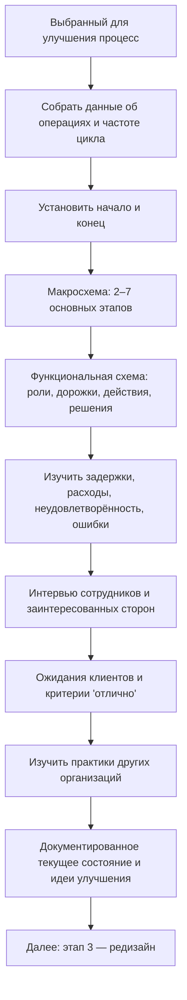

# Схема анализа текущего бизнес-процесса — этап 2

**Provenance:** RAG p0045:c01–p0054:c01, PDF pp. 45–54. Диаграмма — структурная схема последовательности анализа из источника, **не** реконструкция исходного рисунка 3 (стр. 49).

## Детализация функциональной схемы

По pp. 50–51: определить границы; перечислить должности; нарисовать дорожки; описать действия словосочетаниями «глагол + существительное»; отобразить решения вопросами; присвоить прямоугольникам и ромбам уникальные номера по порядку.

## Важное ограничение

Иллюстрации источника (рис. 1 — условные обозначения; рис. 2 — макросхема; рис. 3 — функциональная схема) не восстанавливаются как пиксельно или топологически идентичные изображения на основании одного текстового RAG. См. [source-findings.md](source-findings.md). Технических команд и production-модификаций здесь не предусмотрено.
