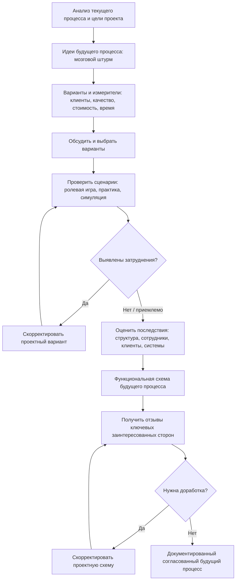

# Логика редизайна — этап 3

**Provenance:** PDF pp. 55–68; `business-process-improvement-hbsp-ru:p0057:c01`–`p0068:c01`. Mermaid — схема шагов главы, **не** графическое воспроизведение PDF.

## Где в источнике

- Генерация и обсуждение идей: pp. 57–61.
- Проверка реалистичных сценариев и устранение найденных проблем: pp. 61–63.
- Анализ организационных последствий: pp. 63–64.
- Простая функциональная схема для заинтересованных лиц: p. 65.
- Вопросы и корректировки по откликам: pp. 65–66.

**Безопасность:** эксперимент по выявлению узких мест увеличением потока и скорости на p. 68 — потенциально нагрузочное действие. В Mermaid он намеренно не представлен как автоматический production-переход: конкретная безопасная процедура отсутствует в источнике (**[Needs confirmation]**). Работа с проектом не приравнивается к внедрению.
