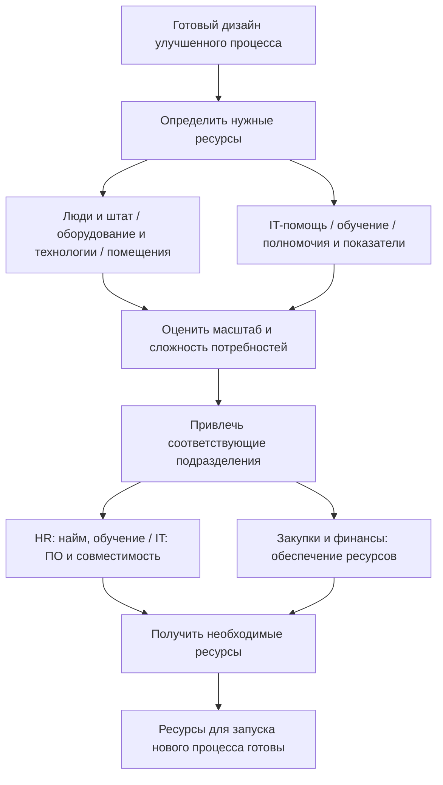

# Этап 4 — логика привлечения ресурсов

**Источник:** RAG `business-process-improvement-hbsp-ru:p0071:c01`–`p0076:c01`, PDF pp. 71–76. Диаграмма — структурирование по тексту, не оригинальный рисунок книги.

**Сопоставление с RAG:** назначение этапа и подразделения — p. 71; виды потребностей — pp. 71–73; каналы закупок и кадровой подготовки — pp. 75–76. Перечни типов ресурсов исчерпывают только **перечисленные в данной главе категории**, а не любые возможные организационные нужды.

**Примечание по кейсу:** упражнение Линн (pp. 74–77) посвящено выбору способа редизайна, а не подтверждению выделенных средств; см. `review-questions.md` и `review-answers.md`.

**Граница изменения:** выделение бюджета, закупки, кадровые назначения и IT-интеграции меняют организационное состояние. Авторизация, технические тесты и rollback — **[Needs confirmation]**.
