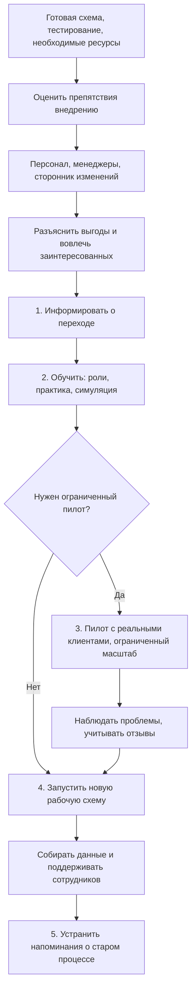

# Mermaid — этап 5. Внедрение усовершенствованных бизнес-процессов

Источник: PDF pp. 81–88; RAG `business-process-improvement-hbsp-ru:p0081:c01`–`p0088:c01`; source SHA-256 `4c75aaaa000434b6fd7aeac337e163327060dcbe084e30a1c9793b923b855172`.

Этапы по главе: препятствия и спонсор — pp. 81–83; участие людей — pp. 84–86; действия 1–2 — pp. 86–87; ограниченный пилот — p. 87; запуск и старые материалы — pp. 87–88.

**Граница безопасности:** пилот касается реальных участников и более рискован, чем симуляция (p. 87). Последнее действие не задаёт архивной политики или механизмов отката (p. 88): **[Needs confirmation]**. Диаграмма передаёт описанную последовательность, не авторизует изменения в production.
