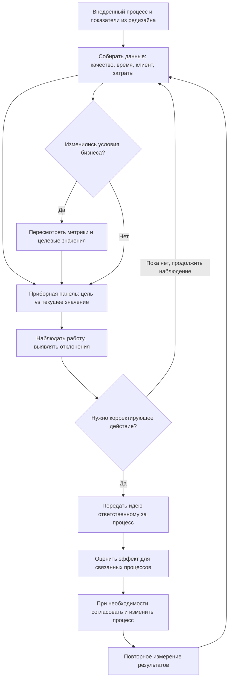

# Диаграмма непрерывного улучшения — этап 6

**Provenance:** `business-process-improvement-hbsp-ru:p0091:c01`–`p0097:c01`, PDF pp. 91–97. Mermaid — концептуальная схема по тексту главы, не реконструкция оригинальной графики.

**Факты источника:** p. 91 — мониторинг и своевременное устранение проблем; pp. 92–95 — данные, dashboard и цели; pp. 95–96 — возможность наблюдать вместо немедленного изменения, согласование улучшений с ответственным за процесс; p. 96 — повышение цели в примере Джо.

**Граница:** схема не выдаёт разрешение на rollout без согласования. Численные критерии вмешательства, процедура восстановления и rollback отсутствуют: **[Needs confirmation]**.
