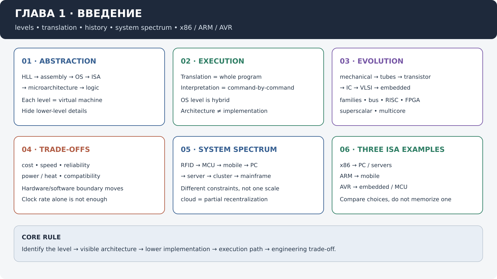
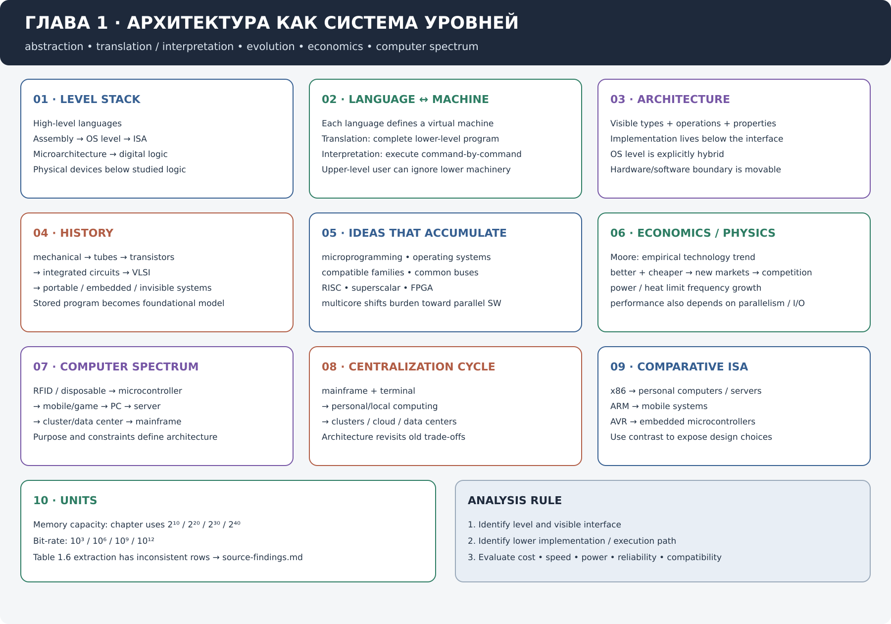

# Глава 1 — Введение

Эндрю С. Таненбаум, Тодд Остин — «Архитектура компьютера», 6-е издание.





## Идентификация и readiness

- Book ID: `computer-architecture-tanenbaum-austin-6e-ru`; inventory: `0006`.
- Chapter: **1. Введение**; slug: `introduction`.
- Canonical source: `source/book.pdf`.
- Source SHA-256: `11c1875711e29244f56f925c17cbe53cb625cf3dbd95a8a03d90c764aa453e75`.
- Book readiness for chapter analysis: **READY**.
- RAG generation: **legacy-compatible**; strict `rag/acceptance.yaml` becomes mandatory only on controlled rebuild.
- RAG validation: `READY_WITH_KNOWN_LIMITATIONS`.
- Source policy: **rag_only**; external web, model-memory completion and direct canonical-PDF reading are not used.

## Chapter boundary

- PDF pages: **20–75** inclusive.
- RAG chunk range: **`p0020:c01`–`p0075:c01`**.
- Chunk path: `rag/chunks/p0001-p0100/p####-c01.md`.
- TOC evidence: `p0006:c01`.
- `p0020:c01` begins «Глава 1. Введение».
- `p0073:c01`–`p0075:c01` contain «Вопросы и задания».
- `p0076:c01` begins «Глава 2. Организация компьютерных систем».
- **Chapter boundary verified: YES.**

Printed-page numbering appears aligned with PDF numbering for this chapter in extracted text; this artifact uses PDF provenance as canonical.

## Карта главы

| Раздел | PDF pages | Содержание |
|---|---:|---|
| Введение / многоуровневая организация | 20–26 | Машинный язык, трансляция, интерпретация, виртуальные машины, уровни современной машины |
| Развитие многоуровневых машин | 26–31 | Hardware/software boundary, микропрограммирование, ОС, системные вызовы |
| Развитие компьютерной архитектуры | 31–47 | Механические машины; поколения ламп, транзисторов, ИС, СБИС; stored program; семейства; шины; параллелизм; FPGA; multicore |
| Типы компьютеров | 47–60 | Технологические/экономические факторы; RFID; микроконтроллеры; mobile/gaming; PC; servers; clusters/cloud; mainframes |
| Семейства компьютеров | 60–70 | x86, ARM, AVR как контрастные ISA-примеры |
| Единицы измерения | 70–72 | Метрические приставки; двоичная емкость памяти против десятичной скорости передачи |
| Краткое содержание книги | 72–73 | Карта последующих глав и роль x86/ARM/AVR как сравнительных примеров |
| Вопросы и задания | 73–75 | 21 вопрос: уровни, история, performance/economics, архитектурные циклы и исследовательские задания |

## Главная идея главы

**Сложность компьютера управляется иерархией абстракций.** Каждый уровень предоставляет собственную «виртуальную машину» и язык, скрывая детали нижнего уровня. Переход между уровнями выполняется трансляцией, интерпретацией либо их сочетанием.

Эта идея задает способ чтения всей книги: не искать одну «истинную» границу между hardware и software, а понимать, **какой уровень наблюдается, какой интерфейс он предоставляет и каким нижним механизмом реализуется**.

## Основные идеи

1. **Программа в конечном итоге сводится к простым машинным командам.** Удобство человека и примитивность аппаратно исполнимого языка создают необходимость уровней абстракции.

2. **Трансляция и интерпретация решают одну задачу разными способами.**
   - трансляция преобразует программу целиком в язык нижнего уровня;
   - интерпретация обрабатывает и исполняет команды по одной.

3. **Виртуальная машина — логическая модель уровня.** Пользователь уровня может рассуждать так, будто машина этого уровня существует непосредственно, не зная детали всех нижних преобразований.

4. **Современный компьютер — многоуровневая система.** В главе рассматриваются цифровой логический уровень, микроархитектура, ISA, уровень ОС, язык ассемблера и языки высокого уровня; физические устройства лежат ниже рассматриваемого цифрового уровня.

5. **Architecture и implementation — разные категории.** Архитектура описывает видимые пользователю уровня типы данных, операции и характеристики; технологическая реализация этих свойств относится к реализации.

6. **Граница hardware/software подвижна.** Источник формулирует логическую эквивалентность: функцию можно переносить между аппаратной и программной реализацией; выбор определяется стоимостью, быстродействием, надежностью и ожидаемой частотой изменений.

7. **История архитектуры — это история изменения trade-offs.** Микропрограммирование, stored program, общая шина, семейства совместимых машин, RISC/CISC, FPGA, superscalar и multicore появляются как ответы на ограничения предыдущих решений.

8. **Совместимость может стать стратегической архитектурной ценностью.** Семейство IBM System/360 показано как пример одной архитектуры на машинах разной мощности и цены; обратной стороной совместимости становятся долгоживущие ограничения.

9. **Производительность определяется не одной тактовой частотой.** Глава связывает развитие с параллелизмом, организацией памяти/ввода-вывода, количеством функциональных блоков, архитектурой и системными компромиссами.

10. **Экономика меняет архитектуру не меньше физики.** Закон Мура представлен как эмпирическое наблюдение, запускающее цикл «лучше/дешевле → новые применения → новые рынки → конкуренция → спрос на новые технологии».

11. **Компьютеры образуют спектр, а не один класс устройств.** От RFID и микроконтроллеров до серверов, кластеров и мэйнфреймов меняются цена, энергопотребление, расширяемость, производительность и характер ввода-вывода.

12. **Централизация и децентрализация могут чередоваться.** Глава проводит линию от мэйнфреймов и терминалов к PC и затем к кластерам/облаку, где вычисления снова концентрируются в центрах обработки данных.

13. **x86, ARM и AVR выбраны как контрастные архитектуры.**
   - x86: PC/server context;
   - ARM: mobile context;
   - AVR: low-cost embedded/microcontroller context.
   Они используются для сравнения решений, а не как учебник программирования этих ISA.

14. **Единицы требуют контекста.** В главе емкость памяти связывается с двоичными степенями, а пропускная способность — с десятичными; смешение систем приводит к неоднозначности.

15. **Правильный способ изучения — сравнивать решения критически.** Авторы прямо предлагают не принимать конкретную архитектуру как единственно нормальную, а спрашивать, почему решение принято именно так и какие альтернативы возможны.

## Практическая модель мышления

```text
problem / requirement
        ↓
which abstraction level exposes the needed operation?
        ↓
what language/interface does this level provide?
        ↓
translation or interpretation to lower level(s)
        ↓
implementation in microarchitecture / digital logic / physical devices
        ↓
observe cost • speed • reliability • flexibility trade-offs
```

## Артефакты

- [cheatsheet.md](cheatsheet.md) — conceptual troubleshooting/analysis map.
- [commands.md](commands.md) — explicit statement that the chapter supplies no operator CLI commands.
- [diagram.md](diagram.md) — Mermaid models of levels, translation/interpretation, historical shifts and system spectrum.
- [visual-cheatsheet.svg](visual-cheatsheet.svg) — compact visual summary.
- [visual-cheatsheet-detailed.svg](visual-cheatsheet-detailed.svg) — detailed visual summary.
- [summary.md](summary.md) — source-grounded transfer of the section «Краткое содержание книги».
- [review-questions.md](review-questions.md) — 21 source questions/exercises with original numbering.
- [review-answers.md](review-answers.md) — RAG-grounded answers; external/current-data tasks remain `[Needs confirmation]`.
- [source-findings.md](source-findings.md) — source/extraction mismatches that are preserved rather than silently corrected.

## Ограничения

- This is a **RAG-only** analysis.
- The source text layer is `unclassified_extractable_pdf_text`; image/table layout may not be fully represented.
- Figures 1.4/1.5 are referenced textually, but their graphical arrows/details are not independently encoded as multimodal RAG objects.
- Historical/current claims are preserved as chapter content and are not updated from external sources.
- Two material source/extraction issues are recorded in `source-findings.md`.
