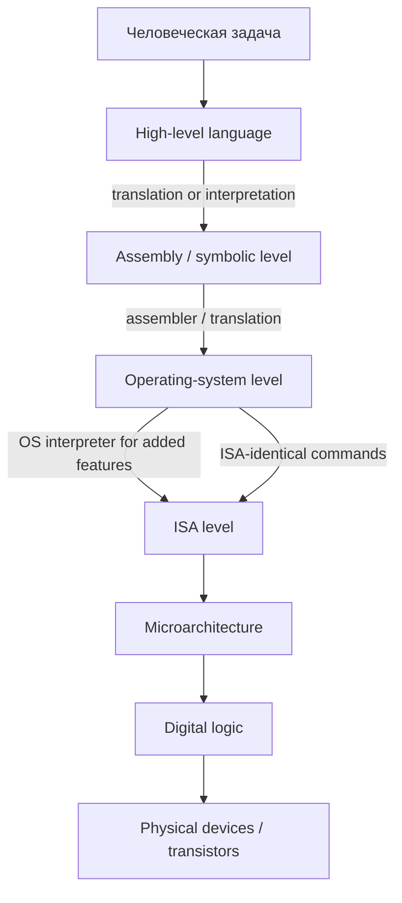
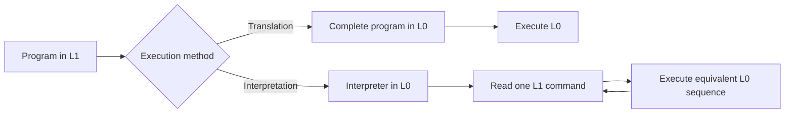
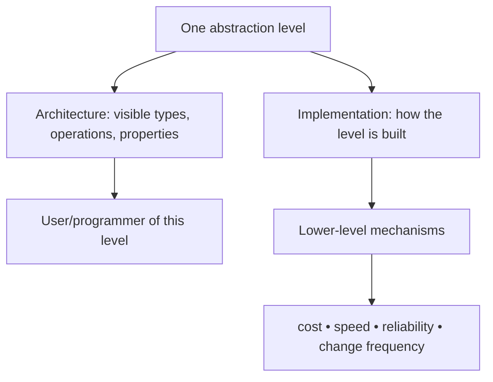
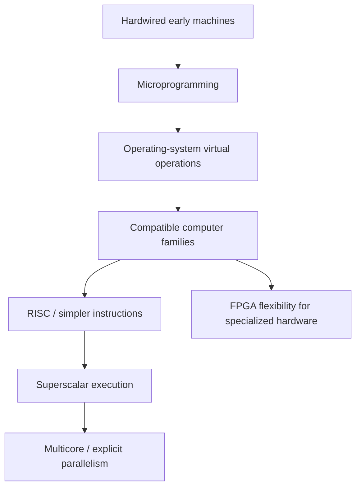
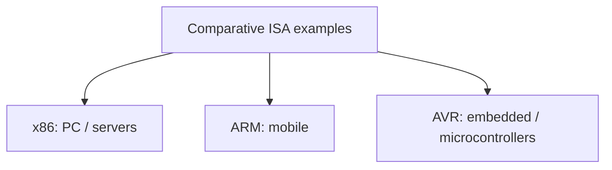

# Mermaid — глава 1 «Введение»

Источник: RAG `p0020:c01`–`p0075:c01`, PDF pages 20–75. Все связи ниже синтезированы только из главы.

## 1. Многоуровневая машина

Примечание: source model не требует, чтобы каждый конкретный program path буквально проходил через каждый блок. Диаграмма показывает иерархию уровней и типичные механизмы поддержки.

## 2. Translation vs interpretation

## 3. Architecture vs implementation

## 4. Historical development

## 5. Architectural ideas accumulated over time

## 6. Computer spectrum

Это не строгая шкала мощности: глава показывает разные назначения и trade-offs, а не единственную линейную иерархию.

## 7. Centralization cycle

## 8. Три сравнительных ISA

