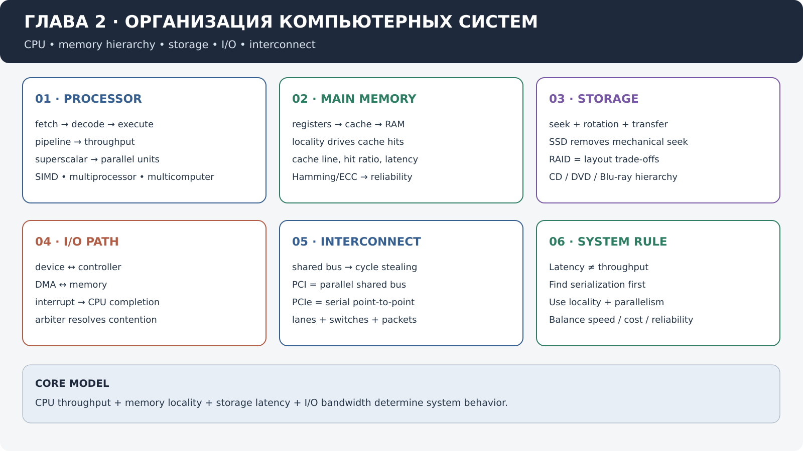
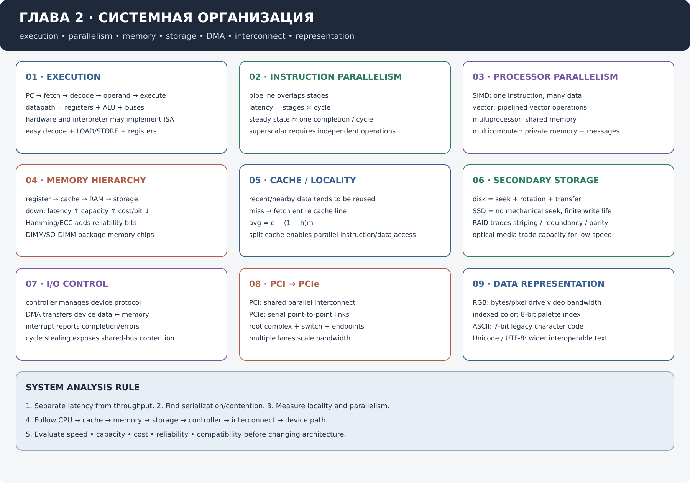

# Глава 2 — Организация компьютерных систем

Эндрю С. Таненбаум, Тодд Остин — «Архитектура компьютера», 6-е издание.





## Идентификация и readiness

- Book ID: `computer-architecture-tanenbaum-austin-6e-ru`; inventory: `0006`.
- Chapter: **2. Организация компьютерных систем**.
- Slug: `computer-system-organization`.
- Canonical source: `source/book.pdf`.
- Source SHA-256: `11c1875711e29244f56f925c17cbe53cb625cf3dbd95a8a03d90c764aa453e75`.
- Book readiness for chapter analysis: **READY**.
- RAG generation: **legacy-compatible**; controlled rebuild was not performed.
- RAG validation: `READY_WITH_KNOWN_LIMITATIONS`.
- Source policy: **rag_only**; no external web, model-memory completion or direct canonical-PDF reading.

## Chapter boundary

- PDF pages: **76–171** inclusive.
- RAG chunks: **`p0076:c01`–`p0171:c01`**.
- TOC evidence: `p0007:c01`.
- `p0076:c01` begins «Глава 2. Организация компьютерных систем».
- `p0167:c01` begins «Краткое содержание главы».
- `p0168:c01`–`p0171:c01` contain 36 review questions/exercises.
- `p0172:c01` begins «Глава 3. Цифровой логический уровень».
- **Chapter boundary verified: YES.**

## Карта главы

| Раздел | PDF pages | Содержание |
|---|---:|---|
| Процессоры | 76–94 | CPU/datapath, fetch-decode-execute, interpretation, RISC/CISC, design principles, pipelining, superscalar execution, processor-level parallelism |
| Основная память | 94–106 | bits/addresses, byte order, error detection/correction, Hamming code, cache/locality, memory modules |
| Вспомогательная память | 106–131 | hierarchy, magnetic disks, IDE/SCSI, RAID, SSD, CD/CD-R/CD-RW/DVD/Blu-ray |
| Ввод-вывод | 131–167 | controllers, DMA, interrupts, bus arbitration, PCI/PCIe, displays/video memory, pointing/game devices, printers, modems/cable access, cameras, character encodings |
| Краткое содержание | 167–168 | Processor/memory/I/O synthesis |
| Вопросы и задания | 168–171 | 36 computational/conceptual/programming exercises |

## Главный принцип

**Производительность системы определяется не одним компонентом, а согласованием CPU, memory hierarchy и I/O path.**

Процессор должен поддерживать высокий поток команд; память должна скрывать разрыв между быстрым CPU и емким, но более медленным storage; I/O должен передавать данные без постоянного участия CPU.

```text
fast component
    ↓
bottleneck / latency / contention
    ↓
buffering • caching • parallelism • controllers
    ↓
trade-off: speed / capacity / cost / reliability / compatibility
```

## Основные идеи

1. **CPU выполняет fetch → decode → execute.** PC указывает следующую команду; instruction register хранит текущую; ALU и registers образуют datapath.
2. **Аппаратный процессор и интерпретатор логически могут реализовать один язык.** Интерпретация позволяет упростить hardware; hybrid designs combine both.
3. **RISC/CISC — не просто число команд.** Важны issue/decode/execution rate и compatibility constraints.
4. **RISC-style principles:** common instructions direct in hardware, high issue rate, easy decode, LOAD/STORE memory access, many registers.
5. **Pipeline повышает throughput, но не обязательно latency одной команды.**
6. **Superscalar execution** требует независимости команд и доступных functional units.
7. **Processor-level parallelism:** SIMD/vector, shared-memory multiprocessor, private-memory multicomputer.
8. **Memory is a hierarchy:** ниже обычно latency ↑, capacity ↑, cost/bit ↓.
9. **Error-correcting memory** обменивает дополнительные биты на reliability; Hamming code в главе исправляет одиночную ошибку.
10. **Cache работает благодаря locality.** Среднее время доступа в source model: `c + (1-h)m`.
11. **Secondary storage** добавляет trade-offs seek/rotation/transfer, wear, capacity, cost.
12. **RAID — набор разных layouts, а не иерархия.** Levels 0–5 имеют разные performance/redundancy свойства.
13. **I/O controller** отделяет device-specific behavior от system path.
14. **DMA** переносит блоки напрямую между controller и memory, после чего controller interrupts CPU.
15. **Bus arbitration** управляет contention; source называет отбор циклов I/O у CPU `cycle stealing`.
16. **PCIe** описан как packet-switched point-to-point serial interconnect, в отличие от shared parallel PCI bus.
17. **Video bandwidth** определяется resolution × bytes/pixel × frame rate.
18. **Character encoding** — interoperability boundary: ASCII, Unicode, UTF-8.

## Operational mental model

```text
workload
  ↓
CPU: issue / dependencies / parallelism
  ↓
cache: locality / hit ratio / line movement
  ↓
main memory
  ↓
secondary storage: latency / throughput / reliability
  ↓
I/O controller: DMA / interrupt
  ↓
interconnect: arbitration / shared bus / point-to-point fabric
  ↓
device
```

## Артефакты

- [cheatsheet.md](cheatsheet.md)
- [commands.md](commands.md)
- [diagram.md](diagram.md)
- [visual-cheatsheet.svg](visual-cheatsheet.svg)
- [visual-cheatsheet-detailed.svg](visual-cheatsheet-detailed.svg)
- [summary.md](summary.md)
- [review-questions.md](review-questions.md)
- [review-answers.md](review-answers.md)
- [source-findings.md](source-findings.md)

## Ограничения

- Text layer is `unclassified_extractable_pdf_text`; figures/tables are not independent multimodal RAG objects.
- Exercises relying on figure-only geometry or ambiguous extracted wording are not silently reconstructed.
- Historical device speeds/capacities are preserved as chapter content, not updated to current hardware.
