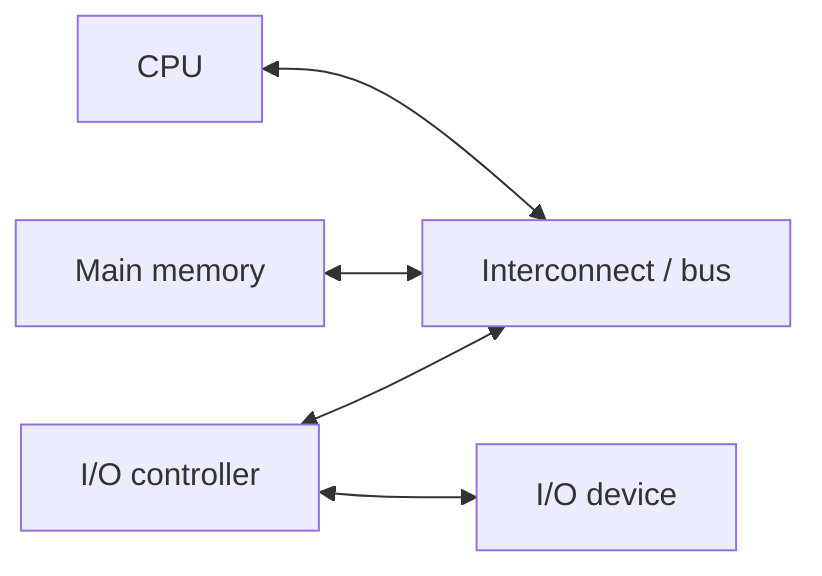
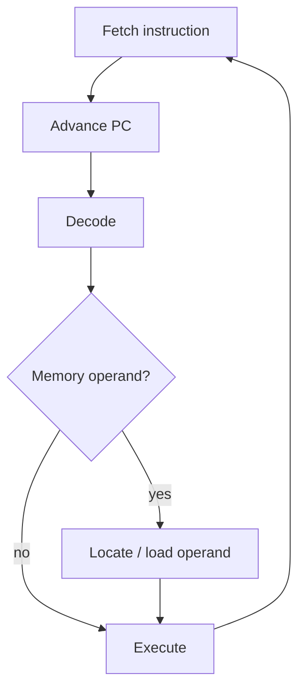
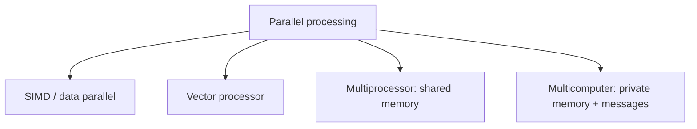
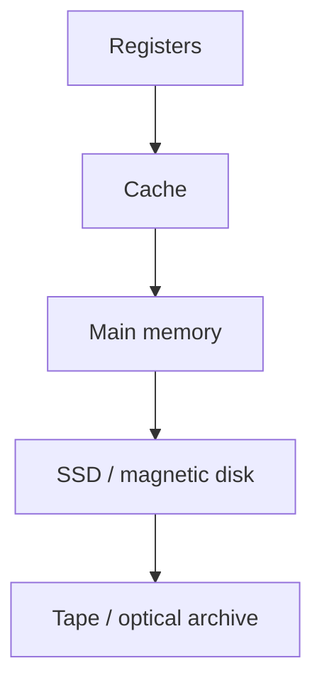
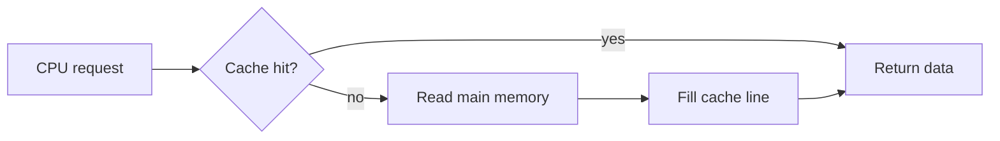
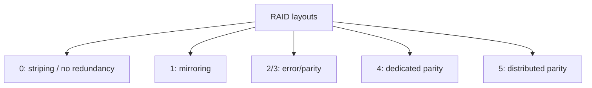
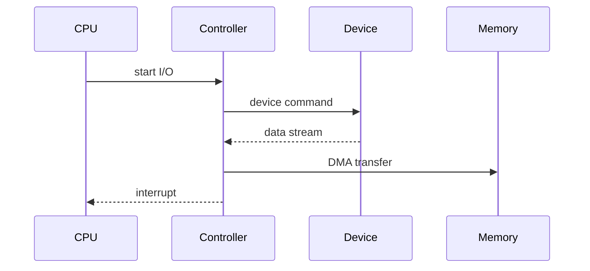
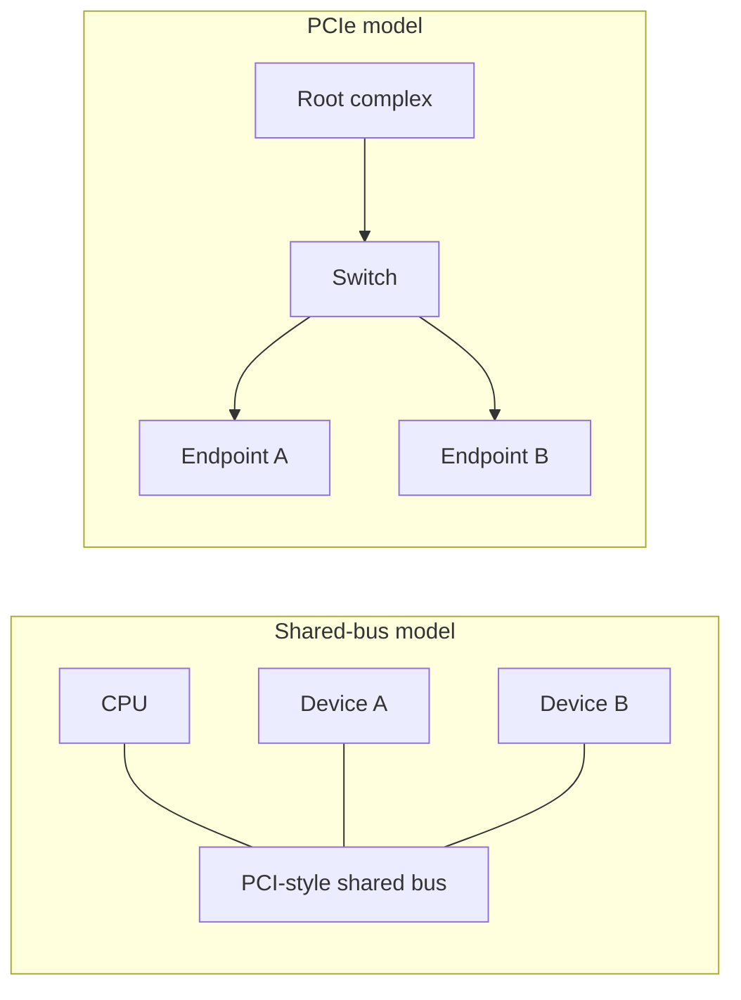
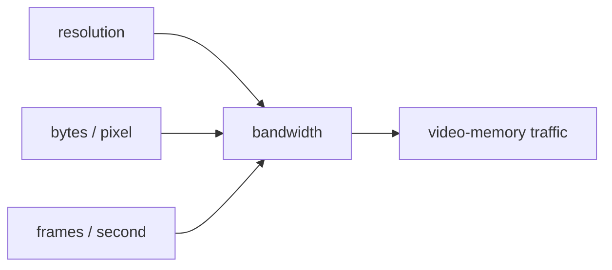

# Mermaid — глава 2 «Организация компьютерных систем»

Источник: RAG `p0076:c01`–`p0171:c01`.

## 1. System organization

## 2. Fetch–decode–execute

## 3. Pipeline

Different instructions may occupy different stages simultaneously.

## 4. Processor-level parallelism

## 5. Memory hierarchy

## 6. Cache path

## 7. Disk latency

## 8. RAID trade-off

## 9. DMA + interrupt

## 10. Shared bus versus PCIe

## 11. Display bandwidth

