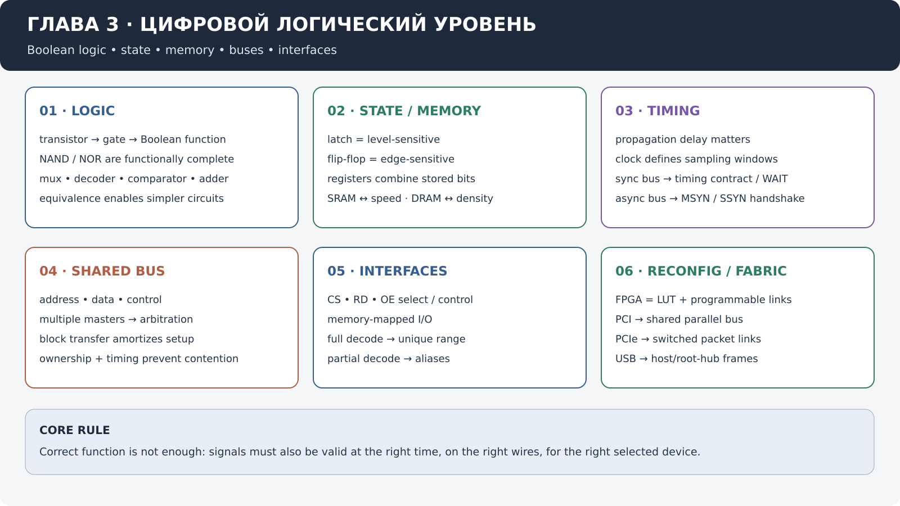
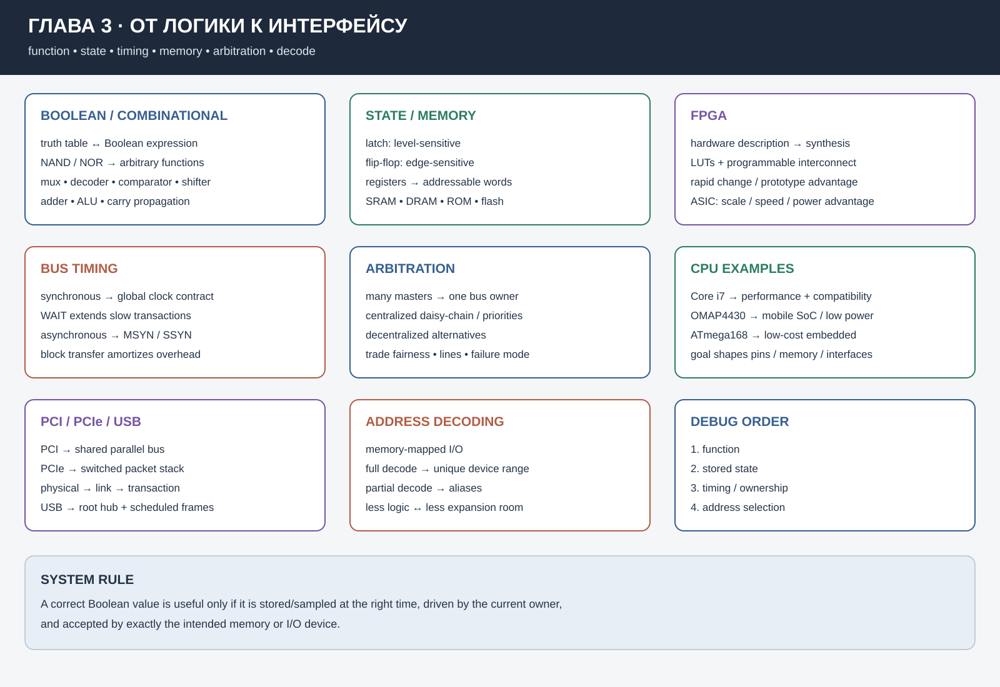

# Глава 3 — Цифровой логический уровень

Эндрю С. Таненбаум, Тодд Остин — «Архитектура компьютера», 6-е издание.





## Идентификация и readiness

- Book ID: `computer-architecture-tanenbaum-austin-6e-ru`; inventory: `0006`.
- Chapter: **3. Цифровой логический уровень**.
- Slug: `digital-logic-level`.
- Canonical source: `source/book.pdf`.
- Source SHA-256: `11c1875711e29244f56f925c17cbe53cb625cf3dbd95a8a03d90c764aa453e75`.
- Book readiness: **READY**.
- RAG: `READY_WITH_KNOWN_LIMITATIONS`, legacy-compatible.
- Source policy: **rag_only**; external web/model-memory completion/direct PDF reading were not used.

## Chapter boundary

- PDF pages: **172–269** inclusive.
- RAG chunks: **`p0172:c01`–`p0269:c01`**.
- TOC evidence: `p0008:c01`.
- `p0172:c01` begins «Глава 3. Цифровой логический уровень».
- `p0263:c01` begins «Краткое содержание главы».
- `p0264:c01`–`p0269:c01` contain **47** questions/exercises.
- `p0270:c01` begins «Глава 4. Уровень микроархитектуры».
- **Chapter boundary verified: YES.**

## Карта главы

| Раздел | PDF pages | Содержание |
|---|---:|---|
| Вентили и булева алгебра | 172–182 | transistor as switch, NOT/NAND/NOR, Boolean functions, equivalence, positive/negative logic |
| Основные цифровые логические схемы | 182–193 | IC, multiplexers/decoders/comparators, shifts, adders, ALU, clocks |
| Память | 193–208 | SR/D latches, flip-flops, registers, memory organization, SRAM/DRAM/ROM family |
| FPGA | 208–210 | LUT + programmable interconnect, synthesis, FPGA/ASIC trade-off |
| Микросхемы процессоров и шины | 210–227 | address/data/control pins, bus width/timing, synchronous/asynchronous buses, arbitration, block/atomic cycles |
| Примеры процессоров | 227–239 | Core i7, OMAP4430, ATmega168 |
| Примеры шин | 239–259 | PCI, PCIe protocol stack, USB |
| Интерфейсы | 259–263 | PIO, memory-mapped I/O, full/partial address decoding |
| Краткое содержание | 263–264 | synthesis of gates → memory → buses/interfaces |
| Вопросы и задания | 264–269 | 47 logic, timing, bus, memory and programming exercises |

## Главная идея

**Digital logic converts abstract Boolean relationships into physical, timed and addressable hardware.**

Chapter 3 connects five layers of reasoning:

```text
Boolean function
    ↓
gates / combinational logic
    ↓
state: latch / flip-flop / register / memory
    ↓
timing + buses + arbitration
    ↓
processor / memory / I/O interface
```

The important transition is from “which function is computed?” to “when is a signal valid, who owns the shared resource, and which device responds to an address?”

## Основные идеи

1. **A transistor can implement a binary switch.** Gate-level NOT/NAND/NOR behavior is built from physical switching but treated abstractly at this level.

2. **NAND and NOR are functionally complete.** Boolean functions can be transformed into equivalent circuits; simplification reduces gates, area, cost and power.

3. **Combinational circuits have no remembered state.** Multiplexers, decoders, comparators, shifters and adders derive outputs from current inputs.

4. **Adder performance is constrained by carry propagation.** Ripple carry is simple but slow; carry-select/look-ahead-like strategies trade hardware for lower latency.

5. **ALU is a replicated bit-slice structure.** One-bit sections combine logic and full-adder functions; control signals select the operation.

6. **Clocking turns propagation into an ordered system.** Edges, levels, setup intervals and gate delays determine when values may be sampled safely.

7. **State changes the model.** A latch remembers; a flip-flop samples on an edge; registers combine multiple bits under common clock/control.

8. **Memory organization separates address, data and control.** `CS` selects a chip; `RD` distinguishes reading/writing in the source example; output enable controls whether the device drives shared data lines.

9. **SRAM/DRAM trade speed for density/cost.** SRAM uses stable state elements and is fast; DRAM stores charge and requires refresh but achieves higher density.

10. **FPGA trades implementation efficiency for reconfigurability.** LUTs + programmable interconnect allow fast prototyping/small series; fixed integrated designs remain faster/cheaper at scale and lower-power.

11. **A processor chip exposes address, data and control signals.** These pins define its physical contract with memory and I/O.

12. **Bus width is multidimensional.** Address width affects addressable space; data width affects transfer size/bandwidth; control lines define protocol semantics.

13. **Synchronous bus = global timing contract.** Devices must meet setup/hold/timing limits and may require wait states.

14. **Asynchronous bus = causal handshake.** `MSYN`/`SSYN` allow each master/slave pair to complete at its own speed using full handshaking.

15. **Arbitration is required when multiple bus masters exist.** Centralized daisy-chain/priority schemes and decentralized schemes trade lines, latency, fairness and single points of failure.

16. **Block transfers amortize protocol overhead.** Multiple words can be transferred after one transaction setup.

17. **Core i7, OMAP4430 and ATmega168 illustrate different constraints.** Desktop performance/compatibility, mobile SoC power/integration, and embedded low-cost integration lead to different pinout/system choices.

18. **PCIe is conceptually a switched packet network implemented in hardware.** Physical, data-link, transaction and software layers replace the old shared parallel-bus model.

19. **USB is host/root-hub oriented and frame-based.** The source emphasizes automatic configuration, hot attachment, powered devices and multiple transfer types.

20. **Memory-mapped I/O turns device registers into addresses.** Full decoding preserves address space; partial decoding uses less logic but creates aliases and limits future expansion.

## Практическая модель

```text
required function
  ↓
truth table / Boolean expression
  ↓
gate network
  ↓
propagation delay + clocking
  ↓
state elements if needed
  ↓
address/data/control interface
  ↓
bus timing + arbitration
  ↓
decode address → select exactly intended device
```

## Артефакты

- [cheatsheet.md](cheatsheet.md)
- [commands.md](commands.md)
- [diagram.md](diagram.md)
- [visual-cheatsheet.svg](visual-cheatsheet.svg)
- [visual-cheatsheet-detailed.svg](visual-cheatsheet-detailed.svg)
- [summary.md](summary.md)
- [review-questions.md](review-questions.md)
- [review-answers.md](review-answers.md)
- [source-findings.md](source-findings.md)

## Ограничения

- Figures are referenced by text but are not independent multimodal RAG objects.
- Figure-dependent timing/schematic questions are answered only where text exposes enough structure; otherwise `[Needs confirmation]`.
- Historical chip/bus figures are preserved as source content and are not updated externally.
