# Mermaid — глава 3 «Цифровой логический уровень»

Источник: RAG `p0172:c01`–`p0269:c01`.

## 1. From Boolean function to system interface

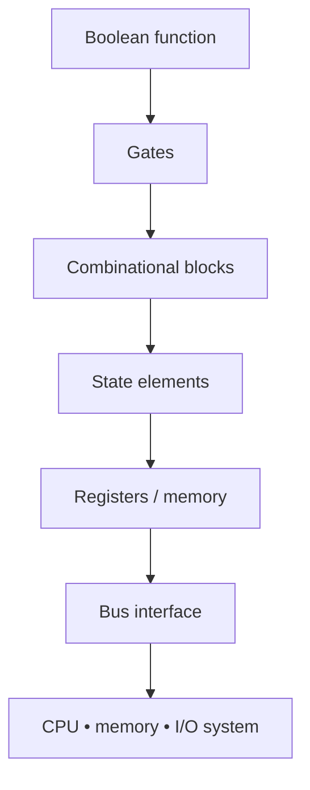

## 2. Combinational versus stateful

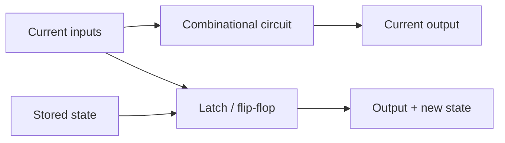

## 3. Adder hierarchy

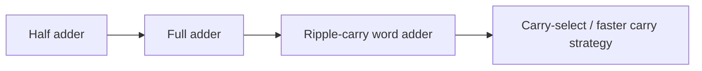

## 4. Memory organization

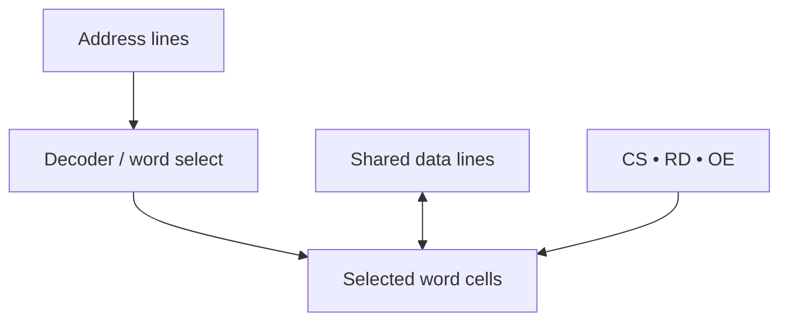

## 5. Stateful timing

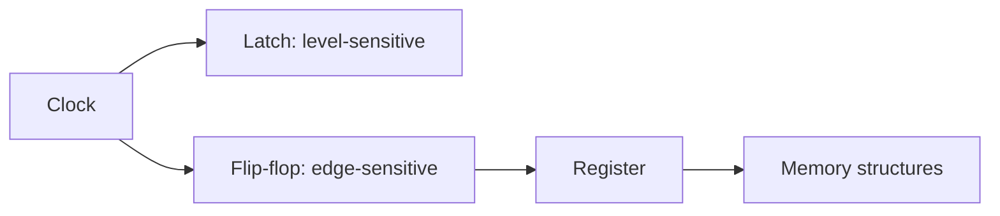

## 6. Synchronous bus

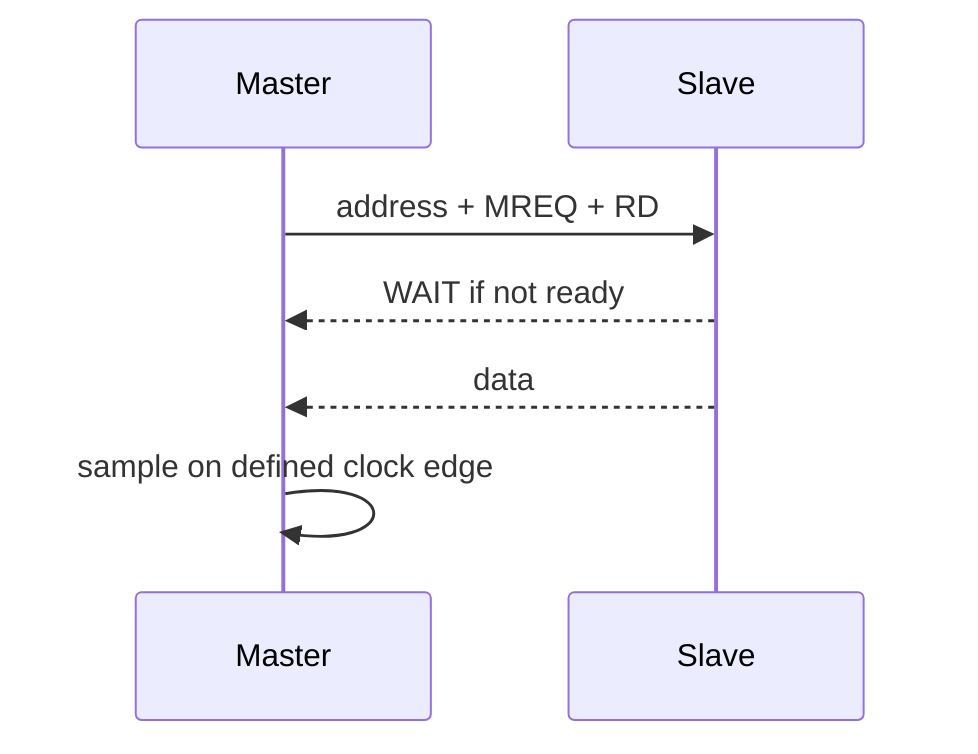

## 7. Asynchronous full handshake

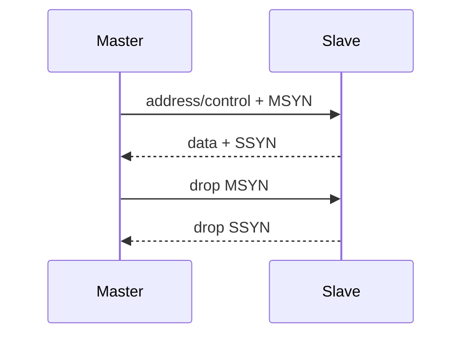

## 8. Bus arbitration

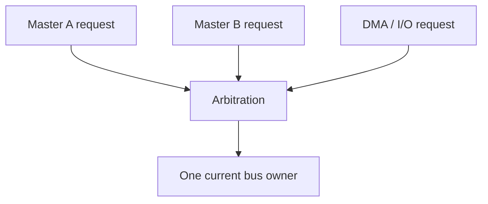

## 9. FPGA

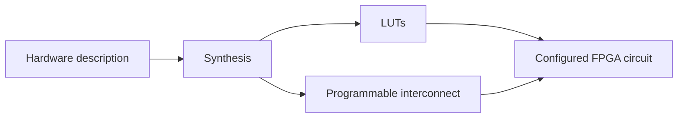

## 10. PCI versus PCIe

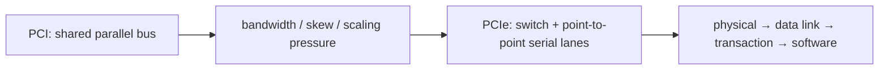

## 11. Address decoding

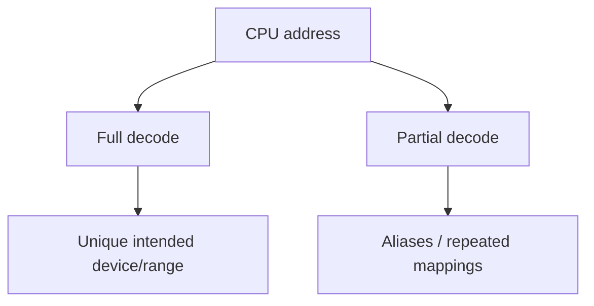
