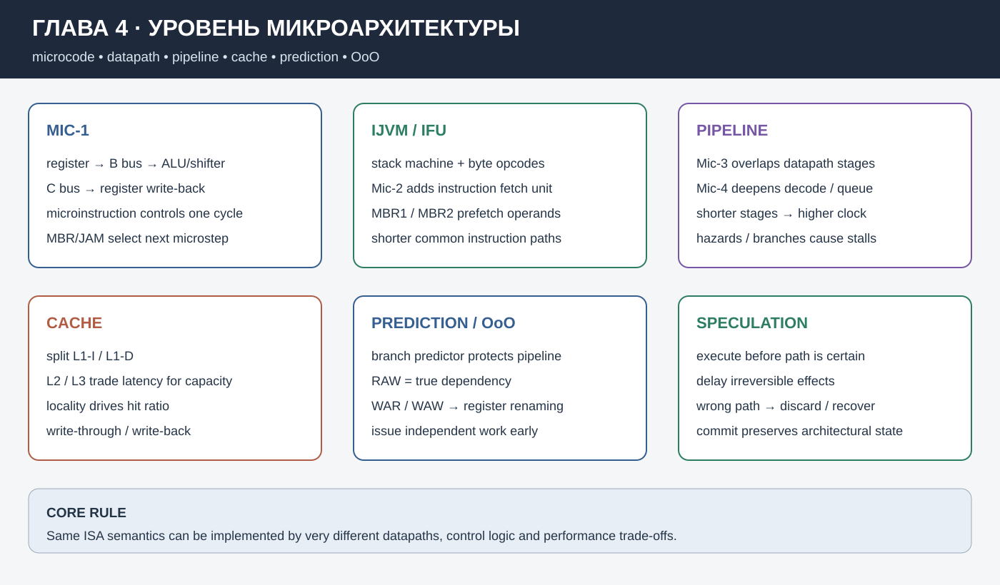
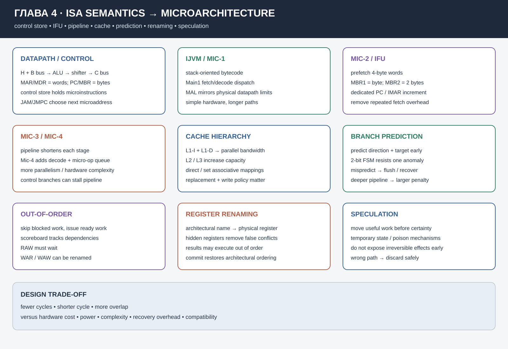

# Глава 4 — Уровень микроархитектуры

Эндрю С. Таненбаум, Тодд Остин — «Архитектура компьютера», 6-е издание.





## Идентификация и readiness

- Book ID: `computer-architecture-tanenbaum-austin-6e-ru`; inventory: `0006`.
- Chapter: **4. Уровень микроархитектуры**.
- Slug: `microarchitecture-level`.
- Canonical source: `source/book.pdf`.
- Source SHA-256: `11c1875711e29244f56f925c17cbe53cb625cf3dbd95a8a03d90c764aa453e75`.
- Book readiness: **READY**.
- RAG: `READY_WITH_KNOWN_LIMITATIONS`, legacy-compatible.
- Source policy: **rag_only**.

## Chapter boundary

- PDF pages: **270–376** inclusive.
- RAG chunks: **`p0270:c01`–`p0376:c01`**.
- TOC evidence: `p0008:c01`–`p0009:c01`.
- `p0270:c01` begins chapter 4.
- `p0372:c01` begins «Краткое содержание главы».
- `p0373:c01`–`p0376:c01` contain **35** questions/exercises.
- `p0377:c01` begins chapter 5.
- **Chapter boundary verified: YES.**

## Карта главы

| Раздел | PDF pages | Содержание |
|---|---:|---|
| Пример микроархитектуры | 270–284 | Mic-1 datapath, registers, memory ports, timing, microinstructions, control store |
| IJVM ISA example | 284–294 | stack machine, IJVM opcodes, procedure frames, Java→IJVM compilation |
| Реализация Mic-1 | 294–313 | MAL notation, Mic-1 microprogram, dispatch, branches, INVOKEVIRTUAL/IRETURN |
| Разработка микроархитектуры | 313–336 | path length, 3-bus ideas, IFU, Mic-2, Mic-3 pipeline, Mic-4 seven-stage pipeline |
| Повышение производительности | 336–357 | cache hierarchy, branch prediction, out-of-order, register renaming, speculation |
| Примеры | 357–372 | Core i7/Sandy Bridge, Cortex A9/OMAP4430, ATmega168 |
| Summary | 372–373 | datapath/control/performance synthesis |
| Review | 373–376 | 35 questions/exercises |

## Главная идея

**Микроархитектура — это механизм, который превращает ISA semantics в последовательность физических micro-operations над datapath.**

```text
ISA opcode
  ↓
decode / microcode
  ↓
register sources
  ↓
ALU / shifter / memory operation
  ↓
write-back
  ↓
next microinstruction
```

Из этой модели вырастает вся глава: сначала Mic-1 выполняет всё почти последовательно, затем Mic-2 выносит instruction fetch в отдельный блок, Mic-3 конвейеризирует datapath, Mic-4 еще сильнее разделяет decode/queue/execute. После этого те же идеи масштабируются до cache, branch prediction, out-of-order execution и speculation.

## Основные идеи

1. **Datapath — центральный исполняющий механизм.** Регистры подают значения в ALU/shifter, результат возвращается через общую шину в один или несколько регистров.

2. **Mic-1 использует один выделенный H input и B bus.** Это ограничивает, какие выражения могут быть вычислены за один microcycle.

3. **Microinstruction = control word for one cycle.** В source model Mic-1 control word includes next-address/JAM, ALU/shifter, C-bus destinations, memory functions and B-bus source.

4. **Control store implements sequencing.** Каждая microinstruction сама определяет следующую, что позволяет dispatch по IJVM opcode через MBR.

5. **Memory paths are asymmetric.** MAR/MDR работают со словами; PC/MBR — с byte stream команд.

6. **MAL is not general programming language.** It mirrors exact datapath capabilities; syntactically plausible expressions may be impossible if data cannot reach the ALU inputs in one cycle.

7. **IJVM is stack-oriented.** Operands are pushed/popped; TOS caches top of stack; LV/SP/CPP/PC track frames, stack, constant pool and bytecode.

8. **Main1 is dispatch overhead in Mic-1.** It increments/fetches and jumps to microcode based on opcode in MBR.

9. **Mic-2 removes much fetch/decode overhead with IFU.** IFU maintains MBR1/MBR2, prefetches 4-byte words and increments PC independently.

10. **Performance can improve in three ways:** fewer cycles per ISA instruction, shorter cycles, or more parallel work per cycle.

11. **Mic-3 trades more pipeline stages/cycles for a shorter clock period.** Throughput rises despite higher single-operation pipeline latency.

12. **Mic-4 separates fetch, decode, micro-op expansion, queueing and pipelined datapath control.** Conditional microbranches can still stall the queue.

13. **Cache hierarchy bridges processor-memory mismatch.** Split L1 instruction/data caches increase available bandwidth; deeper levels trade latency for capacity.

14. **Branch prediction protects the pipeline from control hazards.** Dynamic predictors learn recent behavior; 2-bit schemes avoid flipping prediction after one anomaly.

15. **Out-of-order execution looks for independent work.** RAW dependencies are real; WAR/WAW can often be removed by register renaming.

16. **Register renaming separates architectural names from physical storage.** Hidden physical registers allow overlapping instructions without false dependencies.

17. **Precise architectural state still matters.** Results may execute out of order but must be committed/reordered consistently enough to support interrupts/exceptions.

18. **Speculative execution crosses control-flow boundaries.** It improves utilization only if effects can be canceled or delayed until the path is known to be valid.

19. **Implementation can change radically without changing ISA.** Core i7 translates legacy CISC instructions into internal micro-ops and executes them on a modern pipelined/out-of-order core.

20. **Different products optimize different constraints.** Core i7 emphasizes performance/compatibility, Cortex A9 balances performance and embedded cost/power, ATmega168 emphasizes simplicity/cost.

## Operational mental model

```text
slow instruction / stall
  ↓
count micro-ops / path length
  ↓
identify critical datapath delay
  ↓
check fetch/decode overlap
  ↓
check pipeline dependency / branch hazard
  ↓
check cache/memory wait
  ↓
check false dependency → rename?
  ↓
check speculative work / recovery cost
```

## Артефакты

- [cheatsheet.md](cheatsheet.md)
- [commands.md](commands.md)
- [diagram.md](diagram.md)
- [visual-cheatsheet.svg](visual-cheatsheet.svg)
- [visual-cheatsheet-detailed.svg](visual-cheatsheet-detailed.svg)
- [summary.md](summary.md)
- [review-questions.md](review-questions.md)
- [review-answers.md](review-answers.md)
- [source-findings.md](source-findings.md)

## Ограничения

- Figures/tables are not independent multimodal RAG objects.
- Exact figure-topology questions remain `[Needs confirmation]` when text does not expose enough structure.
- Historical implementation numbers are preserved as book content, not updated externally.
