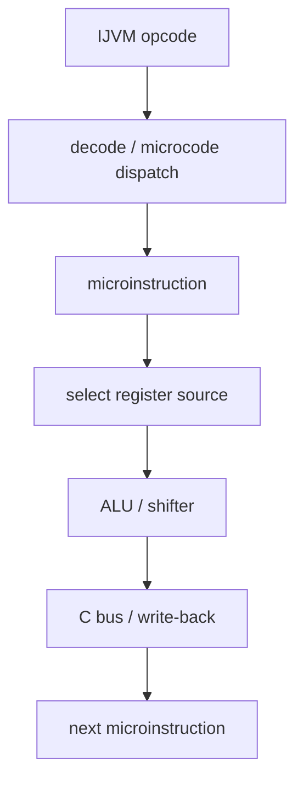
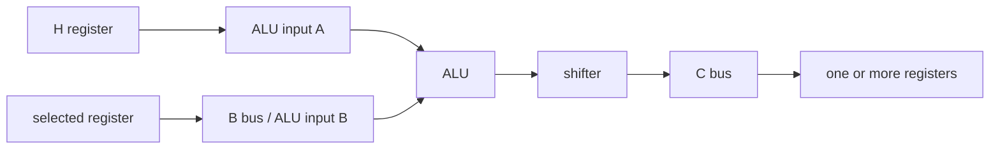
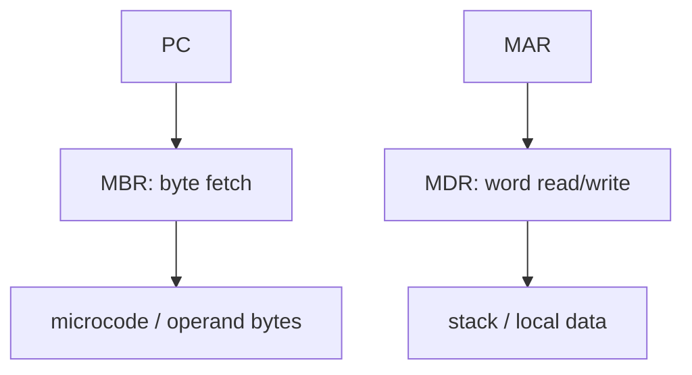
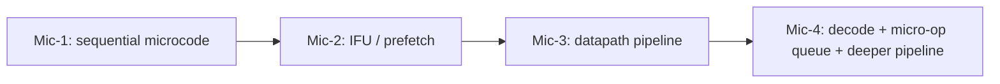
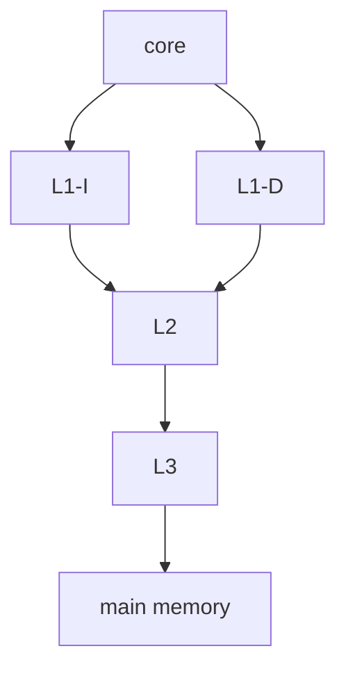
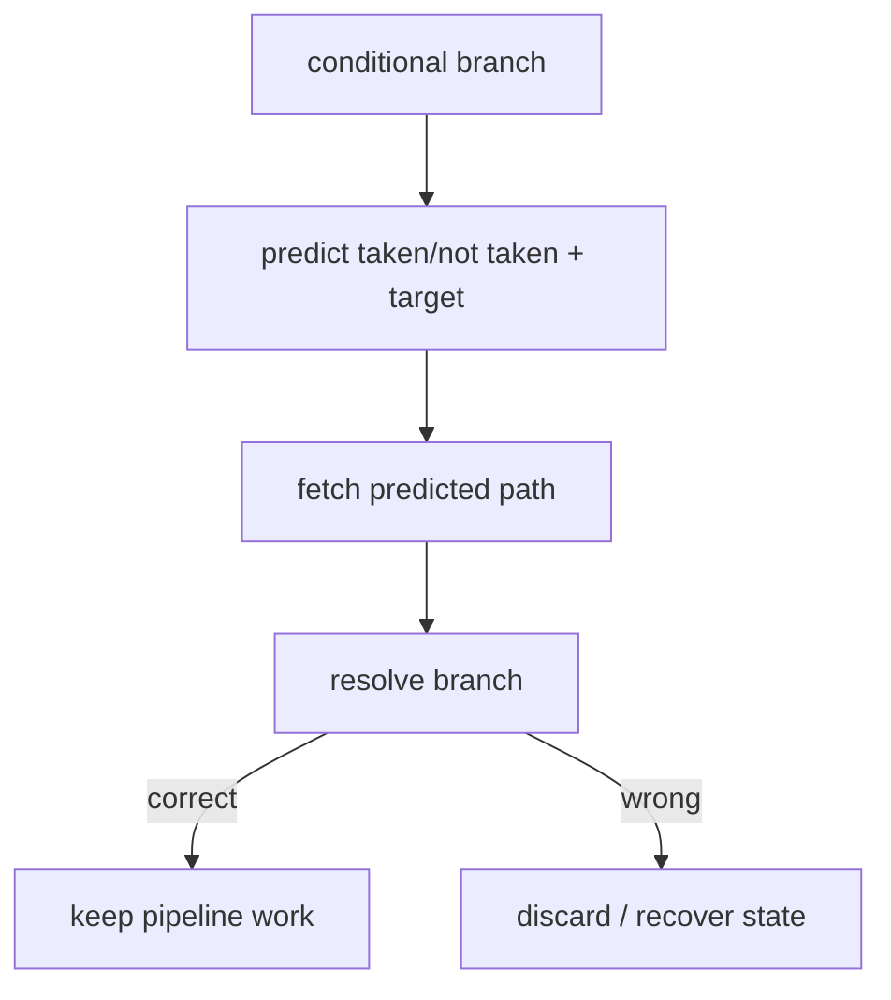
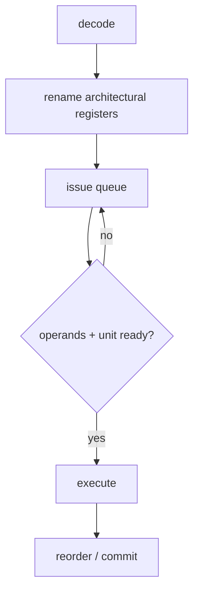
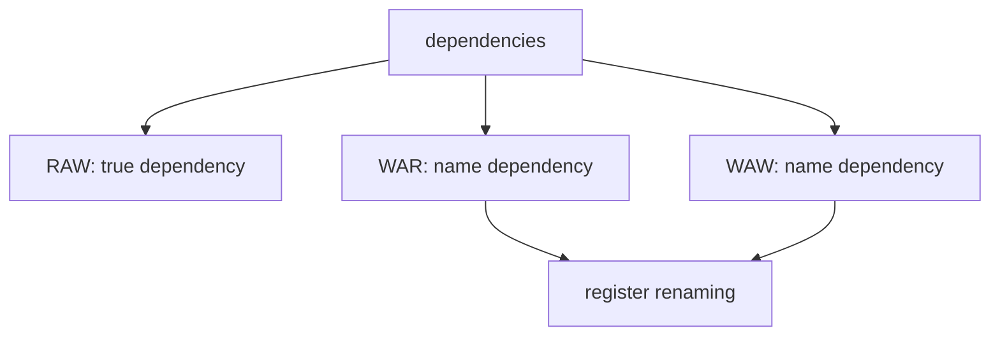
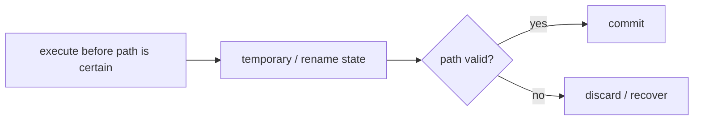

# Mermaid — глава 4 «Уровень микроархитектуры»

Источник: RAG `p0270:c01`–`p0376:c01`.

## 1. ISA to datapath

## 2. Mic-1 datapath

## 3. Memory paths

## 4. Mic-1 → Mic-4

## 5. Pipeline throughput

Different operations may occupy different stages in the same cycle.

## 6. Cache hierarchy

## 7. Branch prediction

## 8. Out-of-order execution

## 9. Dependency types

## 10. Speculation

