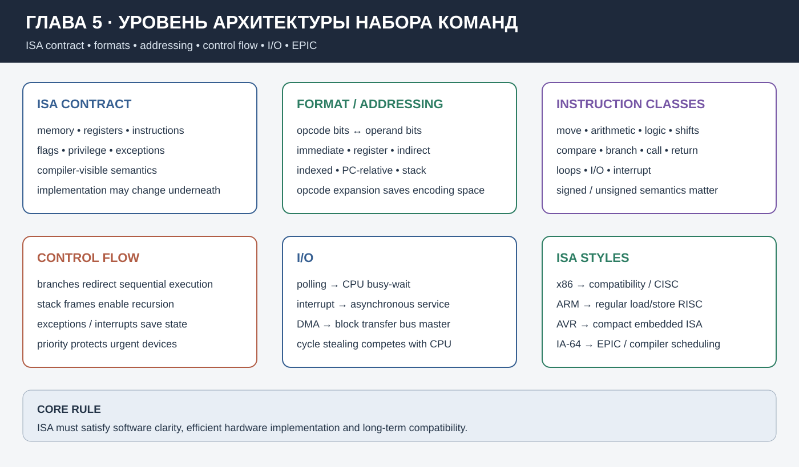
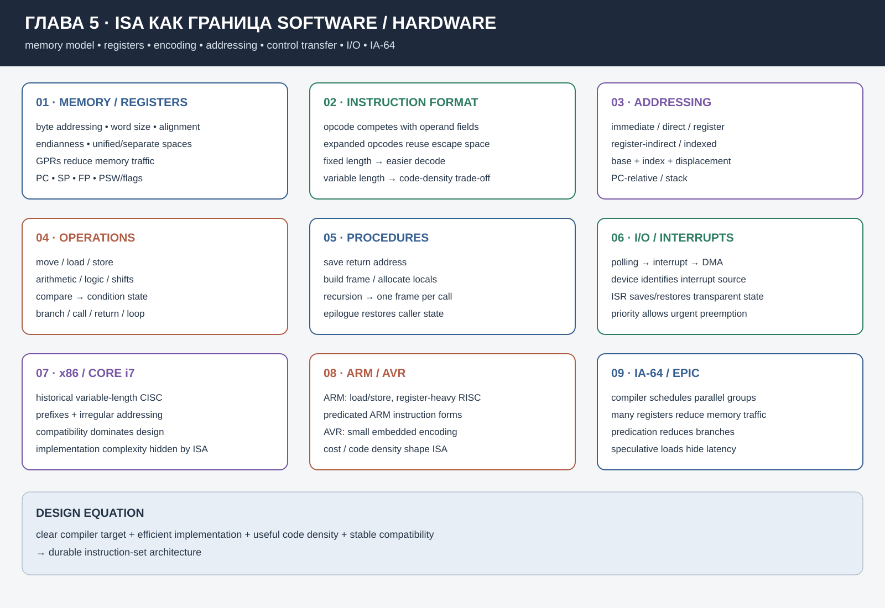

# Глава 5 — Уровень архитектуры набора команд

Эндрю С. Таненбаум, Тодд Остин — «Архитектура компьютера», 6-е издание.





## Идентификация и readiness

- Book ID: `computer-architecture-tanenbaum-austin-6e-ru`; inventory: `0006`.
- Chapter: **5. Уровень архитектуры набора команд**.
- Slug: `instruction-set-architecture-level`.
- Canonical source: `source/book.pdf`.
- Source SHA-256: `11c1875711e29244f56f925c17cbe53cb625cf3dbd95a8a03d90c764aa453e75`.
- Book readiness: **READY**.
- RAG: `READY_WITH_KNOWN_LIMITATIONS`, legacy-compatible.
- Source policy: **rag_only**.

## Chapter boundary

- PDF pages: **377–474** inclusive.
- RAG chunks: **`p0377:c01`–`p0474:c01`**.
- TOC evidence: `p0009:c01`–`p0011:c01`.
- `p0377:c01` begins chapter 5.
- `p0468:c01`–`p0469:c01` contain the chapter summary.
- `p0470:c01`–`p0474:c01` contain **42** questions/exercises.
- `p0475:c01` begins chapter 6.
- **Chapter boundary verified: YES.**

## Карта главы

| Раздел | PDF pages | Содержание |
|---|---:|---|
| ISA overview | 377–396 | ISA as HW/SW contract, privilege, memory model, registers, data types, Core i7/ARM/AVR overview |
| Instruction formats | 396–406 | format trade-offs, opcode expansion, x86/ARM/AVR formats |
| Addressing | 406–419 | immediate/direct/register/indirect/indexed/PC-relative/stack, orthogonality |
| Instruction types | 419–442 | moves, arithmetic/logical, comparison, calls, loops, I/O, DMA, ISA examples |
| Control flow | 442–456 | branches, procedures, recursion, coroutines, exceptions, interrupts and priority |
| Towers of Hanoi | 456–459 | stack frames and recursive implementations |
| IA-64 / Itanium 2 | 459–468 | EPIC, large register files, bundles, predication, speculative loads |
| Summary | 468–469 | ISA synthesis |
| Review | 470–474 | 42 exercises |

## Главная идея

**ISA is the contract between compiled software and the machine implementation.**

```text
source language
   ↓ compiler
ISA-visible program
   ↓
registers • memory model • instruction formats
addressing modes • control flow • exceptions/I/O
   ↓
microarchitecture implementation
```

Software depends on the ISA semantics, not on the particular pipeline, cache or internal micro-op implementation.

## Основные идеи

1. **ISA defines what software can observe.** Memory model, registers, data types, instructions, addressing, exceptions and privilege belong to this contract.

2. **Backward compatibility strongly shapes real ISAs.** Core i7 preserves historical x86 behavior even when it complicates decode and implementation.

3. **Memory organization is visible at ISA level.** Byte addressing, word size, alignment, endianness, separate code/data spaces and ordering guarantees affect software.

4. **Registers are part of the compiler interface.** General-purpose registers reduce memory traffic; special registers expose control state such as PC, SP and flags.

5. **Condition codes compress comparison results.** N/Z/V/C and related flags let later instructions branch without embedding three full operands in every branch.

6. **Instruction format is a bit-budget problem.** Bits used for opcode cannot simultaneously encode registers, addresses, immediates or modes.

7. **Opcode expansion reuses rare format space.** Short opcodes are assigned to formats requiring many operands; longer opcodes are used when fewer/no operands are present.

8. **Regularity improves compilation; compatibility often destroys regularity.** ARM is comparatively regular; x86 format growth is historically layered.

9. **Addressing modes trade code density against decode/hardware complexity.** Immediate, direct, register, indirect, indexed, PC-relative and stack modes target different compiler patterns.

10. **PC-relative addressing helps relocation and compact branches.** Its range is limited by displacement width.

11. **Stack addressing enables zero-address operations.** Reverse Polish notation maps naturally onto a stack ISA such as IJVM.

12. **Instruction classes map common program operations:** data movement, arithmetic, logic, shifts, comparisons, control transfer, procedure calls, loops and I/O.

13. **Procedure calls require recoverable state.** Return address, frame/stack state and saved registers must survive nested and recursive calls.

14. **Interrupts are asynchronous control transfers.** Hardware identifies the source, saves enough state and dispatches to an ISR; transparent return restores the interrupted state.

15. **DMA separates data transfer from CPU execution.** CPU initializes the controller; DMA becomes a bus master and can steal bus cycles while transferring data.

16. **Priority exists because interrupt sources have different service deadlines.** Nested higher-priority interrupts can preempt lower-priority handlers.

17. **Core i7, ARM and AVR expose different ISA philosophies.** Core i7 emphasizes compatibility, ARM regular load/store RISC structure, AVR compact embedded implementation.

18. **IA-64 moves scheduling work toward the compiler.** EPIC exposes parallelism, bundles instructions and reduces hardware scheduling responsibility.

19. **Predication replaces some branches with conditional writes.** This can keep pipelines linear at the cost of executing instructions whose results may be discarded.

20. **Speculative loads move latency earlier.** Fault/result validity is deferred so wrong-path or premature loads need not immediately change architectural state.

## Operational mental model

When reading disassembly or designing an instruction sequence:

```text
What state is ISA-visible?
→ where are operands?
→ which addressing mode computes the effective address?
→ how many instruction bits/bytes are consumed?
→ what flags/state are modified?
→ how does control flow change?
→ what must survive call/interrupt?
→ which parts are ISA semantics vs implementation detail?
```

## Артефакты

- [cheatsheet.md](cheatsheet.md)
- [commands.md](commands.md)
- [diagram.md](diagram.md)
- [visual-cheatsheet.svg](visual-cheatsheet.svg)
- [visual-cheatsheet-detailed.svg](visual-cheatsheet-detailed.svg)
- [summary.md](summary.md)
- [review-questions.md](review-questions.md)
- [review-answers.md](review-answers.md)
- [source-findings.md](source-findings.md)

## Ограничения

- Figure-specific bit layouts are used only when the surrounding RAG text explicitly exposes the fields.
- Historical ISA numbers/claims are preserved as source content and are not updated externally.
- Cross-reference exercise 33 additionally uses canonical book RAG `p0212:c01`–`p0214:c01` for figure 3.33; no external source is used.
