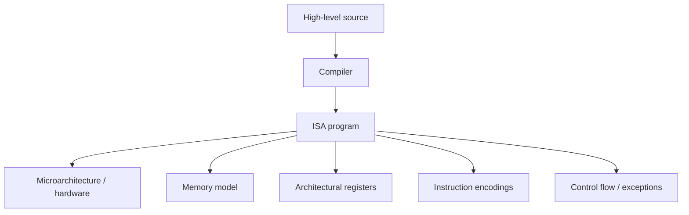
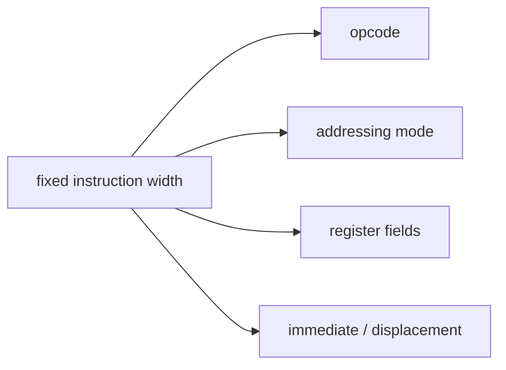
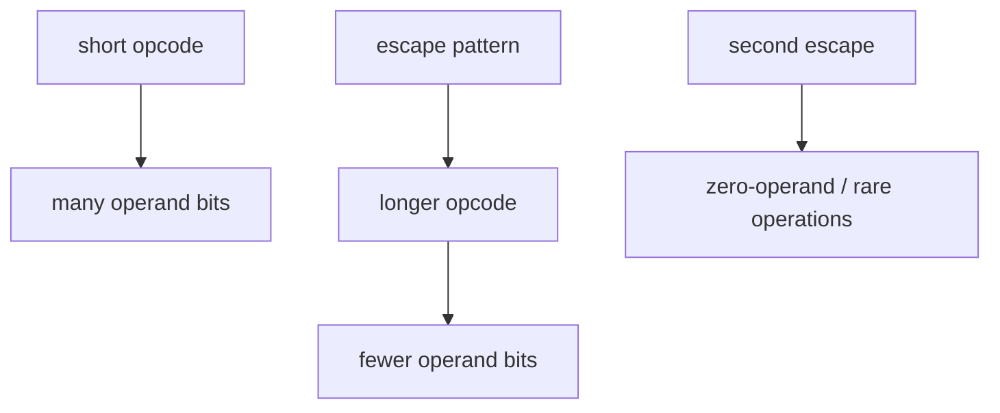
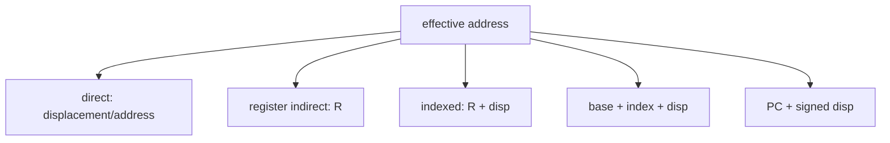
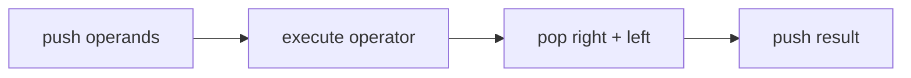
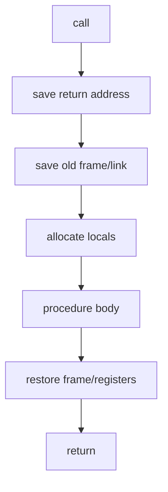
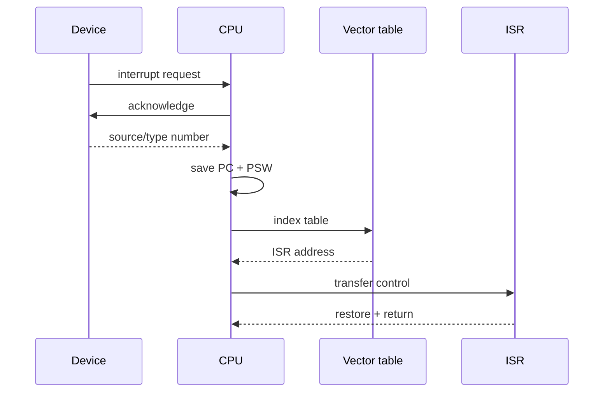
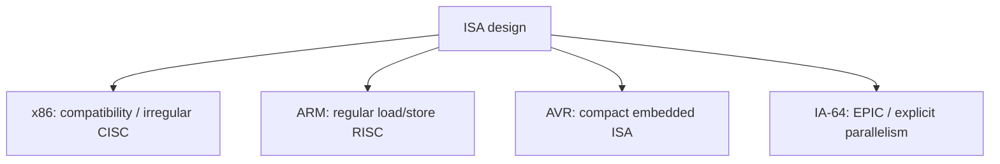
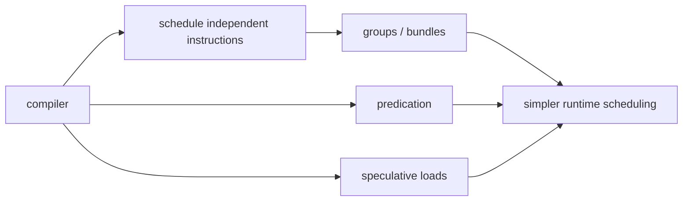

# Mermaid — глава 5 «Уровень архитектуры набора команд»

Источник: RAG `p0377:c01`–`p0474:c01`.

## 1. ISA as contract

## 2. Instruction bit budget

## 3. Opcode expansion

## 4. Effective address

## 5. Stack / postfix

## 6. Procedure frame

## 7. I/O progression

## 8. Interrupt control transfer

## 9. ISA comparison

## 10. IA-64

