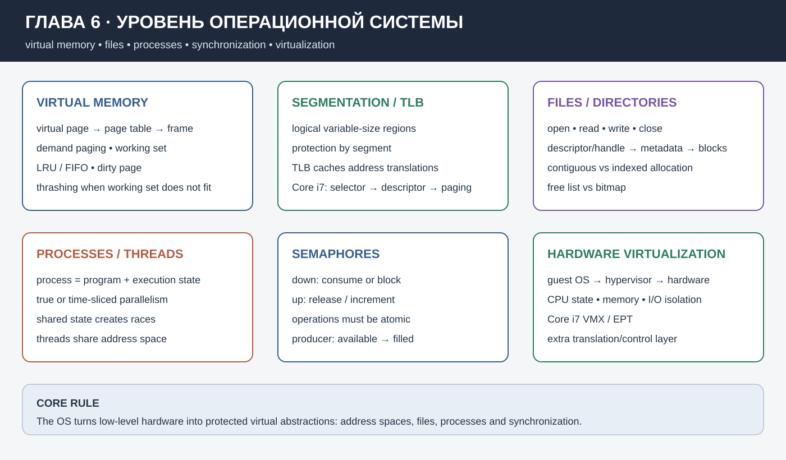
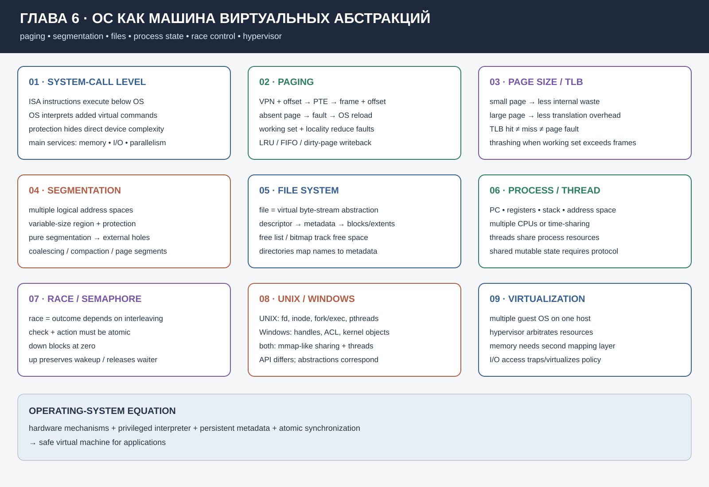

# Глава 6 — Уровень операционной системы

Эндрю С. Таненбаум, Тодд Остин — «Архитектура компьютера», 6-е издание.





## Идентификация и readiness

- Book ID: `computer-architecture-tanenbaum-austin-6e-ru`; inventory: `0006`.
- Chapter: **6. Уровень операционной системы**.
- Slug: `operating-system-machine-level`.
- Canonical source: `source/book.pdf`.
- Source SHA-256: `11c1875711e29244f56f925c17cbe53cb625cf3dbd95a8a03d90c764aa453e75`.
- Book readiness: **READY**.
- RAG: `READY_WITH_KNOWN_LIMITATIONS`, legacy-compatible.
- Source policy: **rag_only**.

## Chapter boundary

- PDF pages: **475–554** inclusive.
- RAG chunks: **`p0475:c01`–`p0554:c01`**.
- TOC evidence: `p0011:c01`.
- `p0475:c01` begins chapter 6.
- `p0547:c01` contains the explicit chapter summary.
- `p0548:c01`–`p0554:c01` contain **40** questions/exercises.
- `p0555:c01` begins chapter 7.
- **Chapter boundary verified: YES.**

## Карта главы

| Раздел | PDF pages | Содержание |
|---|---:|---|
| OS-machine level | 475–476 | системные вызовы как новые виртуальные команды уровня ОС |
| Virtual memory | 476–500 | paging, demand paging, working set, LRU/FIFO, fragmentation, segmentation, Core i7/ARM, TLB |
| Hardware virtualization | 500–502 | hypervisor, memory and I/O virtualization, VMX/EPT |
| Virtual I/O commands | 502–509 | files, allocation, free-space tracking, directories |
| Parallel virtual commands | 509–518 | processes, threads, race conditions, semaphores |
| OS examples | 518–547 | UNIX/Linux and Windows memory, files, processes, synchronization |
| Summary | 547 | chapter synthesis |
| Review | 548–554 | 40 exercises |

## Главная идея

**Операционная система расширяет ISA виртуальными командами и абстракциями, которые безопаснее и удобнее прямой работы с аппаратурой.**

```text
application
   ↓ system calls
OS-machine level
   ├─ virtual memory
   ├─ files / directories
   └─ processes / synchronization
   ↓
ISA + MMU + interrupts + I/O hardware
```

## Основные идеи

1. **Не все команды уровня ОС интерпретируются ОС.** Обычные ISA-команды выполняются аппаратурой; ОС интерпретирует только добавленные системные вызовы/привилегированные услуги.

2. **Virtual memory отделяет virtual address space от physical memory.** Программа оперирует виртуальными адресами; MMU преобразует их в физические.

3. **Paging использует фиксированные страницы и кадры.** Номер виртуальной страницы индексирует page table; offset переносится без изменения.

4. **Page fault — нормальный механизм demand paging.** ОС загружает отсутствующую страницу, обновляет page table и повторяет faulting instruction.

5. **Working set и locality объясняют эффективность VM.** Если активное множество страниц помещается в RAM, faults редки; если нет — возникает thrashing.

6. **Replacement policy — прогноз будущей полезности страницы.** Глава рассматривает LRU и FIFO и показывает ограничения обоих.

7. **Dirty bit экономит запись на диск.** Неизменённую страницу можно просто отбросить, если на backing store уже есть корректная копия.

8. **Page size — trade-off.** Большие страницы уменьшают page-table/TLB overhead и лучше используют transfer bandwidth; маленькие уменьшают internal fragmentation и лишнюю загрузку sparse working sets.

9. **Segmentation даёт несколько логических address spaces.** Сегменты имеют переменный размер и допускают protection, соответствующую типу объекта.

10. **Paging и segmentation решают разные задачи.** Paging прозрачно виртуализирует память; segmentation делает логические regions явными.

11. **Pure segmentation вызывает external fragmentation.** Ее уменьшают coalescing/compaction и allocation policies; paging сегментов устраняет требование contiguous physical placement.

12. **Core i7 сочетает segmentation и paging.** Selector → descriptor → linear address → multi-level page tables → physical address.

13. **TLB кэширует address translations.** TLB miss дороже hit, но не обязательно page fault.

14. **Hardware virtualization добавляет ещё один уровень translation/control.** Hypervisor изолирует CPU state, memory and I/O between virtual machines; Core i7 VMX/EPT поддерживает это аппаратно.

15. **File — основная OS-level I/O abstraction.** Приложение видит byte stream/logical records, а ОС скрывает disk sectors, device registers и error handling.

16. **Open file имеет OS state.** `open` находит файл, проверяет/готовит metadata и возвращает descriptor/handle; read/write работают через него.

17. **File allocation может быть contiguous или noncontiguous.** Неизвестный рост файла делает noncontiguous allocation практичнее.

18. **Free-space tracking:** free list удобен для поиска extent; bitmap имеет постоянный размер и дешёвое изменение статуса блока.

19. **Process = running program + execution state.** PC, registers, stack and address space составляют состояние процесса.

20. **Concurrency exists even on one CPU.** Time sharing создаёт псевдопараллелизм с теми же synchronization hazards.

21. **Race condition возникает из-за non-atomic check/action.** Результат зависит от interleaving процессов/потоков.

22. **Semaphores preserve wakeups and provide atomic synchronization.** `down` consumes availability or blocks; `up` increments/releases waiter.

23. **Producer/consumer требует как capacity, так и occupancy accounting.** Глава использует `available` и `filled`.

24. **UNIX and Windows expose similar abstractions but different APIs.** UNIX emphasizes small system-call set; Windows uses kernel objects, handles, ACLs and multiple synchronization primitives.

## Operational mental model

```text
virtual address
→ page/segment translation
→ permission/presence check
→ physical address or fault

file operation
→ descriptor/handle
→ filesystem metadata
→ allocated blocks
→ device I/O

concurrent access
→ shared state?
→ atomicity boundary?
→ lock/semaphore/mutex?
→ blocked/wakeup behavior?
```

## Артефакты

- [cheatsheet.md](cheatsheet.md)
- [commands.md](commands.md)
- [diagram.md](diagram.md)
- [visual-cheatsheet.svg](visual-cheatsheet.svg)
- [visual-cheatsheet-detailed.svg](visual-cheatsheet-detailed.svg)
- [summary.md](summary.md)
- [review-questions.md](review-questions.md)
- [review-answers.md](review-answers.md)
- [source-findings.md](source-findings.md)

## Ограничения

- Historical Windows/Linux/API descriptions are preserved as chapter content and are not modernized externally.
- Review tasks requiring execution/benchmarking cannot receive fabricated measurements.
- Source cross-reference inconsistencies are preserved in `source-findings.md`.
