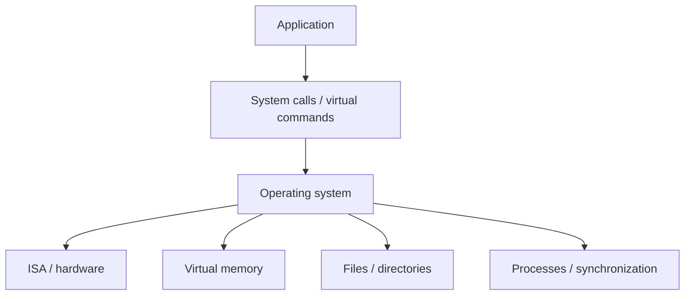
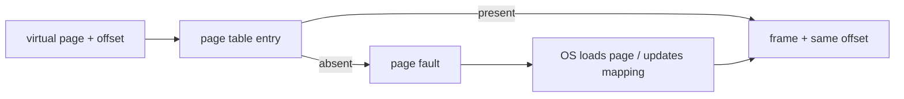
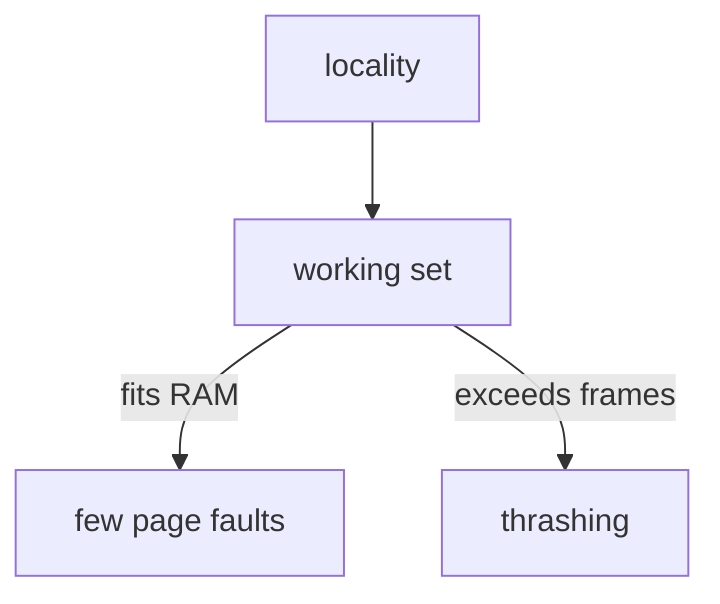
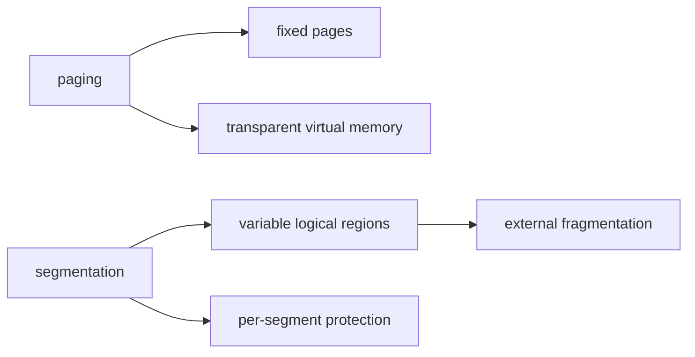
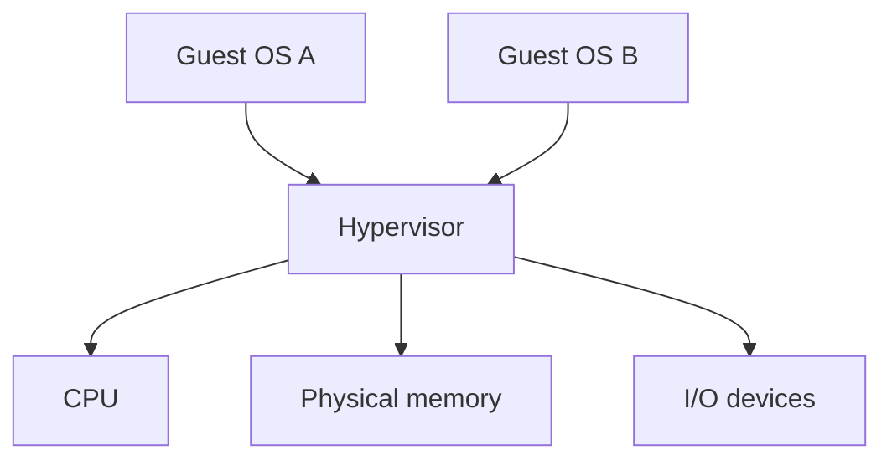
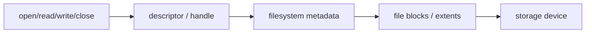
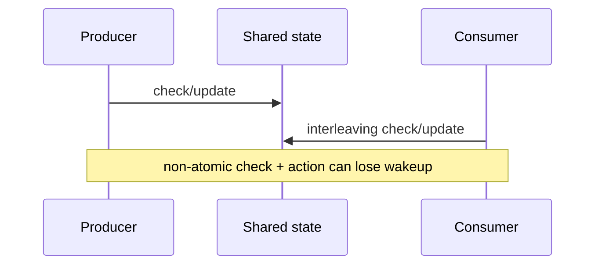
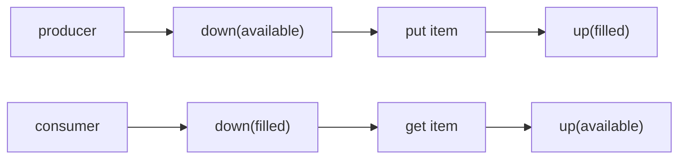

# Mermaid — глава 6 «Уровень операционной системы»

Источник: RAG `p0475:c01`–`p0554:c01`.

## 1. OS-machine layer

## 2. Page translation

## 3. Working set

## 4. Segmentation vs paging

## 5. Core i7 translation

## 6. Hardware virtualization

## 7. File abstraction

## 8. Race condition

## 9. Semaphore producer/consumer

