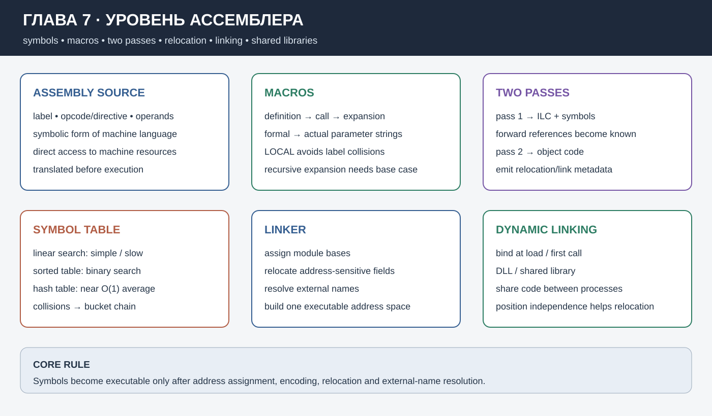
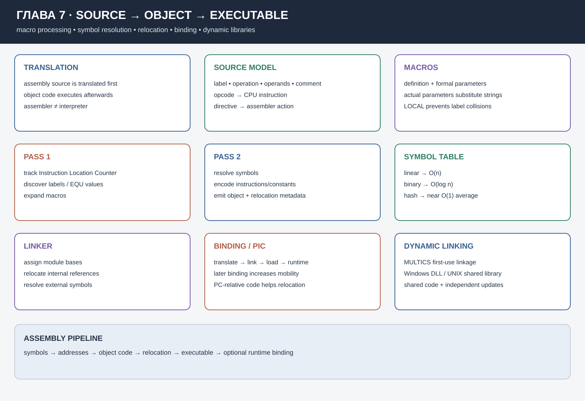

# Глава 7 — Уровень ассемблера

Эндрю С. Таненбаум, Тодд Остин — «Архитектура компьютера», 6-е издание.





## Идентификация и readiness

- Book ID: `computer-architecture-tanenbaum-austin-6e-ru`; inventory: `0006`.
- Chapter: **7. Уровень ассемблера**.
- Slug: `assembly-language-level`.
- Canonical source: `source/book.pdf`.
- Source SHA-256: `11c1875711e29244f56f925c17cbe53cb625cf3dbd95a8a03d90c764aa453e75`.
- Book readiness: **READY**.
- RAG: `READY_WITH_KNOWN_LIMITATIONS`, legacy-compatible.
- Source policy: **rag_only**.

## Chapter boundary

- PDF pages: **555–589** inclusive.
- RAG chunks: **`p0555:c01`–`p0589:c01`**.
- TOC evidence: `p0012:c01`.
- `p0555:c01` begins chapter 7.
- `p0586:c01` begins the explicit chapter summary.
- `p0587:c01`–`p0589:c01` contain **26** review questions/exercises.
- `p0590:c01` begins chapter 8.
- **Chapter boundary verified: YES.**

## Карта главы

| Раздел | PDF pages | Содержание |
|---|---:|---|
| Introduction to assembly | 555–561 | translation vs interpretation, assembly-language model, statement fields, directives |
| Macros | 561–566 | macro definition/call/expansion, parameters, local labels, conditional/recursive macros |
| Assembly process | 566–574 | forward references, two passes, ILC, pass 1/pass 2, symbol tables, hashing |
| Linking/loading | 574–582 | external references, relocation, object-module structure, binding time, position independence |
| Dynamic linking | 582–586 | MULTICS, Windows DLL, UNIX shared libraries |
| Summary | 586–587 | chapter synthesis |
| Review | 587–589 | 26 exercises |

## Главная идея

**Assembler level is implemented by translation rather than interpretation.**

```text
assembly source
   ↓ macro expansion
pass 1
   ↓ symbols / ILC / metadata
pass 2
   ↓ object module
linker
   ↓ relocation + external symbol resolution
executable
   ↓ loader / dynamic linker
running machine code
```

## Основные идеи

1. **Assembly source is a symbolic form of machine language.** A source statement usually corresponds to one machine instruction, while directives control the assembler itself.

2. **Translation and interpretation are different execution models.** Translation first creates an equivalent target program; only afterwards is that target program executed.

3. **Assembly exposes the target machine directly.** Registers, flags, instruction set and machine-specific resources are available to the programmer.

4. **The two main motivations are performance and hardware access.** The source also emphasizes compiler understanding and architectural education.

5. **Statement structure has four fields:** label, operation, operands and comment.

6. **Directives are assembler commands, not CPU instructions.** Examples in MASM include data definition, segment/control and symbol-definition directives.

7. **Macros are source-text substitution.** Macro expansion occurs before final machine-code generation; macros do not have runtime call/return overhead.

8. **Macro parameters are textual/formal substitutions.** Registers, constants and symbolic names can all be actual parameters if the expanded text is syntactically valid.

9. **Local macro labels prevent duplicate-symbol collisions.** Recursive macros need a changing parameter/base case or expansion can become infinite.

10. **Forward references motivate multi-pass assembly.** Pass 1 discovers symbol values; pass 2 emits final object code.

11. **ILC is an assembly-time location counter.** It tracks the address that the next emitted instruction/data item will have in the object module.

12. **Pass 1 constructs metadata.** Symbol table, opcode/directive tables, literals and macro definitions are used to determine addresses and source meaning.

13. **Pass 2 emits object code and relocation/link information.** At this point forward symbol values are known.

14. **Symbol-table lookup is an algorithmic choice.** Linear search is simple, binary search needs ordering, hashing targets near-constant average lookup with suitable load.

15. **Separately assembled modules need a linker.** Each module begins with its own local address assumptions, while the final program needs one coherent virtual address space.

16. **Relocation adjusts addresses when modules move.** External-symbol resolution replaces references to procedures/data defined in other modules.

17. **An object module contains code plus metadata.** The chapter lists identification, entry points, external references, machine code/constants, relocation dictionary and end marker.

18. **Binding time matters.** Names may be bound at translation, link, load, base-register load or execution time.

19. **Position-independent code reduces relocation pressure.** PC-relative references permit a procedure to move without rewriting internal addresses.

20. **Dynamic linking delays binding until load or first use.** It reduces duplicate library copies and permits shared/updateable libraries.

21. **DLL/shared-library code executes in the caller's process/thread context.** The key difference from static linking is how the procedure is located and bound.

## Operational mental model

```text
undefined symbol?
→ forward or external?
→ current ILC known?
→ symbol-table entry exists?
→ relocation required?
→ resolved at assembly, link, load or runtime?
```

## Артефакты

- [cheatsheet.md](cheatsheet.md)
- [commands.md](commands.md)
- [diagram.md](diagram.md)
- [visual-cheatsheet.svg](visual-cheatsheet.svg)
- [visual-cheatsheet-detailed.svg](visual-cheatsheet-detailed.svg)
- [summary.md](summary.md)
- [review-questions.md](review-questions.md)
- [review-answers.md](review-answers.md)
- [source-findings.md](source-findings.md)

## Ограничения

- MASM/x86 examples are historical source material, not current platform guidance.
- Exact assembler syntax outside the quoted source examples is not invented.
- Exercise 25 cross-references canonical Mic-1/MAL RAG from chapter 4.
