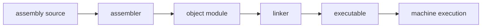
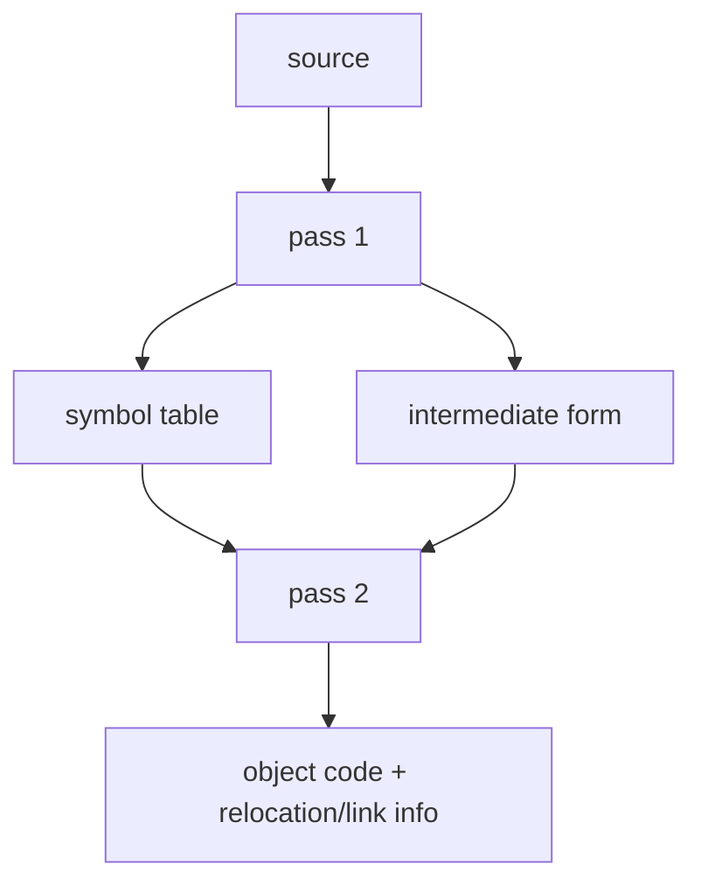
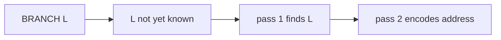
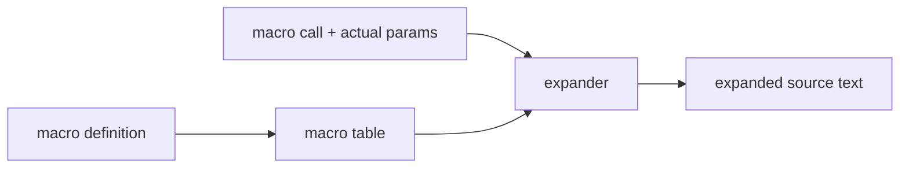
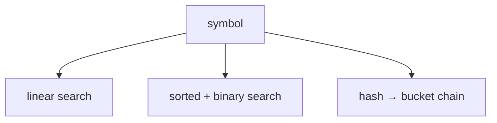
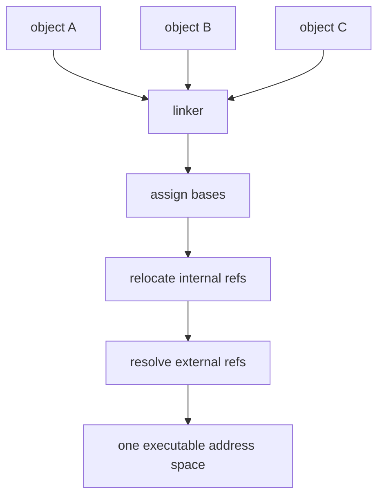
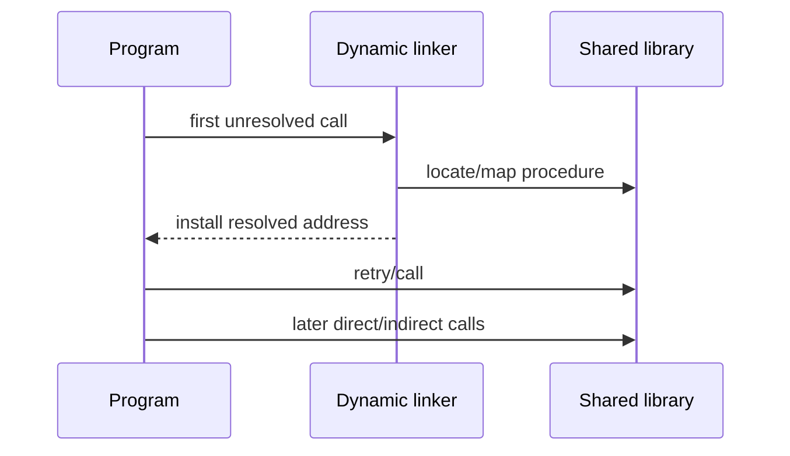
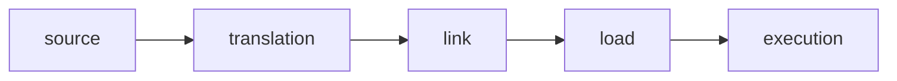

# Mermaid — глава 7 «Уровень ассемблера»

Источник: RAG `p0555:c01`–`p0589:c01`.

## 1. Translation

## 2. Two-pass assembler

## 3. Forward reference

## 4. Macro expansion

## 5. Symbol lookup

## 6. Linking

## 7. Dynamic linking

## 8. Binding time

Later binding increases relocation flexibility.
