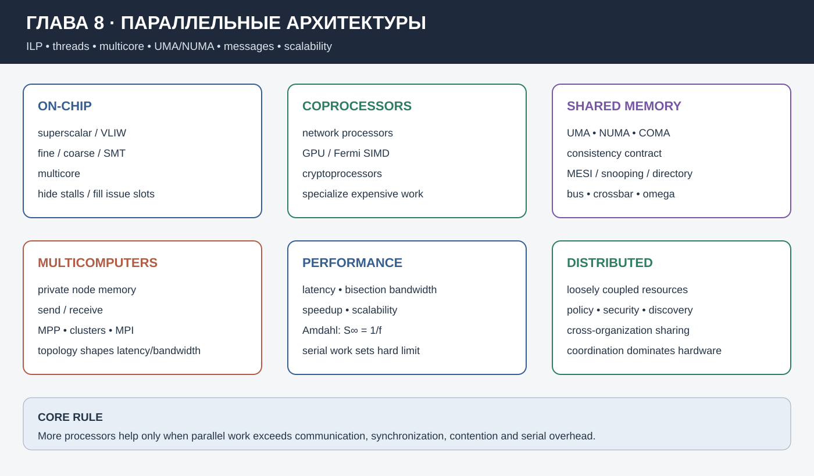
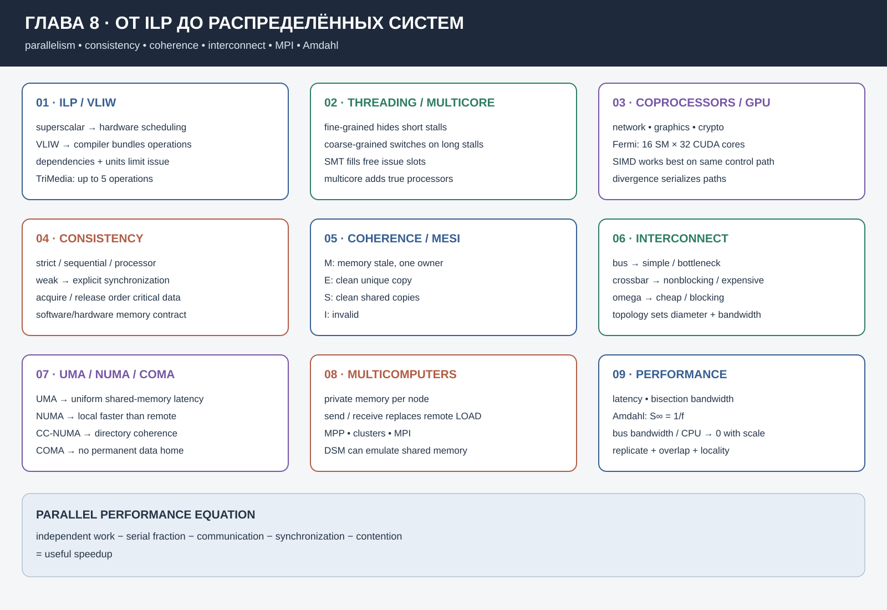

# Глава 8 — Параллельные компьютерные архитектуры

Эндрю С. Таненбаум, Тодд Остин — «Архитектура компьютера», 6-е издание.





## Идентификация и readiness

- Book ID: `computer-architecture-tanenbaum-austin-6e-ru`; inventory: `0006`.
- Chapter: **8. Параллельные компьютерные архитектуры**.
- Slug: `parallel-computer-architectures`.
- Canonical source: `source/book.pdf`.
- Source SHA-256: `11c1875711e29244f56f925c17cbe53cb625cf3dbd95a8a03d90c764aa453e75`.
- Book readiness: **READY**.
- RAG: `READY_WITH_KNOWN_LIMITATIONS`, legacy-compatible.
- Source policy: **rag_only**.

## Chapter boundary

- PDF pages: **590–698** inclusive.
- RAG chunks: **`p0590:c01`–`p0698:c01`**.
- TOC evidence: `p0012:c01`–`p0013:c01`.
- `p0590:c01` begins chapter 8.
- `p0694:c01` begins the explicit chapter summary.
- `p0696:c01`–`p0698:c01` contain **33** review questions/exercises.
- `p0699:c01` begins chapter 9 (bibliography).
- **Chapter boundary verified: YES.**

## Карта главы

| Раздел | PDF pages | Содержание |
|---|---:|---|
| Introduction | 590–592 | limits of frequency scaling and hierarchy of parallelism |
| Intraprocessor parallelism | 592–612 | superscalar/VLIW, TriMedia, fine/coarse/SMT, multicore |
| Coprocessors | 612–624 | network processors, NVIDIA Fermi GPU, cryptoprocessors |
| Multiprocessors | 624–655 | Flynn taxonomy, shared-memory semantics, UMA, MESI, crossbar/omega, NUMA, CC-NUMA, COMA |
| Multicomputers | 655–691 | message passing, topologies, MPP, clusters, MPI, scheduling, DSM/application-level shared memory, performance |
| Distributed computing | 691–694 | grid/resource-sharing model and security/services |
| Summary | 694–696 | parallelism hierarchy |
| Review | 696–698 | 33 exercises |

## Главная идея

**Рост производительности всё меньше достигается ускорением одного sequential execution stream и всё больше — одновременным выполнением независимой работы.**

```text
instruction-level parallelism
→ multithreading
→ multicore
→ coprocessors
→ shared-memory multiprocessors
→ message-passing multicomputers
→ distributed/grid computing
```

Чем выше уровень, тем слабее coupling, больше latency и важнее software coordination.

## Основные идеи

1. **ILP extracts parallel work inside one instruction stream.** Superscalar hardware schedules dynamically; VLIW shifts compatibility/scheduling work toward the compiler.

2. **TriMedia demonstrates explicit multi-operation issue.** Up to five operations share one VLIW command, but slot/function compatibility must be respected.

3. **Fine-grained multithreading rotates between threads to hide stalls.** It spends register/context resources to keep the pipeline busy.

4. **Coarse-grained multithreading switches mainly on long stalls.** It needs fewer active contexts but loses cycles during switches/flushes.

5. **Simultaneous multithreading fills unused issue slots with operations from another thread.** Core i7 Hyper-Threading is the practical chapter example.

6. **Multicore creates actual parallel processors on one die.** Shared caches/interconnects become central scalability constraints.

7. **Coprocessors specialize.** Network, GPU and cryptographic accelerators offload high-cost domains from the main CPU.

8. **Fermi uses SIMD-style execution inside streaming multiprocessors.** Divergent thread control paths reduce parallel efficiency.

9. **Flynn taxonomy separates SISD/SIMD/MIMD.** The chapter further splits MIMD into shared-memory multiprocessors and message-passing multicomputers.

10. **Memory consistency is a software/hardware contract.** Strict, sequential, processor, weak and release-like models trade programmer simplicity against implementation freedom.

11. **Cache coherence is distinct from memory consistency.** Snooping/write-through/MESI keep replicas of a cache line from becoming inconsistent.

12. **MESI states encode ownership and freshness:** Modified, Exclusive, Shared, Invalid.

13. **Shared-bus UMA does not scale far.** A common bus becomes the throughput bottleneck as processor count grows.

14. **Crossbar is nonblocking but expensive.** Omega/multistage networks use far fewer switches but may block.

15. **NUMA preserves one shared address space while making local memory faster than remote memory.**

16. **NC-NUMA avoids cache-coherence complexity but pays remote-memory latency directly.**

17. **CC-NUMA uses coherent caches and directories.** Directory metadata trades memory overhead for scalable coherence.

18. **COMA removes fixed home locations for data.** Main memory behaves like a large migrating cache.

19. **Multicomputers remove hardware shared memory.** Nodes communicate using `send`/`receive`, changing the programming model.

20. **Network topology determines degree, diameter, bisection bandwidth and fault tolerance.**

21. **MPI standardizes message-passing communication.** Communicators, datatypes, operations and virtual topologies form its core model.

22. **Application-level shared memory can emulate shared-memory programming over multicomputers.** DSM does so at page granularity; Linda/Orca/Globe expose higher-level shared abstractions.

23. **Amdahl's law bounds speedup by the sequential fraction.** More processors cannot accelerate work that remains serial.

24. **Scalability requires avoiding new bottlenecks.** Aggregate bandwidth should grow with processor count while latency should grow as slowly as possible.

25. **Replication, locality and overlapping communication with computation are key latency-hiding techniques.**

26. **Distributed/grid systems are the loosest coupling level.** Resource ownership, policy, security and interoperability dominate the architecture.

## Operational mental model

```text
parallel workload
→ where is independence?
→ what is the sharing model?
→ what communication path exists?
→ what ordering/coherence contract applies?
→ where can contention occur?
→ what is latency / bandwidth / synchronization cost?
→ what serial fraction remains?
```

## Артефакты

- [cheatsheet.md](cheatsheet.md)
- [commands.md](commands.md)
- [diagram.md](diagram.md)
- [visual-cheatsheet.svg](visual-cheatsheet.svg)
- [visual-cheatsheet-detailed.svg](visual-cheatsheet-detailed.svg)
- [summary.md](summary.md)
- [review-questions.md](review-questions.md)
- [review-answers.md](review-answers.md)
- [source-findings.md](source-findings.md)

## Ограничения

- Figure-specific routing questions are not reconstructed beyond what textual RAG exposes.
- Historical hardware performance/count claims are preserved as source content, not updated externally.
- Numeric review results are derived only from chapter-provided parameters.
