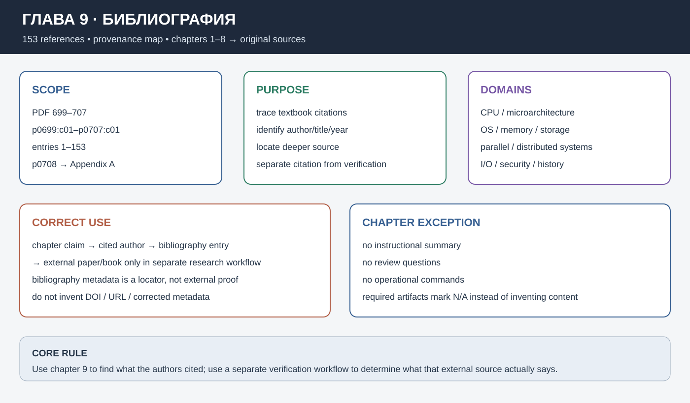
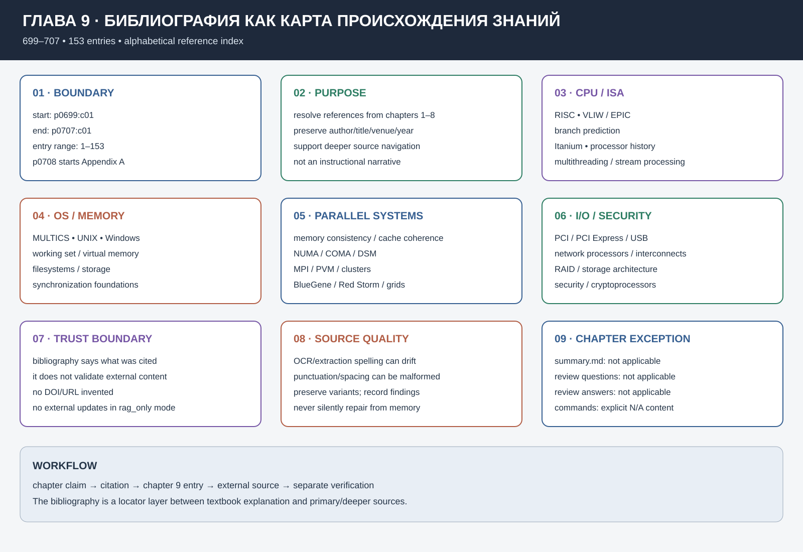

# Глава 9 — Библиография

Эндрю С. Таненбаум, Тодд Остин — «Архитектура компьютера», 6-е издание.





## Идентификация и readiness

- Book ID: `computer-architecture-tanenbaum-austin-6e-ru`; inventory: `0006`.
- Chapter: **9. Библиография**.
- Slug: `bibliography`.
- Canonical source: `source/book.pdf`.
- Source SHA-256: `11c1875711e29244f56f925c17cbe53cb625cf3dbd95a8a03d90c764aa453e75`.
- Book readiness: **READY**.
- RAG: `READY_WITH_KNOWN_LIMITATIONS`, legacy-compatible.
- Source policy: **rag_only**.

## Chapter boundary

- PDF pages: **699–707** inclusive.
- RAG chunks: **`p0699:c01`–`p0707:c01`**.
- TOC evidence: `p0013:c01`.
- `p0699:c01` begins chapter 9.
- `p0707:c01` contains bibliography entries 139–153.
- `p0708:c01` begins Appendix A.
- Total bibliography entries: **153**.
- **Chapter boundary verified: YES.**

## Nature of this chapter

This is not a normal instructional chapter. The source explicitly defines it as an **alphabetical list of all books and articles referenced by the book**.

Therefore:

- no chapter-end summary exists;
- no review questions/exercises exist;
- no review answers are created;
- no operational commands are present;
- analysis focuses on bibliography structure, provenance and thematic navigation.

## What the bibliography covers

The references span the same domains developed across the book, including:

- computer architecture and microarchitecture;
- RISC/CISC, VLIW/EPIC and branch prediction;
- operating systems, virtual memory and filesystems;
- shared-memory multiprocessors and cache coherence;
- memory-consistency models;
- NUMA/COMA and distributed shared memory;
- message passing, MPI/PVM and clusters;
- grids/distributed computing;
- GPUs, stream processors and multithreading;
- network processors and interconnects;
- cryptoprocessors and security;
- storage, RAID and I/O buses;
- historical systems and architecture history.

## Representative source anchors

These are examples from the bibliography itself, not external recommendations.

| Topic | Example bibliography entries |
|---|---|
| Memory consistency | Adve & Hill; Lamport; Sorin, Hill & Wood |
| Cache coherence | Goodman; Papamarcos & Patel; Sorin, Hill & Wood |
| Virtual memory / working set | Denning; Fotheringham |
| Operating systems | Corbató & Vyssotsky; Ritchie & Thompson; McKusick et al.; Russinovich & Solomon |
| RISC / processor design | Patterson; Patterson & Séquin; Radin; Hennessy |
| Parallel/distributed systems | Bal; Geist et al.; Gropp et al.; Snir et al.; Sunderram |
| NUMA / DSM | LaRowe & Ellis; Li & Hudak; Kontothanassis et al.; Stets et al. |
| Large-scale systems | BlueGene papers; Red Storm papers; Google File System |
| Security / crypto | Kaufman et al.; Gaspar et al.; Haghighizadeh et al.; Shoufan et al. |
| Interconnects / I/O | PCI/PCIe/USB references; Charlesworth; Mayhew & Krishnan |

## Main principle

**The bibliography is a provenance map for the technical claims in chapters 1–8.**

Use it to move from textbook-level explanation to the original or deeper source named by the authors.

```text
textbook claim
→ cited reference number / author
→ bibliography entry
→ original paper/book
→ deeper verification or historical context
```

## Recommended use inside biblioteka-vsp

1. Start from the chapter artifact where a concept is learned.
2. Identify the cited author/reference in the canonical RAG.
3. Locate the corresponding bibliography entry here.
4. Treat the bibliography metadata as a locator, not as proof of the external document's current availability or correctness.
5. External retrieval/verification is a separate workflow and is not performed under this `rag_only` chapter analysis.

## Conditional artifacts

| Artifact | Status | Reason |
|---|---|---|
| `summary.md` | [Not applicable] | no explicit chapter-end summary in source |
| `review-questions.md` | [Not applicable] | no review section |
| `review-answers.md` | [Not applicable] | no review questions |
| `source-findings.md` | Present | bibliography RAG contains wording/extraction inconsistencies |

## Artifacts

- [cheatsheet.md](cheatsheet.md)
- [commands.md](commands.md)
- [diagram.md](diagram.md)
- [visual-cheatsheet.svg](visual-cheatsheet.svg)
- [visual-cheatsheet-detailed.svg](visual-cheatsheet-detailed.svg)
- [source-findings.md](source-findings.md)

## Limitations

- Bibliographic entries are preserved from canonical RAG; they are not externally validated.
- Apparent spelling/punctuation defects are not silently corrected.
- No claim is made that referenced works are freely available online.
- No DOI/URL metadata is invented when absent from source.
