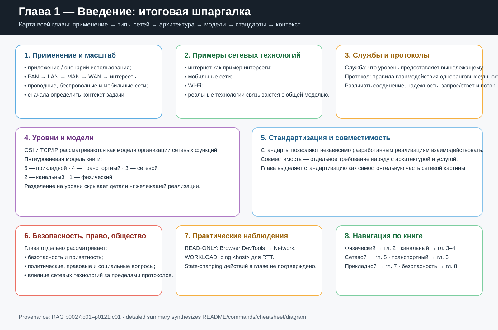
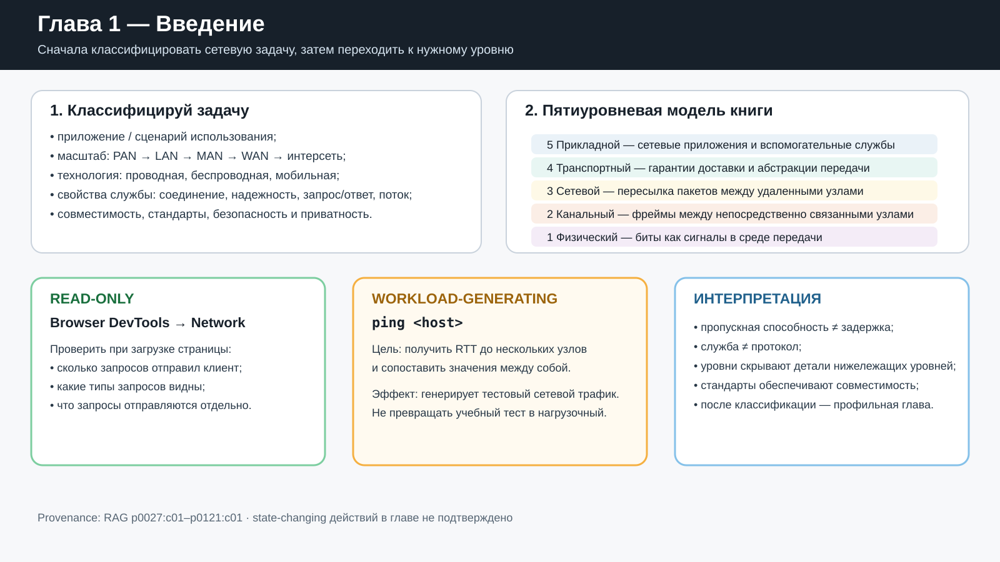

# Глава 1 — Введение

Практические заметки по главе 1 книги «Компьютерные сети», 6-е издание.

Содержимое:

- [commands.md](commands.md) — команды и наблюдательные инструменты, явно подтвержденные RAG.
- [cheatsheet.md](cheatsheet.md) — шпаргалка для первичной декомпозиции сетевой задачи по понятиям главы.
- [diagram.md](diagram.md) — Mermaid-схема, отделяющая логику главы от диагностических ветвей, которых в источнике нет.
- [visual-cheatsheet-detailed.svg](visual-cheatsheet-detailed.svg) — итоговая визуальная шпаргалка всей главы.
- [visual-cheatsheet.svg](visual-cheatsheet.svg) — компактная визуальная шпаргалка главы.
- [summary.md](summary.md) — краткое резюме главы из заключительного раздела книги.
- [review-questions.md](review-questions.md) — контрольные вопросы и задачи из конца главы.
- [review-answers.md](review-answers.md) — RAG-grounded ответы и решения к контрольным вопросам; не официальный ключ издательства.

## Scope

Материалы составлены только по RAG-фрагментам главы 1.

Provenance: `p0027:c01`–`p0121:c01` (PDF pages 27–121; печатные страницы 26–120).

Граница проверена: `p0026:c01` относится к разделу «От издательства», а `p0122:c01` уже начинает главу 2 «Физический уровень».

## Карта главы

- 1.1 — применение компьютерных сетей;
- 1.2 — типы компьютерных сетей;
- 1.3 — сетевые технологии от персональных до глобальных;
- 1.4 — интернет, мобильные сети и Wi-Fi как примеры;
- 1.5 — цели проектирования, уровни, соединения, службы и протоколы;
- 1.6 — OSI, TCP/IP и пятиуровневая модель, используемая в книге;
- 1.7 — стандартизация;
- 1.8 — политические, правовые и социальные проблемы;
- 1.9 — единицы измерения;
- 1.10 — обзор следующих глав;
- 1.11 — резюме.

## Основной принцип

Сетевую систему полезно рассматривать через несколько независимых осей: назначение и масштаб сети, используемую технологию, уровень протокольной архитектуры, свойства предоставляемой службы и требования совместимости/стандартизации. Разделение на уровни позволяет скрывать детали реализации нижележащих уровней и разбирать сложную сетевую систему как набор меньших задач.

## Ограничение

Глава 1 — обзорная, а не operational-runbook по диагностике. Она не задает универсальный workflow CPU/memory/storage tuning и не содержит state-changing команд. В артефактах такие действия не добавляются.
