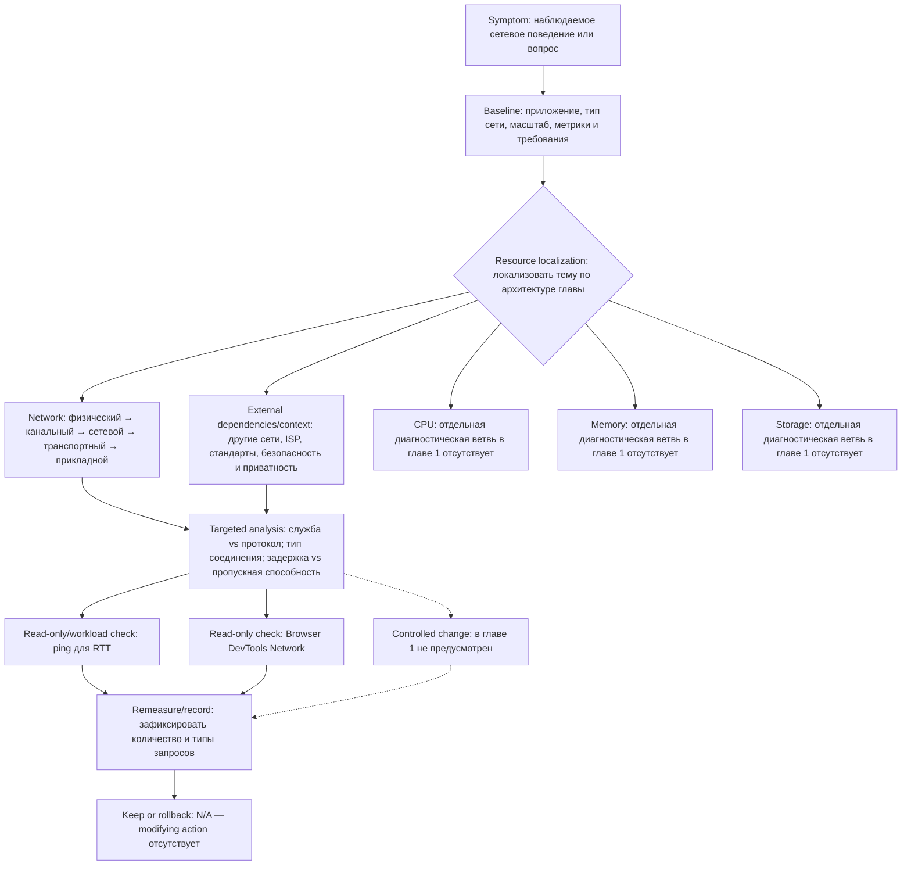

# Диаграмма: декомпозиция сетевого вопроса по главе 1

Шаблон артефактов требует узлы CPU, memory и storage. Глава 1 не использует их как отдельные диагностические ветви, поэтому они отмечены как неприменимые и не снабжены вымышленными проверками.

## Смысл диаграммы

Рабочая логика главы — классифицировать сеть и функцию по масштабу, технологии, службам и уровням, а затем переходить к соответствующему уровню архитектуры. CPU, memory, storage, controlled change и rollback не представлены в главе как части диагностической методологии; они сохранены только как обязательные узлы шаблона и явно помечены как неприменимые.
