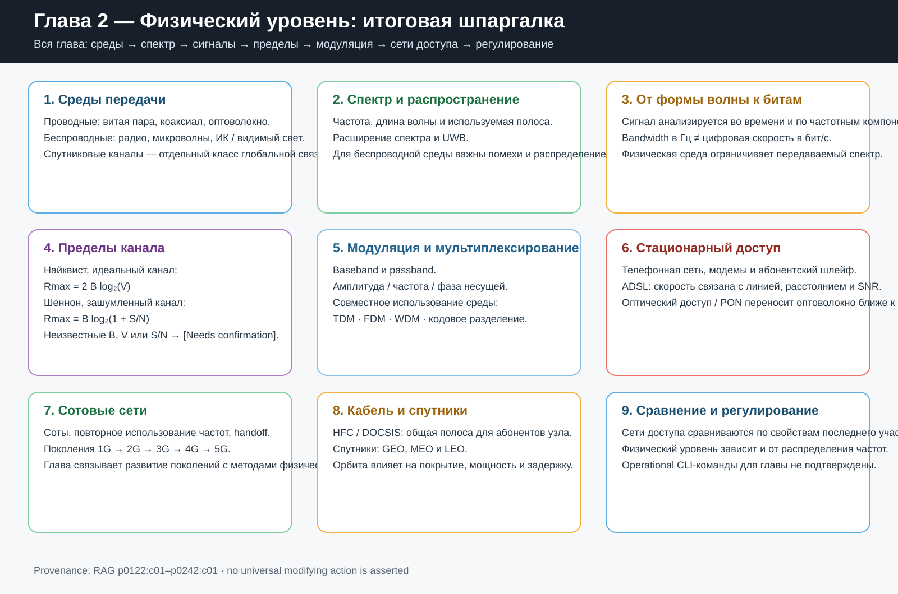
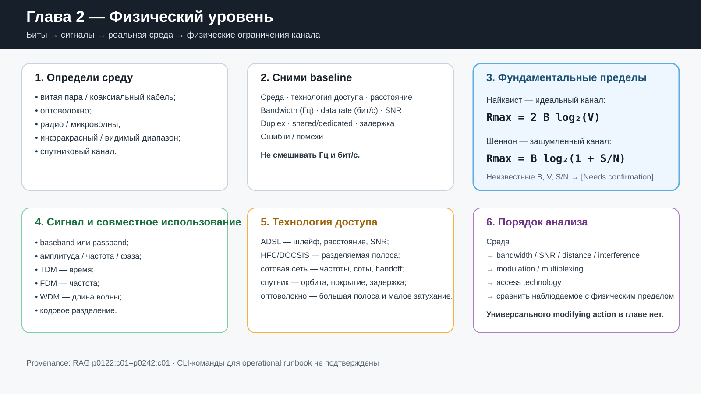

# Глава 2 — Физический уровень

Практические заметки по главе 2 книги «Компьютерные сети», 6-е издание.

Содержимое:

- [commands.md](commands.md) — таблица CLI-команд; для этой главы подтвержденных CLI-вызовов не найдено.
- [cheatsheet.md](cheatsheet.md) — шпаргалка для локализации ограничений физического канала.
- [diagram.md](diagram.md) — Mermaid-диаграмма диагностической декомпозиции по логике главы.
- [visual-cheatsheet-detailed.svg](visual-cheatsheet-detailed.svg) — итоговая визуальная шпаргалка всей главы.
- [visual-cheatsheet.svg](visual-cheatsheet.svg) — компактная визуальная шпаргалка главы.

## Scope

Материалы составлены только по RAG-фрагментам главы 2.

Provenance: `p0122:c01`–`p0242:c01` (PDF pages 122–242; печатные страницы 121–241).

Граница проверена: `p0121:c01` завершает главу 1, а `p0243:c01` начинает главу 3 «Канальный уровень».

## Карта главы

- 2.1 — проводные среды передачи: носители, витая пара, коаксиальный кабель, оптоволокно;
- 2.2 — беспроводная передача: спектр, расширение спектра, UWB;
- 2.3 — использование спектра: радио, микроволны, инфракрасный и видимый диапазоны;
- 2.4 — переход от форм волн к битам: теория сигналов, пределы Найквиста и Шеннона, цифровая модуляция, мультиплексирование;
- 2.5 — коммутируемая телефонная сеть: абонентские шлейфы, модемы, ADSL, оптоволокно, соединительные линии и коммутация;
- 2.6 — сотовые сети: соты, handoff, поколения 1G–5G;
- 2.7 — кабельные сети: HFC, DOCSIS и совместное использование ресурса;
- 2.8 — спутниковая связь: GEO, MEO и LEO;
- 2.9 — сравнение сетей доступа;
- 2.10 — нормативное регулирование физического уровня;
- 2.11 — резюме.

## Основной принцип

Физический уровень определяет, как биты представляются сигналами и проходят по реальной среде. Доступная скорость, задержка и вероятность ошибок зависят от физических свойств канала: полосы пропускания, шума/SNR, расстояния, среды передачи, способа модуляции и мультиплексирования, а для беспроводных систем — также от распределения спектра и взаимных помех.

Законы природы задают фундаментальные ограничения: предел Найквиста для идеального канала и предел Шеннона для зашумленного канала. Архитектура доступа может добавлять собственные ограничения, например совместное использование полосы в кабельной сети, зависимость ADSL от параметров абонентского шлейфа или задержку спутникового пути.

## Ограничение

Глава не является CLI-runbook и не задает универсальных state-changing действий для устранения физического bottleneck. Поэтому команды, tuning и rollback из общих знаний в артефакты не добавляются.
