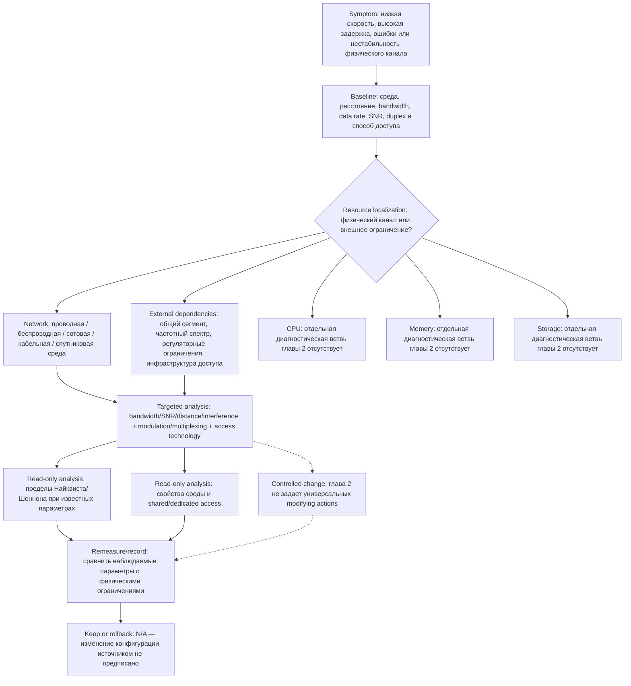

# Диаграмма: локализация физического ограничения

Обязательные узлы CPU, memory и storage сохранены по шаблону, но глава 2 не использует их как ветви диагностики физического уровня. Они явно помечены как неприменимые.

## Смысл диаграммы

Логика главы начинается с самой физической среды. Сначала фиксируются свойства канала, затем проверяются фундаментальные ограничения, способ модуляции/мультиплексирования и архитектура доступа. Переход к изменению конфигурации глава не задает; поэтому controlled change и rollback не превращаются в выдуманный tuning.
