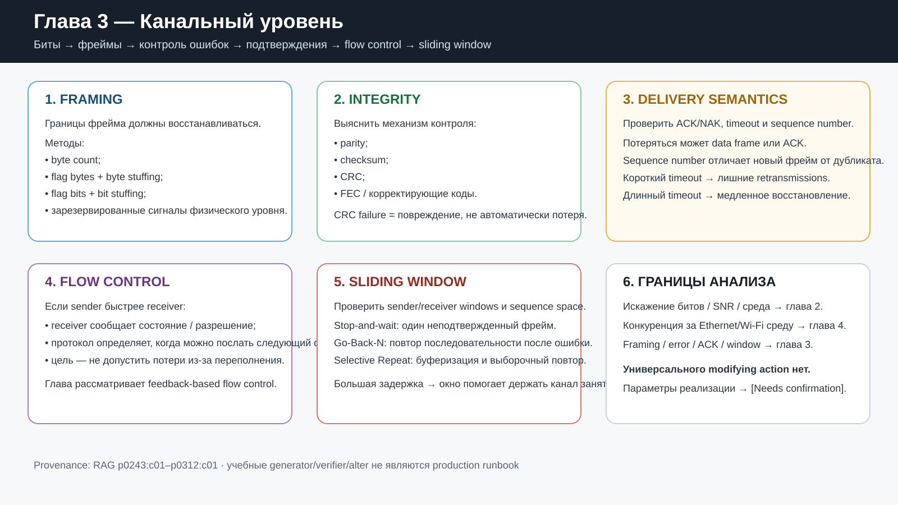

# Глава 3 — Канальный уровень

Практические заметки по главе 3 книги «Компьютерные сети», 6-е издание.

Содержимое:

- [commands.md](commands.md) — operational-команды, подтвержденные RAG; точные shell-команды в этой главе не выделены.
- [cheatsheet.md](cheatsheet.md) — шпаргалка для локализации проблем framing/error control/flow control/sliding window.
- [diagram.md](diagram.md) — Mermaid-диаграмма диагностической декомпозиции по логике главы.
- [visual-cheatsheet.svg](visual-cheatsheet.svg) — визуальная шпаргалка главы.

## Scope

Материалы составлены только по RAG-фрагментам главы 3.

Provenance: `p0243:c01`–`p0312:c01` (PDF pages 243–312; печатные страницы 242–311).

Граница проверена: `p0242:c01` завершает главу 2, а `p0313:c01` начинает главу 4 «Подуровень управления доступом к среде».

## Карта главы

- 3.1 — ключевые вопросы канального уровня: службы сетевому уровню, формирование фреймов, обработка ошибок и управление потоком;
- 3.2 — обнаружение и коррекция ошибок: корректирующие коды, parity/checksum/CRC;
- 3.3 — элементарные протоколы передачи данных;
- 3.4 — повышение эффективности: двунаправленная передача, вложенные подтверждения, раздвижные окна, Go-Back-N и Selective Repeat;
- 3.5 — практическое применение: PPP поверх SONET, ADSL и DOCSIS;
- 3.6 — резюме и задачи.

## Основной принцип

Канальный уровень превращает необработанный поток битов физического уровня в поток фреймов для сетевого уровня. Его основные задачи — надежно определять границы фреймов, обнаруживать или исправлять повреждения, предотвращать дубликаты и нарушение порядка при повторной передаче, а также согласовывать скорость отправителя и получателя.

Надежность достигается сочетанием контрольной информации, подтверждений, таймеров, порядковых номеров и повторной передачи. Эффективность на каналах с заметной задержкой повышается за счет конвейерной передачи нескольких фреймов и протоколов раздвижного окна.

## Практический фокус

При анализе канального уровня важно различать:

1. framing — корректно ли определяются начало и конец фрейма;
2. integrity — проходит ли контрольная сумма/CRC;
3. delivery semantics — потерян ли фрейм, пришел ли дубликат, сохранен ли порядок;
4. flow control — не передает ли отправитель быстрее, чем способен принимать получатель;
5. efficiency — не простаивает ли канал из-за слишком малого окна, чрезмерных тайм-аутов или повторных передач.

## Ограничение

Глава содержит псевдокод протоколов и учебное упражнение с программами `generator`, `verifier` и `alter`, но не задает готового эксплуатационного CLI-runbook. В RAG строки shell pipeline повреждены OCR, поэтому они не нормализуются в canonical commands без подтверждения исходного символа.
