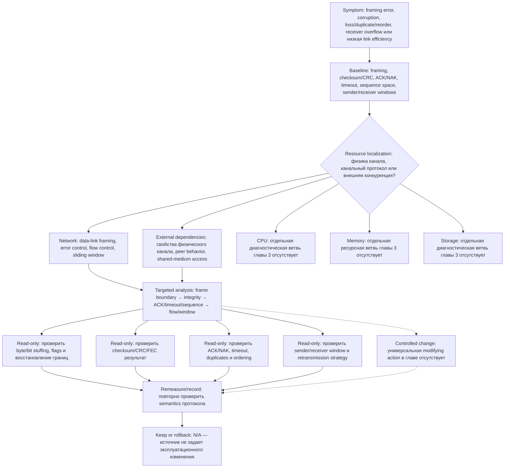

# Диаграмма: диагностика канального уровня

CPU, memory и storage сохранены как обязательные узлы schema, но глава 3 не рассматривает их как независимые bottleneck-ветви. Они отмечены как неприменимые.

## Смысл диаграммы

Диагностика следует структуре главы: сначала определить корректность framing, затем целостность фрейма, после этого проверить подтверждения/таймеры/порядковые номера и только затем — flow control и эффективность sliding window. Проблемы физической среды относятся к главе 2, а конкуренция за общую среду — к главе 4.
