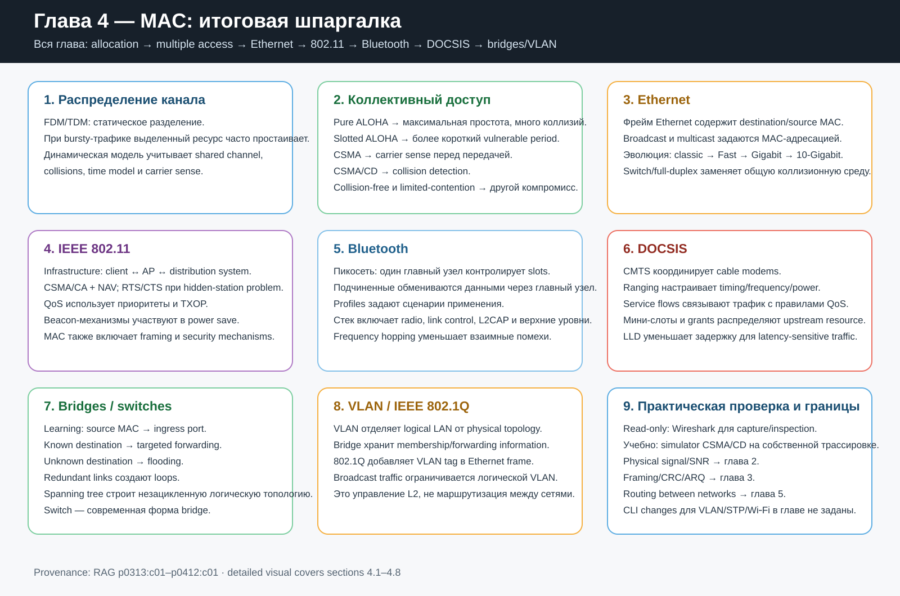
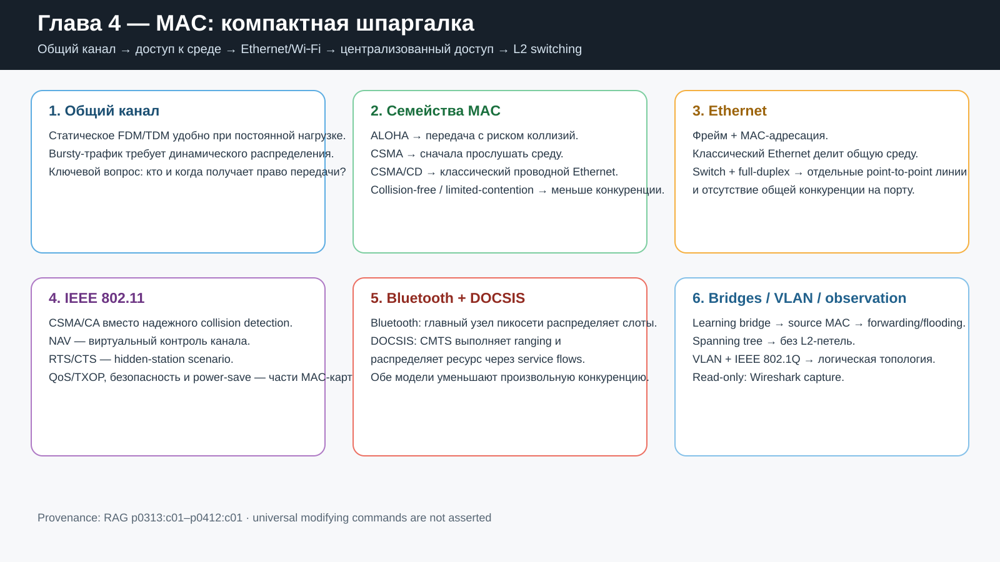

# Глава 4 — Подуровень управления доступом к среде

Практические и концептуальные заметки по главе 4 книги «Компьютерные сети», 6-е издание.

Содержимое:

- [commands.md](commands.md) — подтвержденные RAG инструменты наблюдения и учебные активности.
- [cheatsheet.md](cheatsheet.md) — quick-reference по распределению общего канала, Ethernet, 802.11, Bluetooth, DOCSIS, мостам и VLAN.
- [diagram.md](diagram.md) — Mermaid-карта логики главы.
- [visual-cheatsheet-detailed.svg](visual-cheatsheet-detailed.svg) — итоговая визуальная шпаргалка всей главы.
- [visual-cheatsheet.svg](visual-cheatsheet.svg) — компактная визуальная шпаргалка главы.
- [summary.md](summary.md) — краткое резюме главы из заключительного раздела книги.
- [review-questions.md](review-questions.md) — контрольные вопросы и задачи из конца главы.
- [review-answers.md](review-answers.md) — RAG-grounded ответы и решения к контрольным вопросам; не официальный ключ издательства.

## Scope

Материалы составлены только по RAG-фрагментам главы 4.

Provenance: `p0313:c01`–`p0412:c01` (PDF pages 313–412; печатные страницы 312–411).

Boundary evidence:

- `p0312:c01` — вопросы и задачи главы 3;
- `p0313:c01` — начало главы 4 «Подуровень управления доступом к среде»;
- `p0412:c01` — последние задачи главы 4;
- `p0413:c01` — начало главы 5 «Сетевой уровень».

## Карта главы

- 4.1 — проблема распределения общего канала: статическое и динамическое распределение;
- 4.2 — протоколы коллективного доступа: ALOHA, CSMA, CSMA/CD, бесколлизионные и ограниченно-конкурентные схемы;
- 4.3 — Ethernet: форматы фреймов, MAC-адреса, классический/Fast/Gigabit/10-Gigabit Ethernet и переход к коммутации;
- 4.4 — беспроводные LAN IEEE 802.11: архитектура, физические варианты, CSMA/CA, RTS/CTS, NAV, QoS/TXOP, структура фрейма, безопасность и управление питанием;
- 4.5 — Bluetooth: пикосети, профили, стек протоколов, радиоуровень, соединения и фреймы;
- 4.6 — DOCSIS: MAC-подуровень, ranging, service flows и распределение полосы;
- 4.7 — коммутация на канальном уровне: мосты/коммутаторы, обучение, spanning tree, VLAN и IEEE 802.1Q;
- 4.8 — резюме.

## Анализ главы

Главная проблема MAC-подуровня — определить, кто получает право передачи, когда один канал делят несколько станций. Статическое деление вроде FDM/TDM подходит для постоянной нагрузки, но при неравномерном компьютерном трафике значительная часть ресурса может простаивать. Поэтому глава переходит к динамическим схемам.

Конкурентные протоколы позволяют станциям бороться за канал. ALOHA демонстрирует простейший вариант; carrier-sense схемы уменьшают число коллизий, проверяя занятость канала. CSMA/CD используется как модель классического проводного Ethernet. Бесколлизионные и limited-contention протоколы показывают другой компромисс: больше управляющей структуры в обмен на предсказуемость и эффективность при высокой нагрузке.

Ethernet в главе рассматривается не только как формат фрейма и MAC-адресация, но и как эволюция топологии: от общего коаксиального канала и концентраторов к двухточечным линиям и коммутаторам. Современные коммутаторы и полнодуплексные линии устраняют конкуренцию между станциями на отдельных портах.

Для 802.11 проблема сложнее: беспроводные станции не всегда слышат друг друга и не могут столь же надежно обнаруживать коллизии во время передачи. Поэтому используются CSMA/CA, виртуальный контроль канала через NAV и, при необходимости, RTS/CTS. Глава также связывает MAC с QoS/TXOP, безопасностью и энергосбережением.

Bluetooth и DOCSIS иллюстрируют более централизованное распределение среды. В Bluetooth главный узел пикосети контролирует временные слоты; в DOCSIS головная станция CMTS участвует в ranging и выделении ресурса service flows.

Последняя большая тема — организация LAN с помощью мостов и коммутаторов. Learning bridge определяет, на каком порту находится источник, flooding применяется при неизвестном назначении, spanning tree устраняет циклы в резервной топологии, а VLAN отделяют логическую структуру от физической. IEEE 802.1Q добавляет информацию VLAN во фреймы Ethernet.

## Основной принцип

MAC — это не один универсальный алгоритм, а набор стратегий распределения общего ресурса. Правильная модель зависит от свойств среды, нагрузки и топологии: конкуренция полезна при одних условиях, централизованное или бесколлизионное распределение — при других, а коммутируемые полнодуплексные LAN могут вообще устранить конкуренцию на отдельных линиях.

## Ограничение

Глава не является конфигурационным runbook для Linux, Ethernet-коммутатора или Wi-Fi AP. Она не предоставляет универсальных CLI-команд для изменения VLAN, bridge/STP, Wi-Fi или DOCSIS. Такие команды из общих знаний не добавляются.
