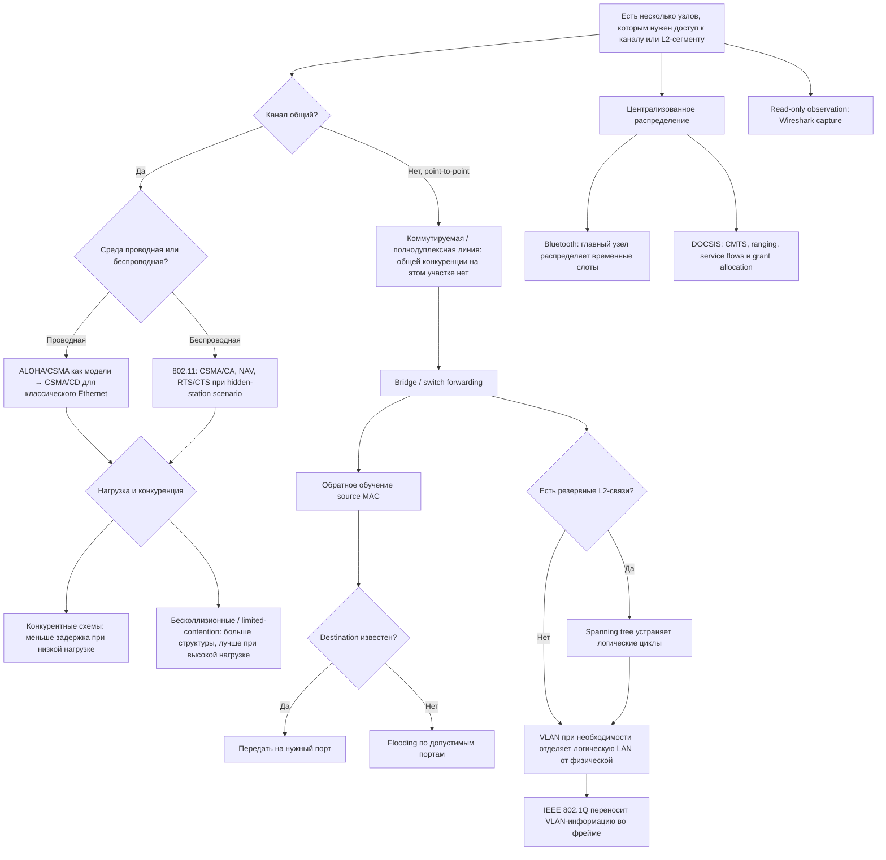

# Диаграмма: логика главы 4

Диаграмма отражает логику главы: сначала определяется модель доступа к среде, затем конкретная MAC-технология, а для коммутируемых LAN — правила forwarding, loop prevention и логическое разделение VLAN.
