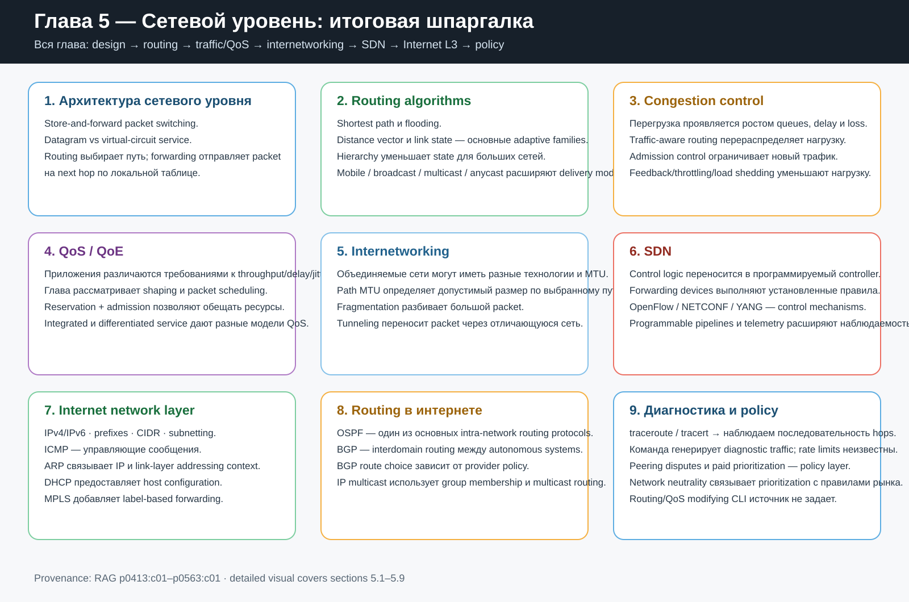
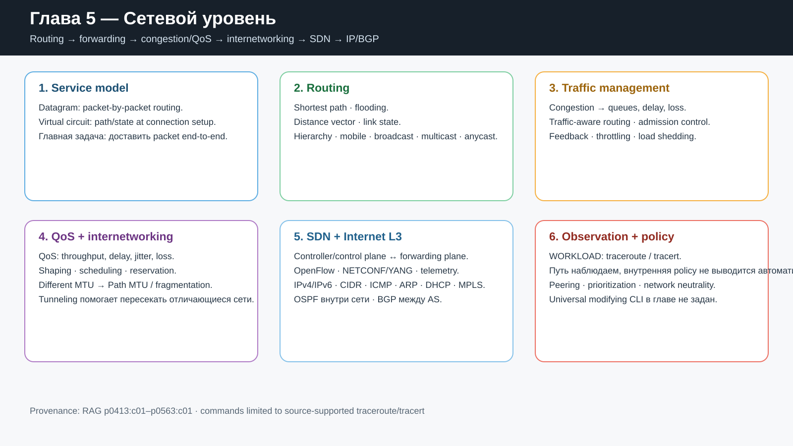

# Глава 5 — Сетевой уровень

Практические и концептуальные заметки по главе 5 книги «Компьютерные сети», 6-е издание.

Содержимое:

- [commands.md](commands.md) — подтвержденные RAG инструменты наблюдения и учебные активности.
- [cheatsheet.md](cheatsheet.md) — quick-reference по маршрутизации, congestion/QoS, internetworking, SDN и интернет-протоколам сетевого уровня.
- [diagram.md](diagram.md) — Mermaid-карта логики главы.
- [visual-cheatsheet-detailed.svg](visual-cheatsheet-detailed.svg) — итоговая визуальная шпаргалка всей главы.
- [visual-cheatsheet.svg](visual-cheatsheet.svg) — компактная визуальная шпаргалка главы.
- [summary.md](summary.md) — краткое резюме главы из заключительного раздела книги.
- [review-questions.md](review-questions.md) — контрольные вопросы и задачи из конца главы.
- [review-answers.md](review-answers.md) — RAG-grounded ответы и решения к контрольным вопросам; не официальный ключ издательства.

## Scope

Материалы составлены только по RAG-фрагментам главы 5.

Provenance: `p0413:c01`–`p0563:c01` (PDF pages 413–563; печатные страницы 412–562).

Boundary evidence:

- `p0412:c01` — последние задачи главы 4;
- `p0413:c01` — начало главы 5 «Сетевой уровень»;
- `p0563:c01` — последние задачи главы 5;
- `p0564:c01` — начало главы 6 «Транспортный уровень».

## Карта главы

- 5.1 — вопросы разработки сетевого уровня: store-and-forward, службы транспортному уровню, дейтаграммные сети и виртуальные каналы;
- 5.2 — алгоритмы маршрутизации внутри одной сети: кратчайшие пути, flooding, distance vector, link state, иерархия, мобильные хосты, broadcast/multicast/anycast;
- 5.3 — управление трафиком: перегрузка, traffic-aware routing, admission control, throttling и обратная связь;
- 5.4 — QoS и QoE приложений: traffic shaping, scheduling, reservation и дифференцированное обслуживание;
- 5.5 — межсетевое взаимодействие: объединение неоднородных сетей, tunneling, fragmentation и Path MTU;
- 5.6 — программно-конфигурируемые сети: разделение логики управления и пересылки, контроллеры, OpenFlow/NETCONF/YANG, программируемые pipelines и telemetry;
- 5.7 — сетевой уровень интернета: IPv4/IPv6, адресация и CIDR, ICMP, ARP, DHCP, MPLS, OSPF, BGP и multicast;
- 5.8 — политика сетевого уровня: peering, paid prioritization и network neutrality;
- 5.9 — резюме.

## Анализ главы

Сетевой уровень — самый нижний уровень, который решает задачу доставки по всему пути от отправителя к получателю через потенциально множество маршрутизаторов. Он должен связывать forwarding конкретного пакета с более общей задачей routing: выбором и поддержанием путей в сети.

Глава начинает с двух моделей службы. В дейтаграммной сети каждый пакет маршрутизируется независимо и содержит полный адрес назначения. В сети виртуальных каналов путь выбирается при установлении соединения, а последующие пакеты используют идентификатор канала. Эти модели отличаются требованиями к состоянию маршрутизаторов, поведением при отказах и возможностями предварительного резервирования ресурсов.

Далее глава систематизирует routing algorithms. Помимо flooding, основными адаптивными подходами являются distance-vector и link-state routing. По мере роста сети появляется необходимость в иерархии; отдельно рассматриваются mobile routing, broadcast, multicast и anycast.

Маршрутизация сама по себе не предотвращает перегрузку. Глава выделяет congestion как состояние, в котором нагрузка превышает возможности сети и растут очереди, задержки и потери. В ответ применяются traffic-aware routing, admission control, feedback источнику, throttling и сброс нагрузки. После контроля перегрузки можно обсуждать QoS/QoE: shaping, scheduling, reservation и differentiated treatment для разных потоков.

Межсетевое взаимодействие добавляет проблемы неоднородности. Разные сети могут иметь разные MTU и внутренние механизмы. Глава рассматривает fragmentation, Path MTU и tunneling как способы преодоления части различий.

SDN выносит больше логики управления в программный контроллер и отделяет ее от dataplane. В главе рассматриваются OpenFlow, NETCONF/YANG, программируемые match-action pipelines и programmable telemetry как способы более непосредственного управления пересылкой и наблюдения за сетью.

Большая часть второй половины главы посвящена интернету: IPv4 и IPv6, префиксам/CIDR и подсетям, ARP/DHCP/ICMP, MPLS, OSPF и BGP. Для BGP подчеркивается роль политики провайдера при выборе междоменного маршрута. Завершается глава вопросами peering, prioritization и network neutrality.

## Основной принцип

Сетевой уровень связывает три разные задачи: найти путь, переслать пакет по выбранному пути и управлять сетевыми ресурсами так, чтобы нагрузка и требуемое качество обслуживания оставались приемлемыми. Routing, forwarding, congestion control, QoS и interdomain policy взаимосвязаны, но не являются одним и тем же механизмом.

## Ограничение

Глава содержит алгоритмы, протоколы и примеры конфигурационной логики, но не предоставляет универсальный operational CLI-runbook для изменения routing tables, BGP/OSPF, QoS или SDN. Такие команды из общих знаний не добавляются.
