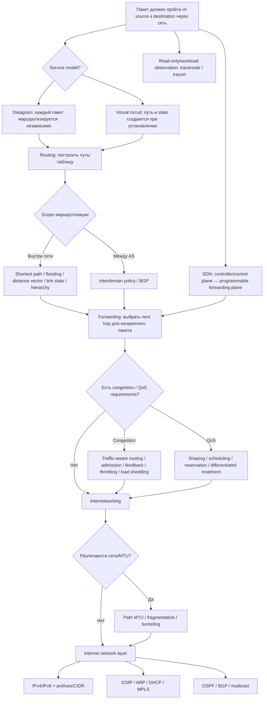

# Диаграмма: логика главы 5

Диаграмма разделяет service model, route computation, packet forwarding, traffic management, internetworking и конкретные интернет-протоколы, как это делает сама глава.
