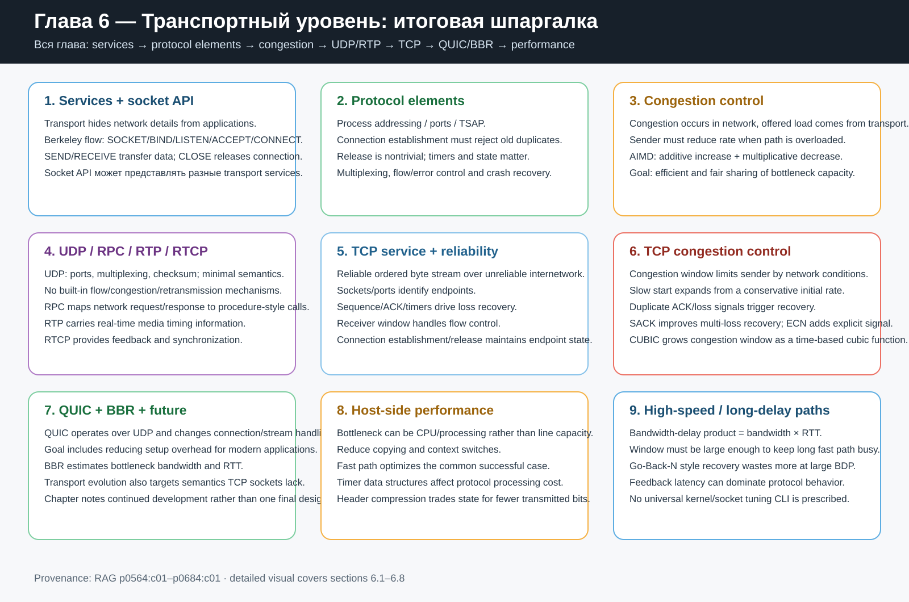
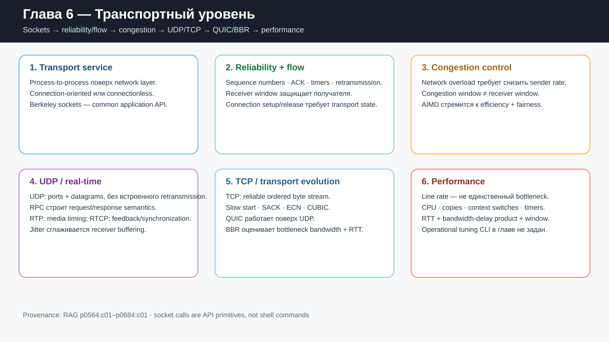

# Глава 6 — Транспортный уровень

Практические и концептуальные заметки по главе 6 книги «Компьютерные сети», 6-е издание.

Содержимое:

- [commands.md](commands.md) — подтвержденные RAG transport API primitives и границы operational CLI.
- [cheatsheet.md](cheatsheet.md) — quick-reference по transport services, congestion control, UDP/TCP/QUIC и performance.
- [diagram.md](diagram.md) — Mermaid-карта логики главы.
- [visual-cheatsheet-detailed.svg](visual-cheatsheet-detailed.svg) — итоговая визуальная шпаргалка всей главы.
- [visual-cheatsheet.svg](visual-cheatsheet.svg) — компактная визуальная шпаргалка главы.
- [summary.md](summary.md) — краткое резюме главы из заключительного раздела книги.
- [review-questions.md](review-questions.md) — контрольные вопросы и задачи из конца главы.

## Scope

Материалы составлены только по RAG-фрагментам главы 6.

Provenance: `p0564:c01`–`p0684:c01` (PDF pages 564–684; печатные страницы 563–683).

Boundary evidence:

- `p0563:c01` — последние задачи главы 5;
- `p0564:c01` — начало главы 6 «Транспортный уровень»;
- `p0684:c01` — последние задачи главы 6;
- `p0685:c01` — начало главы 7 «Прикладной уровень».

## Карта главы

- 6.1 — транспортные службы: абстракция end-to-end, служебные примитивы, Berkeley sockets и пример socket programming;
- 6.2 — элементы транспортных протоколов: адресация, установление/разрыв соединений, управление ошибками и потоком, multiplexing, recovery;
- 6.3 — контроль перегрузки: allocation, fairness/efficiency и AIMD;
- 6.4 — интернет-транспорт UDP: UDP service, RPC, RTP и RTCP;
- 6.5 — интернет-транспорт TCP: service model, protocol/header, connection establishment/release, windows, timers, congestion control, SACK/ECN и CUBIC;
- 6.6 — transport protocols и congestion control: QUIC, BBR и дальнейшее развитие TCP;
- 6.7 — вопросы производительности: measurement, access throughput/QoE, host design, fast path, timers, header compression и high-bandwidth/long-delay networks;
- 6.8 — резюме.

## Анализ главы

Транспортный уровень предоставляет приложениям end-to-end abstraction поверх потенциально ненадежного сетевого уровня. В отличие от канального уровня, transport protocol работает не через один физический линк, а через сеть; поэтому он должен явно адресовать процессы, устанавливать/разрывать соединения, учитывать старые/дублированные пакеты, таймеры и сбои.

Berkeley socket API выступает практической абстракцией transport service. Для TCP глава показывает последовательность server-side primitives `SOCKET → BIND → LISTEN → ACCEPT`, client-side `SOCKET → CONNECT`, затем обмен через `SEND/RECEIVE` и завершение через `CLOSE`. Это программный API, а не shell CLI.

Контроль перегрузки требует взаимодействия transport и network layers: перегрузка возникает в сети, но снизить offered load должен отправитель. Глава связывает fairness и efficiency с AIMD: additive increase и multiplicative decrease сходятся к справедливой и эффективной рабочей точке.

UDP предоставляет ports/multiplexing и минимальный transport service без встроенных flow control, congestion control и retransmission. Поэтому надежность/таймеры могут быть реализованы приложением. На основе UDP глава рассматривает RPC, RTP и RTCP; для real-time media отдельно важны jitter, playback buffering и feedback.

TCP предоставляет reliable ordered byte stream через ненадежную internetwork. Он использует sockets/ports, sequence numbers, ACK, timers, retransmission, flow-control window и congestion window. Глава подробно рассматривает connection management, RTT/RTO, slow start/AIMD, duplicate ACK, SACK, ECN и CUBIC.

Раздел 6.6 показывает, что transport evolution продолжается. QUIC работает поверх UDP и стремится уменьшить издержки установления и лучше обслуживать группы потоков. BBR оценивает bottleneck bandwidth и RTT, выбирая рабочую точку не только по loss signal.

В конце глава переносит фокус с корректности протокола на performance. Bottleneck может находиться в host processing, context switches, copying, packet size, timers или bandwidth-delay product. Для протяженных высокоскоростных сетей throughput недостаточно рассматривать без RTT: окно должно быть сопоставимо с bandwidth-delay product, а протоколы с частой обратной связью могут терять эффективность.

## Основной принцип

Transport layer скрывает от приложения сложность сети, но сам должен одновременно решать end-to-end reliability, process addressing, flow control, congestion control и performance. TCP, UDP и более новые механизмы делают разные trade-offs; нельзя оценивать transport behavior только по пропускной способности линии без RTT, окон, host processing и congestion state.

## Ограничение

Глава содержит socket API и программные примеры, но не является системным CLI-runbook. Она не задает универсальных команд для изменения TCP congestion algorithm, socket buffers или kernel/network tuning. Такие команды из общих знаний не добавляются.
