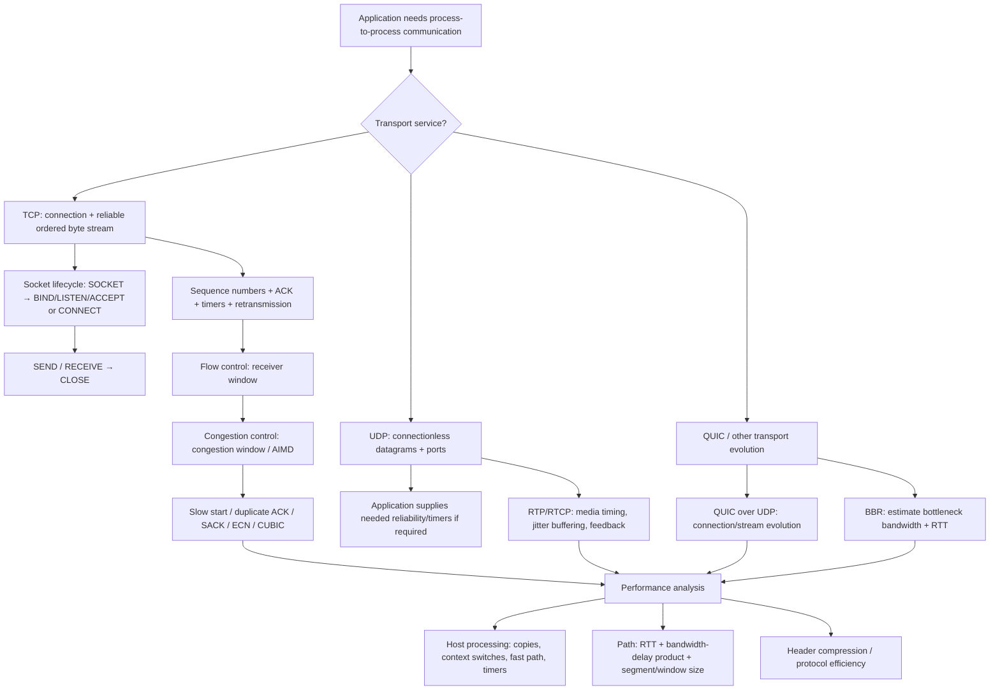

# Диаграмма: логика главы 6

Диаграмма отражает переход главы от transport service и connection lifecycle к reliability/flow/congestion control, затем к UDP/TCP/QUIC и итоговому performance analysis.
