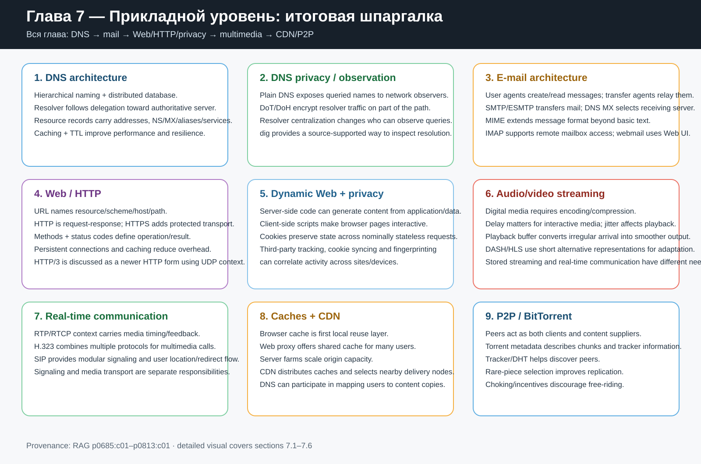
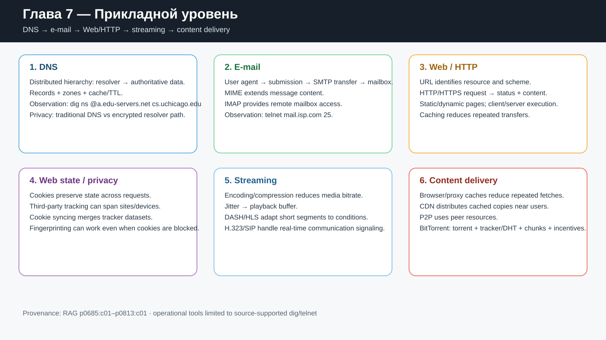

# Глава 7 — Прикладной уровень

Практические и концептуальные заметки по главе 7 книги «Компьютерные сети», 6-е издание.

Содержимое:

- [commands.md](commands.md) — подтвержденные RAG инструменты для DNS/SMTP и границы operational CLI.
- [cheatsheet.md](cheatsheet.md) — quick-reference по DNS, e-mail, Web, streaming и content delivery.
- [diagram.md](diagram.md) — Mermaid-карта логики главы.
- [visual-cheatsheet-detailed.svg](visual-cheatsheet-detailed.svg) — итоговая визуальная шпаргалка всей главы.
- [visual-cheatsheet.svg](visual-cheatsheet.svg) — компактная визуальная шпаргалка главы.
- [summary.md](summary.md) — краткое резюме главы из заключительного раздела книги.
- [review-questions.md](review-questions.md) — контрольные вопросы и задачи из конца главы.

## Scope

Материалы составлены только по RAG-фрагментам главы 7.

Provenance: `p0685:c01`–`p0813:c01` (PDF pages 685–813; печатные страницы 684–812).

Boundary evidence:

- `p0684:c01` — последние задачи главы 6;
- `p0685:c01` — начало главы 7 «Прикладной уровень»;
- `p0813:c01` — последние задачи главы 7;
- `p0814:c01` — начало главы 8 «Сетевая безопасность».

## Карта главы

- 7.1 — DNS: иерархия имен, recursive/iterative resolution, resource records, caching/TTL, зоны, DNSSEC и privacy через DoT/DoH;
- 7.2 — электронная почта: user agents и message transfer agents, message format/MIME, SMTP/ESMTP, submission/final delivery, IMAP/POP3 и webmail;
- 7.3 — Всемирная паутина: URL, client/server architecture, static/dynamic pages, HTTP/HTTPS, HTTP methods/status, caching, cookies и tracking/fingerprinting;
- 7.4 — потоковая передача аудио и видео: digital media, compression, buffering/jitter, DASH/HLS, real-time streaming, H.323 и SIP;
- 7.5 — доставка контента: server farms, web proxies/caches, CDN, P2P и BitTorrent;
- 7.6 — резюме.

## Анализ главы

Прикладной уровень объединяет протоколы, которые непосредственно реализуют пользовательские сетевые сервисы. В отличие от нижних уровней, здесь единицей анализа становится не просто packet/segment, а имя, письмо, веб-объект, медиапоток или контент.

DNS отделяет удобочитаемое имя от IP-адреса. Система построена как распределенная иерархическая база данных с зонами, authoritative name servers, caching и TTL. Recursive resolver при необходимости проходит иерархию от root/TLD к authoritative server. Resource records связывают имя с адресами, mail exchangers, aliases, services и другой информацией. Отдельный раздел показывает privacy-проблему открытых DNS-запросов и переход к шифрованному обмену через TLS/HTTPS.

Электронная почта разделена на user agents и message transfer agents. SMTP используется для передачи mail между серверами и submission, MIME расширяет формат сообщений, а final delivery для удаленного mailbox может выполняться через IMAP. Веб-почта меняет пользовательский интерфейс, но не отменяет серверную инфраструктуру почты.

Web строится вокруг URL и HTTP request/response. Chapter RAG рассматривает HTTP/HTTPS, методы/коды ответа, persistent connections, caching и conditional validation. Контент может быть static или dynamic; execution может происходить на сервере или в браузере. Значительная часть раздела посвящена state/tracking через cookies и device/browser fingerprinting, а также privacy consequences.

Для audio/video требования отличаются от обычного file transfer. Playback rate, delay и jitter напрямую влияют на perceived quality. Buffering сглаживает вариации доставки, а adaptive streaming (DASH/HLS) разбивает media на короткие segments и позволяет менять representation по состоянию пути. Для real-time communications дополнительно рассматриваются RTP/RTCP context, H.323 и SIP.

Content delivery решает проблему масштабного распространения популярных объектов. Browser/proxy caching уменьшает повторную передачу. CDN размещают copies/cache nodes ближе к users и используют naming/routing mechanisms для выбора подходящего узла. P2P делает peers одновременно consumers и suppliers; BitTorrent использует torrent metadata, tracker/DHT, chunks и incentive mechanisms для распределения контента.

## Основной принцип

Прикладной протокол определяет semantics конкретного сервиса, но его поведение связано с нижними уровнями: DNS выбирает endpoint, transport предоставляет соединение или datagrams, HTTP/SMTP формируют request/response semantics, buffering и adaptive streaming маскируют network variation, а CDN/P2P меняют саму точку, откуда приходит контент.

## Ограничение

Глава предоставляет учебные инструменты `dig` и `telnet`, а также описывает protocol commands, но не является универсальным operational runbook для DNS, mail/web servers, CDN или streaming infrastructure. Конфигурационные команды из общих знаний не добавляются.
