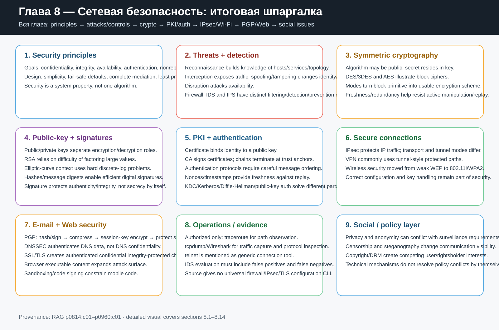
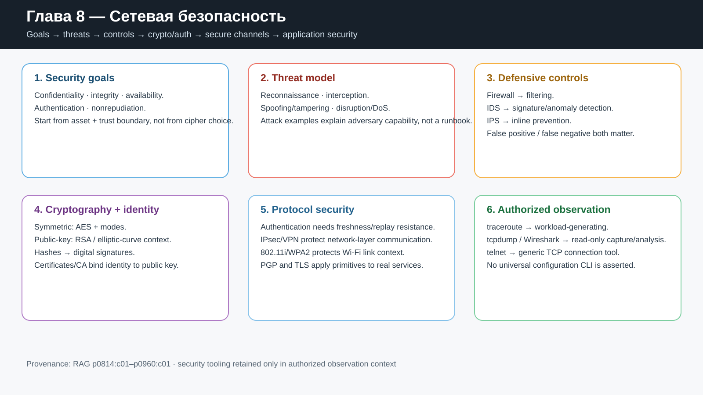

# Глава 8 — Сетевая безопасность

Практические и концептуальные заметки по главе 8 книги «Компьютерные сети», 6-е издание.

Содержимое:

- [commands.md](commands.md) — подтвержденные RAG инструменты наблюдения и ограничения их применения.
- [cheatsheet.md](cheatsheet.md) — quick-reference по threat model, controls, cryptography, authentication и secure protocols.
- [diagram.md](diagram.md) — Mermaid-карта логики главы.
- [visual-cheatsheet-detailed.svg](visual-cheatsheet-detailed.svg) — итоговая визуальная шпаргалка всей главы.
- [visual-cheatsheet.svg](visual-cheatsheet.svg) — компактная визуальная шпаргалка главы.
- [summary.md](summary.md) — краткое резюме главы из заключительного раздела книги.
- [review-questions.md](review-questions.md) — контрольные вопросы и задачи из конца главы.

## Scope

Материалы составлены только по RAG-фрагментам главы 8.

Provenance: `p0814:c01`–`p0960:c01` (PDF pages 814–960; печатные страницы 813–959).

Boundary evidence:

- `p0813:c01` — последние задачи главы 7;
- `p0814:c01` — начало главы 8 «Сетевая безопасность»;
- `p0960:c01` — последние задачи главы 8;
- `p0961:c01` — начало главы 9 «Рекомендации для чтения и библиография».

## Карта главы

- 8.1 — основы сетевой безопасности: confidentiality, integrity, availability, authentication, nonrepudiation и базовые security principles;
- 8.2 — основные компоненты атаки: reconnaissance, listening/interception, spoofing/tampering и disruption/DoS;
- 8.3 — брандмауэры и IDS/IPS: filtering, signatures, anomaly detection, false positives/false negatives;
- 8.4 — криптография: threat model, redundancy/freshness и базовые cryptographic principles;
- 8.5 — algorithms with symmetric keys: block/stream modes, DES/3DES, AES и key-stream concepts;
- 8.6 — algorithms with public keys: public/private keys, RSA и elliptic-curve context;
- 8.7 — digital signatures: message digests, SHA-family и signature construction;
- 8.8 — управление public keys: certificates, certification authorities и chains of trust;
- 8.9 — authentication protocols: challenge-response, replay resistance, KDC, Diffie–Hellman, Kerberos и public-key authentication;
- 8.10 — защита соединений: IPsec, VPN и wireless security/WPA2/802.11i;
- 8.11 — безопасность электронной почты: PGP и associated key/signature/encryption workflow;
- 8.12 — Web security: DNSSEC, SSL/TLS, browser scripting/sandboxing и web attack surface;
- 8.13 — социальные вопросы: privacy, anonymity, censorship, steganography, copyright/DRM;
- 8.14 — summary.

## Анализ главы

Глава начинает с определения security goals. Confidentiality ограничивает доступ к информации, integrity защищает от несанкционированного изменения, availability — от потери доступа к системам и сервисам. Authentication определяет, с кем происходит взаимодействие, а nonrepudiation относится к доказуемости действий и подписей. Авторский подход подчеркивает, что абсолютную безопасность доказать трудно, поэтому важны системные design principles: простота, fail-safe defaults, complete mediation и least privilege.

Далее threat model строится вокруг повторяющихся компонентов атаки. Reconnaissance собирает сведения о хостах, сервисах и topology; interception дает visibility в traffic; spoofing/tampering позволяет выдавать себя за другого или изменять данные; disruption нарушает availability. Глава разбирает port scanning, traffic capture, DNS poisoning, TCP attacks и DoS/DDoS как комбинации этих элементов.

Defensive controls не являются абсолютными. Firewall фильтрует traffic по policy. Signature-based IDS дает конкретные alerts по известным patterns; anomaly-based IDS способен замечать неизвестное поведение, но чаще сталкивается с неоднозначностью. IPS должен находиться inline и может блокировать traffic, поэтому false positive влияет уже не только на наблюдение, но и на availability.

Криптографическая часть отделяет secrecy of key от secrecy of algorithm. Symmetric cryptography использует общий secret key и подходит для высокопроизводительного шифрования; chapter RAG рассматривает DES/3DES, AES и modes of operation. Public-key cryptography использует разные public/private keys и решает часть проблемы key distribution; RSA связывается со сложностью factorization, а elliptic-curve methods — с discrete-logarithm context.

Digital signatures строятся вокруг cryptographic hashes/message digests: вместо подписания всего сообщения подписывается его digest. Public-key management требует удостоверить принадлежность ключа субъекту, для чего используются certificates, certification authorities и chains of trust.

Authentication protocols должны противостоять replay и impersonation. В главе рассматриваются challenge-response patterns, trusted third parties/KDC, Diffie–Hellman, Kerberos и public-key authentication. Повторяющаяся мысль раздела: корректно спроектировать authentication protocol сложнее, чем кажется, и детали порядка сообщений, nonces/timestamps и identity binding критичны.

Connection security переносит эти primitives в реальные protocols. IPsec защищает IP traffic и поддерживает transport/tunnel modes; VPN использует туннельную модель для защищенной связи через public network. Для Wi-Fi показан переход от слабого WEP к 802.11i/WPA2 mechanisms.

Application examples связывают cryptography с пользовательскими сервисами. PGP объединяет hashing/signature, compression, session-key encryption и public-key protection. Web security включает DNSSEC для authenticity DNS data и SSL/TLS для authenticated, confidential, integrity-protected connection. Отдельно рассматривается риск executable browser content и sandboxing/code-signing approaches.

Финальный блок показывает, что security не сводится к cryptography. Privacy, anonymity, censorship, steganography, copyright и DRM создают противоречия между техническими возможностями, policy и интересами разных сторон.

## Основной принцип

Безопасность — это layered system property, а не отдельный алгоритм. Требуется связать threat model, security goals, least privilege и mediation с конкретными controls, cryptographic primitives, identity/key management и защищенными protocols. Сильная криптография не компенсирует ошибочную trust model, плохую authentication logic или небезопасную конфигурацию.

## Ограничение

Глава содержит примеры атак и reconnaissance для объяснения threat model. Эти примеры не преобразуются здесь в offensive runbook. Инструменты наблюдения сохраняются только в безопасном/авторизованном контексте; универсальные firewall/IDS/IPsec/WPA/TLS configuration commands источник не задает.
