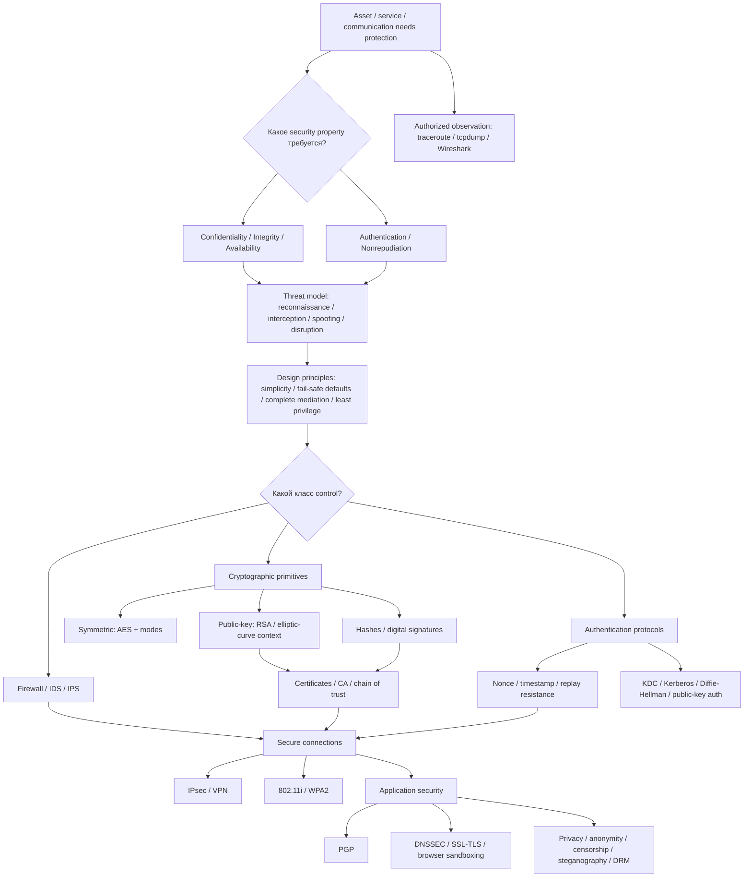

# Диаграмма: логика главы 8

Диаграмма отражает центральную логику главы: security goals → threat model → principles/controls → cryptography/key management/authentication → защищенные соединения и application security.
