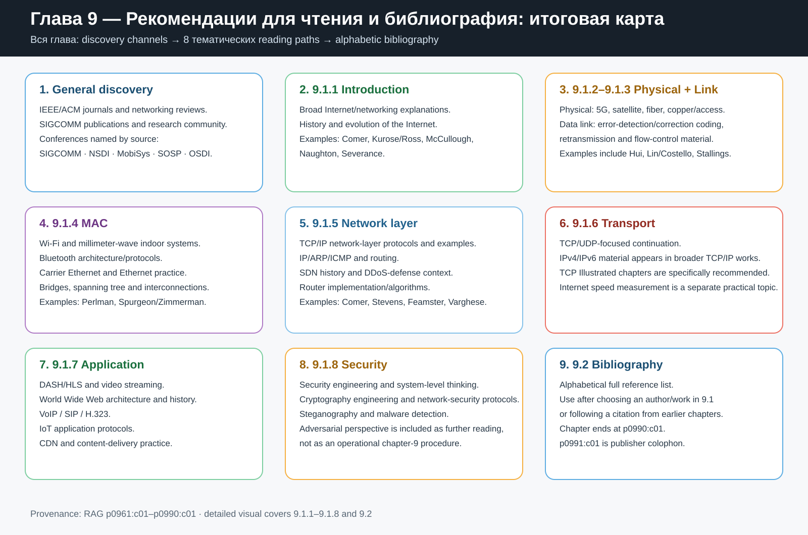
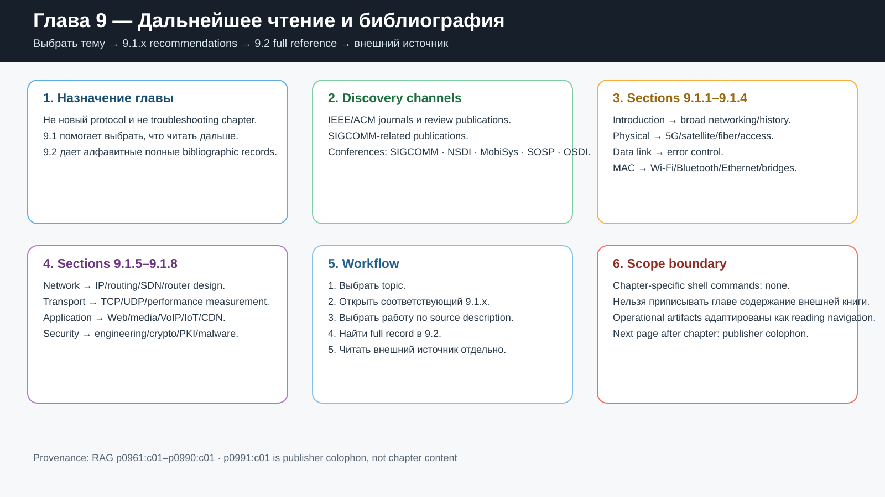

# Глава 9 — Рекомендации для чтения и библиография

Навигационные заметки по заключительной главе книги «Компьютерные сети», 6-е издание.

Содержимое:

- [commands.md](commands.md) — статус operational-команд для главы.
- [cheatsheet.md](cheatsheet.md) — quick-reference по выбору дальнейшего чтения и использованию библиографии.
- [diagram.md](diagram.md) — Mermaid-карта навигации по источникам.
- [visual-cheatsheet-detailed.svg](visual-cheatsheet-detailed.svg) — итоговая визуальная карта всей главы.
- [visual-cheatsheet.svg](visual-cheatsheet.svg) — компактный обзор главы.

## Scope

Материалы составлены только по RAG-фрагментам главы 9.

Provenance: `p0961:c01`–`p0990:c01` (PDF pages 961–990; печатные страницы 960–989).

Boundary evidence:

- `p0960:c01` — последние задачи главы 8;
- `p0961:c01` — начало главы 9 «Рекомендации для чтения и библиография»;
- `p0990:c01` — окончание алфавитного списка литературы;
- `p0991:c01` — издательские выходные данные, не учебная глава.

## Карта главы

- 9.1 — литература для дальнейшего чтения;
  - 9.1.1 — введение;
  - 9.1.2 — физический уровень;
  - 9.1.3 — канальный уровень;
  - 9.1.4 — подуровень управления доступом к среде;
  - 9.1.5 — сетевой уровень;
  - 9.1.6 — транспортный уровень;
  - 9.1.7 — прикладной уровень;
  - 9.1.8 — сетевая безопасность;
- 9.2 — алфавитный список литературы.

## Анализ главы

Глава 9 не вводит новый сетевой протокол или operational workflow. Ее задача — перевести читателя от законченного учебника к дальнейшему самостоятельному изучению предмета.

Раздел 9.1 начинается с общих каналов, где публикуются материалы по компьютерным сетям. В RAG прямо названы профильные журналы и периодические издания IEEE/ACM, а также конференции SIGCOMM, NSDI, MobiSys, SOSP и OSDI. После этого рекомендации сгруппированы по тем же предметным областям, которые соответствуют предыдущим главам книги.

Для введения предлагаются обзорные книги и исторические материалы: например, Comer «The Internet Book», Kurose and Ross «Computer Networking», McCullough «How the Internet Happened», Naughton «A Brief History of the Future» и Severance «Introduction to Networking».

Для физического уровня список смещается к 5G, спутниковой связи, оптоволокну и access networks. Для канального уровня — к error-control coding и надежной передаче. Для MAC — к Wi-Fi, Bluetooth, Carrier Ethernet, bridges/spanning tree и Ethernet practice.

Сетевой уровень представлен дополнительными материалами по TCP/IP, IP/ARP/ICMP, SDN, routing и router implementation. Транспортный уровень — материалами по TCP/UDP, IPv6 context и измерению internet speed. Прикладной уровень — Web, DASH/HLS, VoIP, IoT protocols, CDN и video streaming. Для безопасности рекомендуются работы по security engineering, cryptography engineering, steganography, PKI/protocols, adversarial thinking и malware detection.

Раздел 9.2 меняет способ организации: вместо тематического отбора он дает алфавитный список библиографических записей. Это справочная база для поиска полной ссылки на работу, упомянутую в тексте книги или в 9.1.

## Основной принцип

Глава 9 — это карта дальнейшего обучения. Раздел 9.1 отвечает на вопрос «что читать дальше по конкретной теме», а раздел 9.2 — «как найти полную библиографическую запись». Для практического использования сначала выбирается предметная область, затем подходящий рекомендованный источник, после чего при необходимости используется алфавитная библиография.

## Ограничение

Глава не является operational runbook и не содержит подтвержденных shell-команд, tuning-команд или modifying actions. Никакие команды из предыдущих глав не переносятся сюда.
