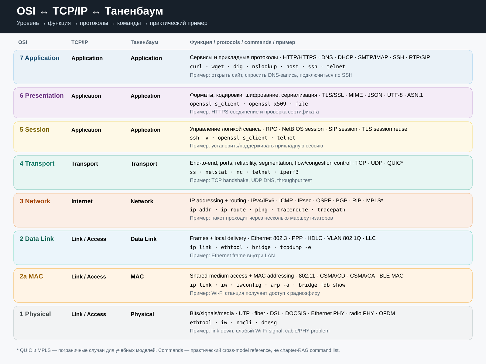

# OSI ↔ TCP/IP ↔ модель Таненбаума

Сводная cross-model шпаргалка для сопоставления уровней OSI, TCP/IP и учебной структуры Таненбаума.

> **Scope:** это межглавный reference artifact. Колонка с командами содержит практические operational-примеры для работы с соответствующим уровнем и не означает, что каждая команда была приведена в конкретной главе книги.

## Сводная таблица слоёв

| OSI | TCP/IP | Таненбаум | Что здесь происходит | Типичные протоколы / технологии | Консольные команды | Пример |
| --- | --- | --- | --- | --- | --- | --- |
| **7. Application** | **Application** | **Application** | Пользовательские сетевые сервисы и прикладные протоколы | HTTP, HTTPS, DNS, DHCP, SMTP, IMAP, POP3, FTP, SSH, SNMP, RTP, SIP, MQTT, CoAP | `curl`, `wget`, `dig`, `nslookup`, `host`, `ssh`, `telnet` | Открыть сайт, спросить DNS-запись, подключиться по SSH |
| **6. Presentation** | обычно входит в **Application** | обычно входит в **Application** | Форматы данных, кодировки, шифрование, сериализация | TLS/SSL, MIME, JPEG, MPEG, ASCII, UTF-8, JSON, ASN.1 | `openssl s_client`, `openssl x509`, `file` | HTTPS-соединение, проверка сертификата |
| **5. Session** | обычно входит в **Application** | обычно входит в **Application** | Управление сеансом, установление/поддержание логики обмена | RPC, NetBIOS session, SIP session logic, TLS session reuse | `ssh -v`, `openssl s_client`, `telnet` | Установление сессии приложения, повторное использование соединения |
| **4. Transport** | **Transport** | **Transport** | Доставка «конец-конец», порты, надёжность, сегментация, контроль потока/перегрузки | TCP, UDP, QUIC* | `ss`, `netstat`, `nc`, `telnet`, `iperf3` | TCP 3-way handshake, UDP DNS-запрос, измерение пропускной способности |
| **3. Network** | **Internet** | **Network** | Логическая адресация и маршрутизация между сетями | IPv4, IPv6, ICMP, IPsec, OSPF, BGP, RIP, MPLS* | `ip addr`, `ip route`, `ping`, `traceroute`, `tracepath` | Пакет идёт через несколько роутеров |
| **2. Data Link** | **Link / Network Access** | **Data Link** | Кадры, локальная доставка в пределах канала/сегмента | Ethernet (802.3), PPP, HDLC, VLAN (802.1Q), LLC | `ip link`, `ethtool`, `bridge`, `tcpdump -e` | Передача Ethernet frame внутри LAN |
| **2a. MAC** *(подуровень L2)* | **Link / Network Access** | **MAC** *(у Таненбаума выделен особенно явно)* | Доступ к общей среде, MAC-адреса, управление коллизиями/доступом | Ethernet MAC, Wi‑Fi MAC (802.11), CSMA/CD, CSMA/CA, BLE MAC | `ip link`, `iw`, `iwconfig`, `arp -a`, `bridge fdb show` | Wi‑Fi станция получает доступ к радиоэфиру |
| **1. Physical** | **Link / Network Access** | **Physical** | Биты, сигнал, среда передачи, разъёмы, частоты, модуляция | UTP, fiber, DSL, DOCSIS, 100BASE-TX, 10GBASE-SR, radio PHY, OFDM | `ethtool`, `iw`, `nmcli`, `dmesg` | Нет линка в порту, плохой сигнал Wi‑Fi, проблема с кабелем |

\* QUIC и MPLS можно считать пограничными в таких таблицах: они не всегда идеально ложатся в учебную модель уровней.

## Как использовать

Для теории начинайте с OSI, для реального стека интернета — с TCP/IP, а модель Таненбаума используйте как учебную декомпозицию, где MAC особенно заметен как самостоятельный предмет анализа.

При troubleshooting удобно двигаться от наблюдаемого симптома к соответствующему уровню и затем проверять его собственные сущности: application object → socket/port → IP/path → frame/MAC → physical signal.
