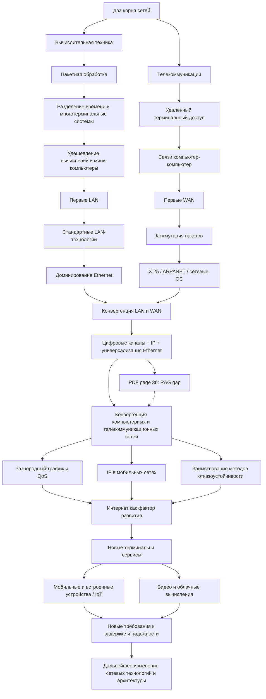

# Diagram — эволюция компьютерных сетей

## Как читать схему

- Левая ветвь показывает эволюцию вычислительных систем к LAN.
- Правая ветвь показывает развитие дальней связи к WAN и packet switching.
- Эти ветви сходятся через стандартизацию, цифровые каналы, IP и Ethernet.
- Следующий этап — сближение компьютерных и телекоммуникационных сетей.
- Интернет постоянно повышает требования к сети за счет новых устройств, приложений и профиля трафика.
- Пунктирный узел отмечает документированный RAG-gap PDF page 36; его содержание не реконструировалось.
