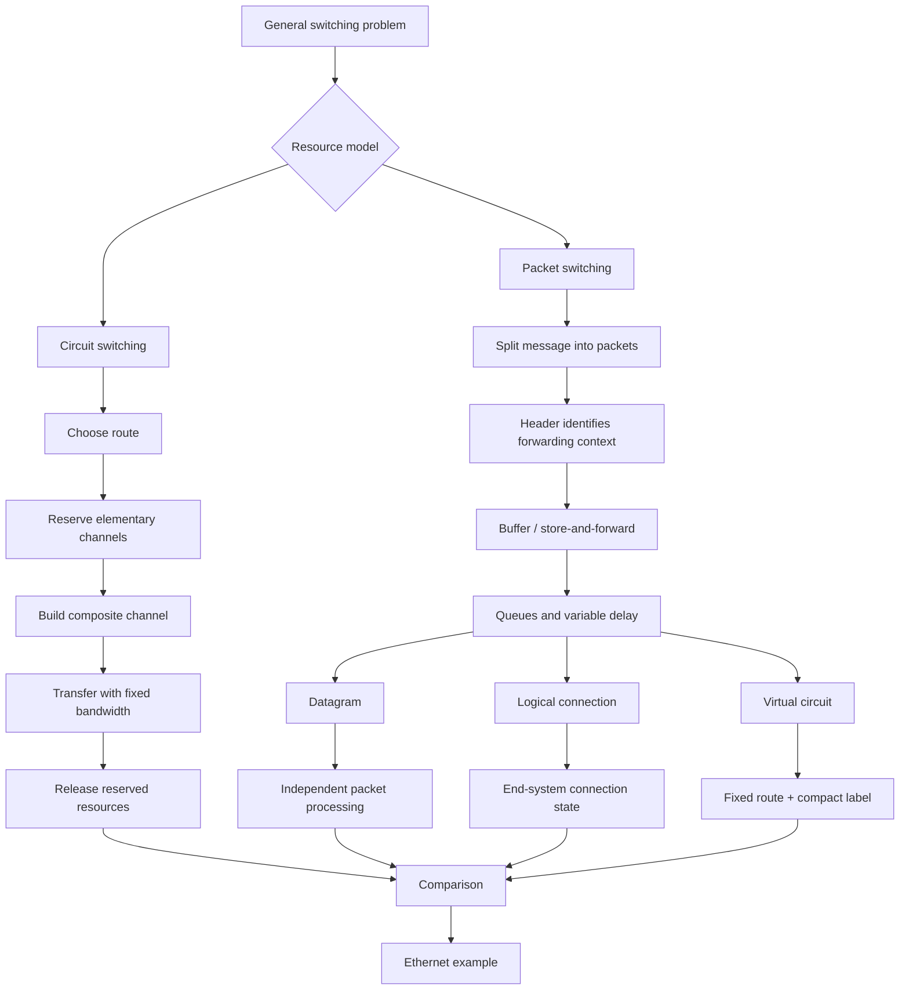

# Chapter 3 diagram

## Interpretation

Circuit switching spends resources before transfer to obtain predictability. Packet switching shares resources dynamically and gains utilization efficiency at the cost of queues, variable delay and possible loss.
