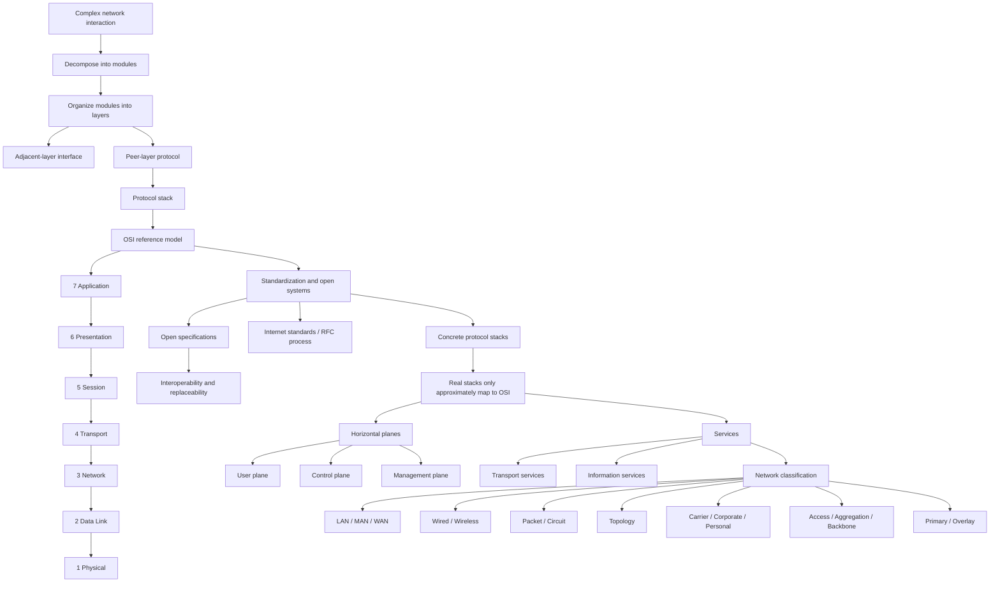

# Chapter 4 diagram

## Interpretation

The chapter moves from decomposition of a single network interaction problem to two complementary models:

- **vertical structure** — layers, interfaces and protocols;
- **horizontal structure** — user, control and management planes.

Standardization makes implementations from different vendors interoperable, while classification provides multiple independent ways to describe a network.
