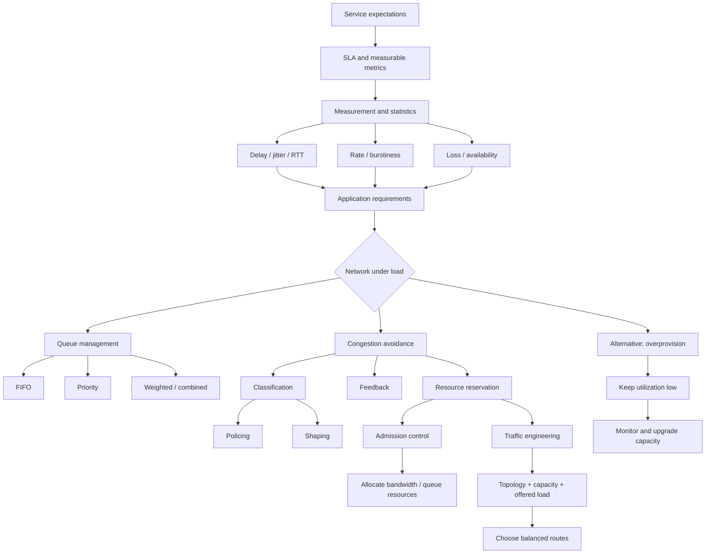

# Chapter 5 diagram

## Interpretation

QoS starts with measurable requirements, not with queue configuration. The chapter connects observed service quality to traffic characteristics and resource utilization, then introduces increasingly explicit control mechanisms: queue scheduling, conditioning, feedback, reservation and traffic engineering. Overprovisioning is presented as a simpler but capacity-expensive alternative.
