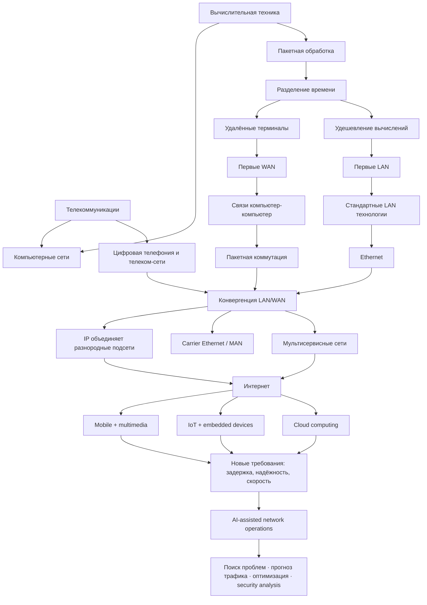

# Diagram — глава 1: эволюция компьютерных сетей

## Как читать схему

- Левая ветвь показывает вычислительный корень: централизованная обработка → интерактивность → распределённые связи.
- Правая ветвь показывает телекоммуникационный корень: передача на расстояние и цифровые каналы.
- Центральная линия — сближение через packet switching, IP, Ethernet и multiservice networking.
- Интернет создаёт новые классы нагрузок и устройств, которые снова меняют требования к сети.
- AI в конце главы показан как дополнительный слой автоматизации, а не как доказанная замена всех сетевых инженеров.

Provenance: `p0028:c01`–`p0045:c01`.
