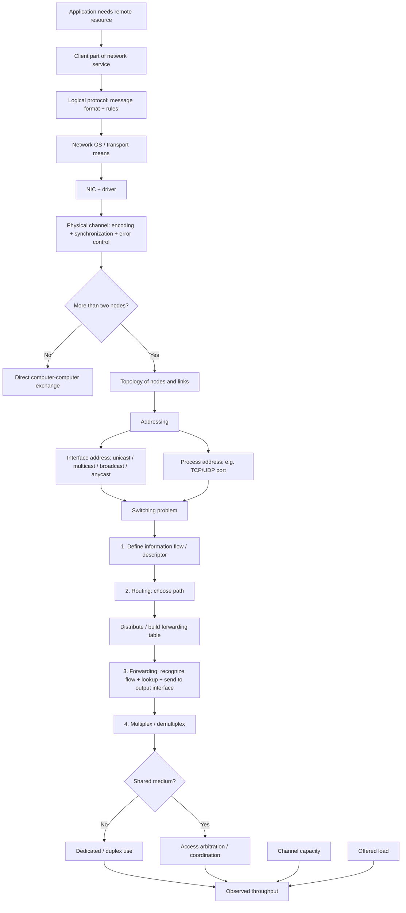

# Diagram — глава 2: общие принципы построения сетей

## Ключевые разделения

- **Protocol vs interface:** logical rules vs physical boundary.
- **Capacity vs throughput:** maximum channel capability vs measured passed data rate.
- **Routing vs forwarding:** compute/learn path vs apply table to each unit of data.
- **Multiplexing vs shared medium:** shared medium is a special case where flows from different nodes contend for one physical medium.

Provenance: `p0046:c01`–`p0080:c01`.
