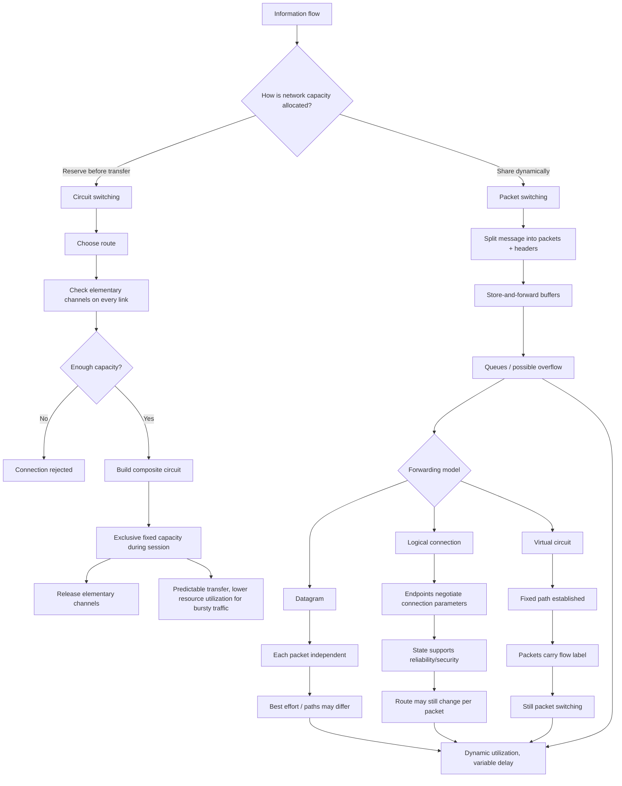

# Diagram — глава 3: коммутация каналов и пакетов



## Delay decomposition

```text
Circuit: propagation + serialization (+ setup before transfer)

Packet path:
packetization
+ propagation
+ serialization/buffering
+ queueing
+ switching
repeated across hops, with pipeline overlap between packets
```

Queueing is the principal load-dependent component in the chapter's comparison.

Provenance: `p0081:c01`–`p0107:c01`.
