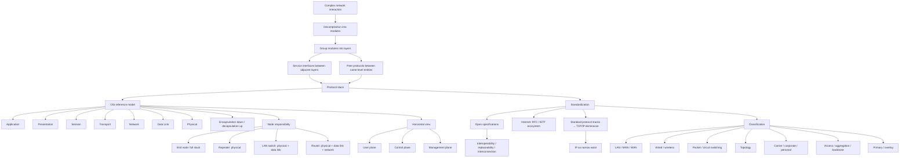

# Diagram — глава 4: стандартизация и классификация сетей

## Логика главы

Многоуровневая архитектура отвечает на вопрос **«как разделить сложность»**; стандартизация — **«как сделать независимые реализации совместимыми»**; классификация — **«по каким независимым признакам описывать реальные сети»**.

Provenance: `p0108:c01`–`p0130:c01`.
