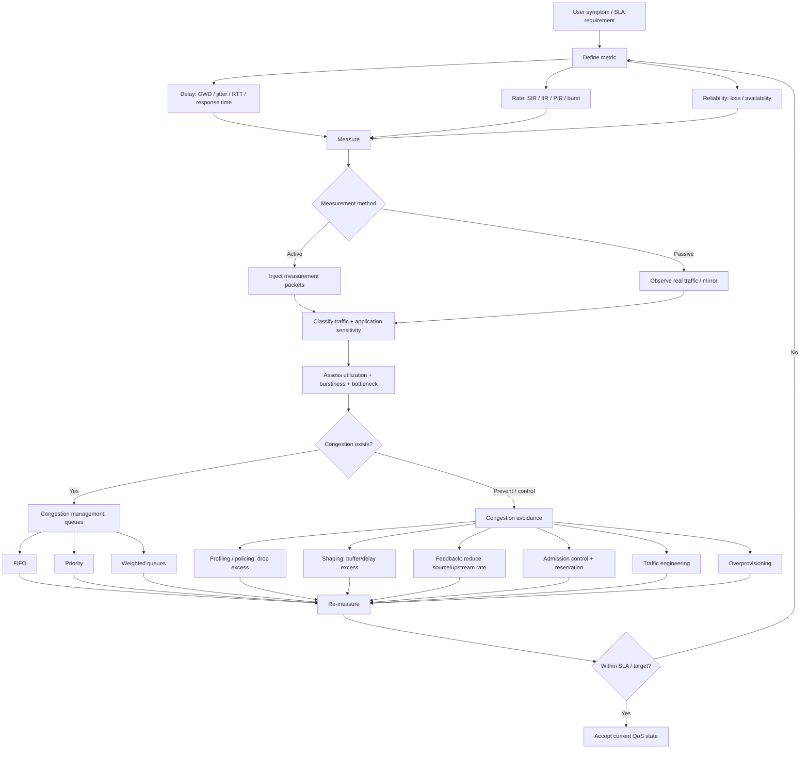

# Diagram — глава 5: QoS workflow

## Key relationships

- Queueing delay depends strongly on **utilization** and **burstiness**.
- Priority reduces latency for favored traffic but can starve lower classes.
- Weighted queues protect minimum bandwidth shares under congestion.
- Policing drops; shaping delays.
- Reservation coordinates resources along the path.
- Traffic engineering changes route/resource placement.
- Overprovisioning avoids congestion by maintaining excess capacity.

Provenance: `p0131:c01`–`p0177:c01`.
