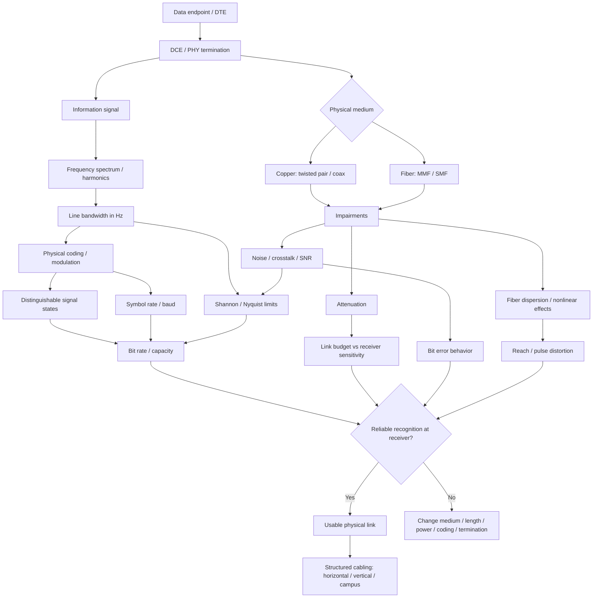

# Diagram — глава 6: от физической среды к capacity

## Key distinctions

- `bandwidth` in this chapter: Hz range passed by the line.
- `capacity`: bit/s achievable for the line **with a chosen physical coding/protocol**.
- `baud`: symbol/state changes per second; it is not automatically equal to bit/s.
- Copper emphasizes resistance/capacitance/inductance, noise and crosstalk.
- Fiber largely avoids electromagnetic interference but has attenuation/dispersion/nonlinear limits.

Provenance: `p0183:c01`–`p0214:c01`.
