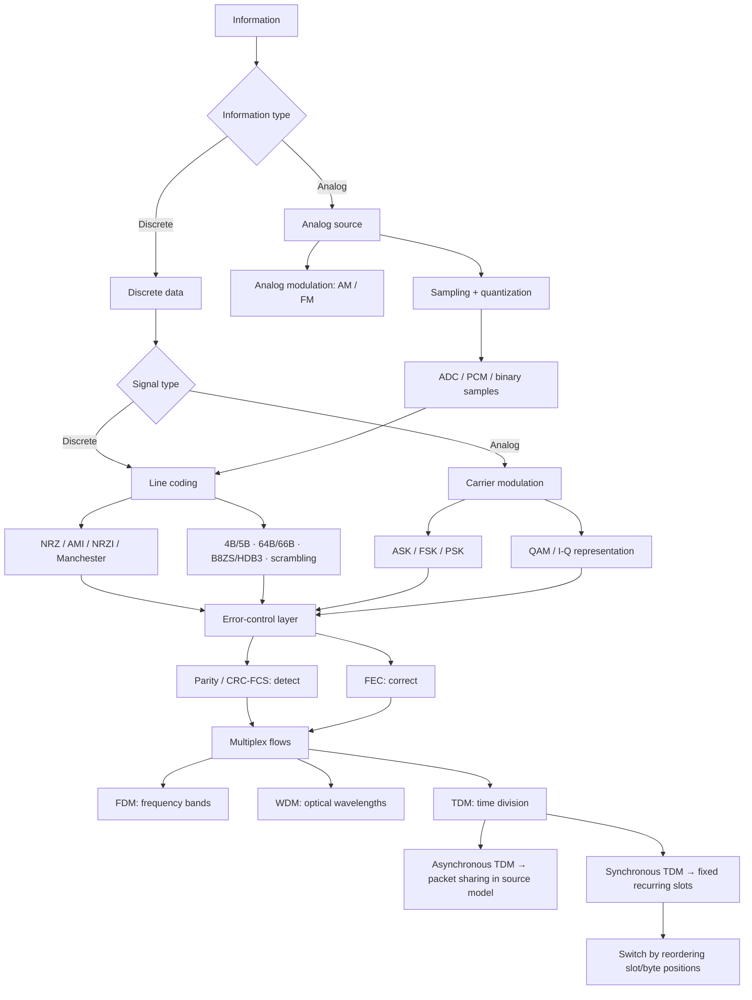

# Diagram — глава 7: coding → error control → multiplexing



## Design constraints

```text
coding choice
  → spectrum width / position
  → self-synchronization
  → noise tolerance
  → redundancy / error behavior
  → symbol rate and bit rate

multiplexing choice
  → frequency / wavelength / time resource allocation
  → compatible switching semantics
```

Provenance: `p0215:c01`–`p0241:c01`.
