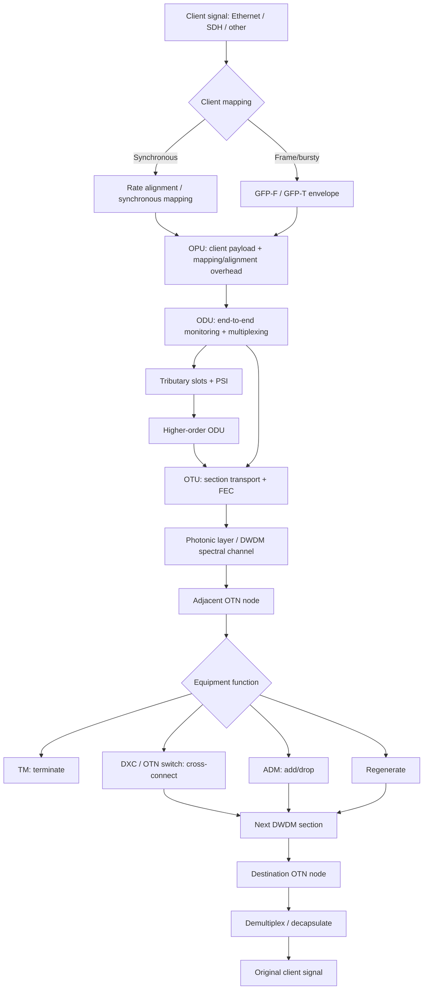

# Diagram — глава 8: OTN transport pipeline



## Architecture evolution

```text
PDH
  → bit stuffing / difficult lower-order extraction

SDH
  → pointers + virtual containers + fixed 125 μs cycle

OTN
  → larger transport units
  → explicit OPU/ODU/OTU layering
  → FEC
  → GFP/client transparency
  → tributary slots / flexible hierarchy
  → transponder → muxponder → OTN switching
```

Provenance: `p0242:c01`–`p0267:c01`.
